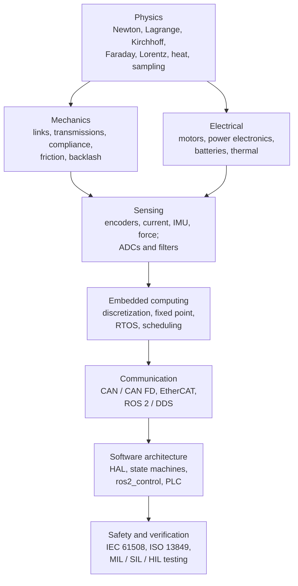

# Control systems engineering: from physics to software

*The mechanical, electrical, embedded and software background that every automatic control system rests on. It goes from the physical laws, through transmissions, motors, power electronics and sensors, to real-time computing, communication buses, software architecture, functional safety and testing. It explains what each layer adds to the control loop (limits, delay, noise, nonlinearity, failure modes), which design choices suit which application, and the breakthroughs and trends. The format matches the other collections in this repository. Equations and runnable examples are in the companion [cookbook](cookbook/COOKBOOK.md) (recipes H1–H23), and every source is in the [catalog](CATALOG.md).*

## Summary

- **A control law is only as good as the hardware and software that run it.**
  - Between the equation $u=-Kx$ and a moving robot sit gears that resonate and backlash, and motors that saturate and heat up.
  - There are also drives that switch at kilohertz, encoders that quantize, ADCs that alias, and processors that add delay and round numbers.
  - Finally come buses that limit bandwidth, and software that must never enable torque at the wrong moment.
  - Each layer changes the loop the control engineer designed.
- **The physics is classical and stable:**
  - Newton–Euler and Lagrange for mechanics;
  - Kirchhoff, Faraday and the Lorentz force for motors;
  - heat flow for thermal limits;
  - Nyquist and Shannon for sampling.
  - What changes is the technology implementing it.
- **Mechanics sets the achievable bandwidth.**
  - Compliance creates resonances that cap the loop bandwidth: with a load encoder the loop went unstable at half the anti-resonance (H3).
  - Friction and backlash create stick-slip and hunting (H4, H5).
  - Low-ratio "quasi-direct-drive" actuators trade torque density for transparency, which is why legged robots adopted them (Seok 2015, Wensing 2017, Katz 2019).
- **Electrical engineering sets the torque, speed and duty cycle.** Brushless motors with field-oriented control are now the default. The current loop runs at 10–40 kHz, and thermal limits decide how long peak torque lasts: 81 s at twice the continuous current in H8.
- **Embedded engineering sets the delay.**
  - Sampling, filtering, computation and communication each add delay. A 50 Hz low-pass filter at a 30 Hz crossover alone costs 31° of phase (H14).
  - Bus budgets decide the architecture: 12 joints at 1 kHz need four CAN buses or one EtherCAT segment (H20).
- **Software engineering and safety decide whether the system can be trusted.**
  - The tools: explicit state machines, watchdogs, back-to-back tests against the model, coding standards, and safety standards (IEC 61508, ISO 13849, ISO 26262).
  - **Common-cause failures** dominate redundant designs: 92% of the PFH in H22.
- **Trends:**
  - integrated actuator modules (motor, drive, encoder, bus), and GaN power stages;
  - real-time Linux in the mainline kernel (6.12, 2024) and real-time ROS 2;
  - memory-safe languages (Rust) entering embedded control;
  - model-based design with code generation and hardware-in-the-loop testing;
  - learned actuator models built on top of this stack (see [sim2real](../sim2real/)).

## 1. The layers of a control system

| Layer | What it adds to the loop | Typical numbers | Recipes |
|---|---|---|---|
| Mechanics | Inertia, resonance, friction, backlash, compliance | Resonances 10–200 Hz; backlash 0.1–1° in gearboxes | H1–H5 |
| Motors | Torque constant, torque–speed limits, heating | $\tau_e$ 0.1–2 ms, $\tau_m$ 2–50 ms, thermal 10 s–30 min | H6–H8 |
| Power electronics | Voltage saturation, ripple, dead time | PWM 10–100 kHz | H9 |
| Torque control (FOC) | Current-loop bandwidth, angle-offset sensitivity | 1–5 kHz bandwidth | H10–H11 |
| Sensing | Quantization, noise, aliasing, filter delay | 12–20-bit encoders; 12–16-bit ADCs | H12–H14 |
| Computing | Sample-and-hold delay, rounding, overruns | 1.5 samples of delay; µs-level jitter on an RTOS | H15–H19 |
| Communication | Bandwidth, latency, jitter | CAN 1 Mbit/s; EtherCAT 100 Mbit/s, cycles 100–1000 µs | H20 |
| Software and safety | Modes, faults, watchdogs, verification | Watchdogs of a few ms; PL d / PL e, SIL 2–3 | H21–H23 |

## 2. The physics underneath

| Law or principle | Where it appears in a control system | Recipe |
|---|---|---|
| Newton–Euler; Lagrange ($L=T-V$) | Equations of motion; torque sizing; manipulator dynamics | H1 |
| Energy and power ($P=\tau\omega$) | Motor sizing, regeneration, battery current | H1, H7 |
| Hooke's law; elastic modes | Shaft, belt and harmonic-drive compliance; series elastic actuators | H3 |
| Coulomb and viscous friction; Stribeck effect | Dead zones, stick-slip, limit cycles | H4, H5 |
| Kirchhoff's laws; Ohm's law | Motor windings, H-bridges, sensor circuits | H6, H9 |
| Faraday induction (back-EMF) and Lorentz force (torque) | $k_e$, $k_t$; torque–speed curve | H6, H7 |
| Maxwell's equations (1865) | Machine design, EMC, field-oriented control | H10 |
| Heat conduction and capacity | Continuous ratings, derating, I²t protection | H8 |
| Nyquist (1928) and Shannon (1949) sampling | Anti-alias filters, sampling rates | H13, H15 |
| Probability and reliability | Failure rates, PFH, redundancy | H22 |

## 3. Mechanical design choices

| Transmission or actuator | Ratio | Torque density | Backdrivability, transparency | Backlash | Bandwidth | Typical use |
|---|---|---|---|---|---|---|
| Direct drive | 1 | Low | Excellent | None | Very high | Minitaur (Kenneally 2016), precision stages |
| Quasi-direct drive (single planetary stage) | 6–10 | Medium | Very good; current ≈ torque | Small | High | MIT Cheetah, Mini Cheetah, ODRI, Stanford Doggo, Blue arm |
| Cycloidal | 10–100 | High | Moderate | Very low | Medium–high | Robot joints; cycloidal QDD (Zhu 2024) |
| Harmonic (strain wave) | 50–160 | High | Poor | Near zero | Medium; compliant | Industrial and collaborative arms, humanoids |
| Multi-stage planetary or spur | 20–300 | High | Poor | Moderate | Medium | Low-cost servos, AGV wheels |
| Ball screw / belt | Linear | High force | Moderate | Low (preloaded) | Medium; belt resonance | CNC, gantries, actuators for linear motion |
| Series elastic | Any + spring | Medium | Good (force control) | Spring hides it | Low (by design) | Force-controlled legs and arms (Pratt 1995) |
| Hydraulic | — | Very high | Depends on valve | — | High | Heavy machinery, earlier humanoids |

**Design rule.** The lowest mechanical resonance and the backlash set the highest usable control bandwidth (H3, H5). More gain cannot fix mechanics.

## 4. Electrical design choices

| Component | Options | Key trade-offs | Recipes |
|---|---|---|---|
| Motor | Brushed DC; brushless DC/PMSM; stepper; induction | Brushless PMSM has the best torque density and efficiency; steppers run open loop; induction motors are rugged and magnet-free | H6, H7, H10 |
| Commutation and torque control | Six-step; sinusoidal; FOC; direct torque control | FOC gives smooth torque and decoupled $d$/$q$ control; DTC responds fast with variable switching | H10, H11 |
| Power stage | Si MOSFET; IGBT; SiC; GaN | GaN and SiC allow higher frequency and efficiency; IGBTs for high voltage | H9 |
| Modulation | Sine PWM; space-vector PWM | Space-vector PWM uses about 15% more of the DC bus | H9 |
| Supply | Battery; DC bus with capacitors; regeneration | Voltage sag under load; braking energy must go somewhere | H7 |
| Current sensing | Shunts; Hall sensors; integrated drive | Sampling synchronized to PWM; offset and gain calibration | H13 |
| Position sensing | Incremental, absolute (magnetic, optical); resolver | Resolution, latency, absolute at power-up, robustness | H12 |
| Other sensors | IMU, force/torque, joint torque, temperature | Bandwidth, noise, drift; temperature needed for derating | H8, H14 |

## 5. Embedded and real-time computing

| Loop or function | Typical rate | Where it runs |
|---|---|---|
| Current (torque) loop, FOC | 10–40 kHz | Drive DSP, MCU or FPGA |
| Velocity loop | 1–10 kHz | Drive |
| Position or impedance loop | 0.5–4 kHz | Drive or joint controller |
| Whole-body control, MPC | 100 Hz–1 kHz | Real-time Linux or RTOS on the main computer |
| RL locomotion policy | 50–200 Hz (often 50 Hz) | Main computer or embedded GPU |
| Planning, perception | 1–50 Hz | Main computer, GPU |

- **Processors:**
  - MCUs with FPUs (Arm Cortex-M4/M7) for drives and joints;
  - DSPs and FPGAs for the fastest current loops;
  - application processors with PREEMPT_RT Linux for whole-body control;
  - RTOSes (FreeRTOS, Zephyr) for deterministic firmware.
- **Real-time rules:** fixed priorities by rate (H19); no allocation, blocking I/O or unbounded logging in the control path; measured worst-case execution times; watchdogs.
- **Buses:**
  - CAN and CAN FD: simple, robust, common in legged robots, often one bus per limb;
  - EtherCAT: industrial arms and humanoids, with distributed clocks for synchronization;
  - RS-485 and SPI: short, simple links;
  - Ethernet with DDS (ROS 2) above the real-time layer.
  - Bus timing adds delay and jitter that the controller and simulator must include (H20; [stability S5](../stability-analysis/cookbook/COOKBOOK.md#s5-gain-phase-and-delay-margins)).

## 6. Software engineering for control

| Practice | What it gives | References |
|---|---|---|
| Layered architecture: hardware abstraction, drivers, control, supervision, application | Replace hardware without touching control logic; test each layer alone | Parnas 1972; ros2_control (Chitta 2017) |
| Explicit state machines and statecharts | No hidden modes; safe start-up, fault and recovery behaviour | Harel 1987; CiA 402 drive profile (H21) |
| Model-based design and code generation | One model for analysis, simulation and code; traceability | Simulink and Embedded Coder style workflows; OpEn (Sopasakis 2020) |
| Coding standards | Predictable, analysable C and C++ | MISRA C; Holzmann's "Power of 10" (2006) |
| Memory-safe languages | Removes classes of memory bugs in firmware | Rust in embedded (trend); OpEn's Rust solver |
| Testing ladder: unit → MIL → SIL → PIL → HIL → system | Bugs found when they are cheap; implementation matches model (H23) | Bacic 2005 (HIL) |
| Continuous integration with back-to-back and regression tests | Every change re-verified | H23 |
| Parameter and calibration management | Gains, offsets and limits versioned with the code | Encoder offset (H10) |
| Logging and telemetry | Post-mortem analysis; data for identification ([sim-to-real](../sim2real/)) | Real-time-safe logging (H19) |
| Middleware | ROS 2 / DDS for composition; real-time executors; micro-ROS on MCUs | Macenski 2022; Casini 2025; Staschulat 2021 |

## 7. Safety and standards

| Standard | Scope | Key idea |
|---|---|---|
| IEC 61508 (2010) | Generic functional safety for electrical/electronic/programmable systems | SIL 1–4; life cycle; random and systematic failures |
| ISO 13849-1 (2023) | Safety-related parts of machinery control | Performance levels a–e; categories; MTTFd, DC, CCF |
| IEC 62061 | Machinery, the IEC 61508 route | SIL for machinery |
| IEC 61800-5-2 | Safety functions in drives | Safe torque off (STO), SS1, SLS |
| ISO 26262 (2018) | Road vehicles | ASIL A–D; software and hardware processes |
| ISO 10218-1/2, ISO/TS 15066 | Industrial and collaborative robots | Safeguarding; power and force limiting |
| ISO 3691-4 | Driverless industrial trucks | See [mobile-robot-control](../mobile-robot-control/REPORT.md) |
| IEC 61131-3 (4th ed. 2025) | PLC programming languages | Structured Text, function blocks |
| STAMP / STPA (Leveson 2004, 2011) | Systems-theoretic safety analysis | Accidents as control failures, not only component failures |

**Lessons that keep recurring.**
- The Therac-25 overdoses (Leveson & Turner 1993) came from software race conditions, after hardware interlocks were removed.
- Redundant channels are defeated by common causes (H22).
- Safety functions belong in a separate, simple, certified layer, especially when the main controller is learned ([stability S12](../stability-analysis/cookbook/COOKBOOK.md#s12-control-barrier-functions-a-joint-limit-safety-filter)).

## 8. Which design choices for which application

Fit: ★★★ typical choice · ★★ common · ★ possible · — rare.

| Application | Quasi-direct drive | Harmonic / cycloidal | Ball screw / belt | FOC brushless | CAN / CAN FD | EtherCAT | RTOS / MCU | RT Linux / ROS 2 | Safety level |
|---|---|---|---|---|---|---|---|---|---|
| Industrial arm | — | ★★★ | ★ | ★★★ | ★ | ★★★ | ★★★ | ★★ | PL d / SIL 2 |
| Collaborative arm | ★ | ★★★ | — | ★★★ | ★★ | ★★★ | ★★★ | ★★ | PL d, ISO/TS 15066 |
| Quadruped or humanoid | ★★★ | ★★ | ★ (linear legs) | ★★★ | ★★★ | ★★ | ★★★ | ★★★ | Emerging |
| Drone | — (direct drive props) | — | — | ★★★ | ★★ | — | ★★★ | ★ | Varies |
| AGV / AMR | — | ★ | ★ | ★★★ | ★★★ | ★★ | ★★★ | ★★★ | PL d, ISO 3691-4 |
| CNC machine | — | ★ | ★★★ | ★★★ | ★ | ★★★ | ★★★ | ★ | PL d |
| EV traction drive | — | ★ (single reduction) | — | ★★★ | ★★★ | — | ★★★ | — | ASIL C–D |
| Exoskeleton or prosthesis | ★★★ | ★★ | ★★ | ★★★ | ★★ | ★ | ★★★ | ★ | Medical (IEC 60601, ISO 13482) |

The ratings are a synthesis of common practice, not survey data.

## 9. Breakthroughs, year by year

| Year | Breakthrough | Why it mattered | Source |
|---:|---|---|---|
| 1687 / 1788 | Newton's laws; Lagrangian mechanics | Equations of motion for any mechanism | Principia; Mécanique analytique |
| 1831–1865 | Faraday induction; Kirchhoff's laws; Maxwell's equations | The physics of motors, generators and circuits | Maxwell 1865 |
| 1868 | Maxwell's analysis of governors | First control-stability analysis of a machine | See [stability-analysis](../stability-analysis/) |
| 1888 | AC induction motor (Tesla) | Rugged motors for industry | — |
| 1928 / 1949 | Nyquist and Shannon sampling | Rules for digital measurement and control | Nyquist 1928; Shannon 1949 |
| 1929 | Park's two-reaction (dq) transform | Rotating machines as DC-like systems | Park 1929 |
| 1947–1959 | Transistor; integrated circuit; MOSFET | Solid-state power and logic | — |
| 1968–69 | Programmable logic controller (Modicon) | Software replaces relay logic in factories | — |
| 1971 | Microprocessor (Intel 4004) | Digital control on a chip | — |
| 1972 | Field-oriented control (Blaschke); modular decomposition (Parnas) | High-performance AC drives; information hiding in software | Blaschke 1972; Parnas 1972 |
| 1973 | Rate-monotonic scheduling | Provable real-time deadlines | Liu & Layland 1973 |
| 1986 | CAN bus (Bosch); direct torque control | Robust low-cost networking; fast induction-motor torque | Takahashi & Noguchi 1986 |
| 1987–88 | Statecharts; space-vector PWM | Formal state machines; better inverter use | Harel 1987; van der Broeck 1988 |
| 1989 | Anti-windup analysis | Saturation handled systematically | Åström & Rundqwist 1989 |
| 1993 | IEC 61131-3; Therac-25 investigation | Standard PLC languages; software safety lessons | Leveson & Turner 1993 |
| 1994–95 | Friction survey; LuGre model; series elastic actuators | Models and compensation for friction; force-controllable actuators | Armstrong-Hélouvry 1994; Canudas de Wit 1995; Pratt 1995 |
| 1996 | Disturbance-observer motion control | Robust, fast servo control | Ohnishi et al. 1996 |
| 1998 | IEC 61508 (first edition); MISRA C | Functional safety life cycle; safe C subset | — |
| 2002 | Backlash survey | Compensation methods for gear play | Nordin & Gutman 2002 |
| 2003–04 | EtherCAT | Microsecond-synchronized industrial Ethernet | Jansen & Büttner 2004 |
| 2006–08 | "Power of 10" rules; cyber-physical systems framing | Analysable safety-critical code; software and physics co-design | Holzmann 2006; Lee 2008 |
| 2007–09 | ROS | Shared robot software ecosystem | — |
| 2011 | ISO 26262 (first edition) | Automotive functional safety | — |
| 2012 | CAN FD (Bosch) | 64-byte frames, faster data phase | — |
| 2015–17 | MIT Cheetah proprioceptive actuators; Minitaur direct drive; ros_control; ROS 2 first release | Quasi-direct drive for legged robots; standard controller interfaces | Seok 2015; Kenneally 2016; Wensing 2017; Chitta 2017 |
| 2019–20 | Mini Cheetah; Stanford Doggo; Blue arm; ODRI open actuators | Low-cost, open quasi-direct-drive hardware | Katz 2019; Kau 2019; Gealy 2019; Grimminger 2020 |
| 2022 | ROS 2 in production | Architecture review of ROS 2 | Macenski 2022 |
| 2023 | ISO 13849-1:2023 | Updated machinery safety, including software | — |
| 2024 | PREEMPT_RT in mainline Linux (6.12); learned torque estimation for cycloidal quasi-direct drive; ROS 2 events-executor scheduling | Real-time Linux without patches; learning inside the actuator stack; classical scheduling theory for ROS 2 | Zhu 2024; Teper 2024 |
| 2025 | IEC 61131-3 4th edition; survey of real-time ROS 2 | Updated PLC languages; map of real-time ROS 2 research | Casini 2025 |

## 10. Latest trends

1. **Integrated actuator modules.** Motor, gearbox, FOC drive, absolute encoder and bus in one housing, often open (ODRI, Mini Cheetah-style designs). The control engineer now configures drives rather than building them.
2. **Wide-bandgap power electronics.** GaN and SiC allow higher PWM frequency, lower ripple and smaller drives (H9).
3. **Real-time computing goes mainstream.**
   - PREEMPT_RT is in mainline Linux (6.12).
   - ROS 2 gains real-time executors and scheduling analysis (Teper 2024, Casini 2025), and micro-ROS reaches MCUs.
4. **Safer languages and stricter processes.** MISRA C and AUTOSAR C++ remain the norm. Rust is entering embedded firmware and real-time optimization (OpEn).
5. **Model-based design, code generation and hardware-in-the-loop testing in continuous integration.** Models, generated code and back-to-back tests (H23) are kept in one pipeline.
6. **Learning meets the hardware stack.**
   - Actuator networks and learned torque estimation sit next to FOC drives (Hwangbo 2019; Zhu 2024).
   - RL policies run at 50 Hz on top of kilohertz drive loops.
   - This makes the hardware details in this collection (delay, saturation, derating, backlash) the sim-to-real gap.
7. **Safety for learning-enabled systems.** Certified safety layers (STO, safety controllers, barrier-function filters) wrap uncertified learned control.

## 11. A practical checklist

1. Size the drive train from the motion profile: peak, RMS and holding torque, speed, inertia ratio and thermal duty (H1, H2, H8).
2. Find the first resonance and the backlash, and keep the loop bandwidth below them, or redesign the mechanics (H3, H5).
3. Model friction and decide on feedforward or integral action (H4).
4. Choose motor, voltage and gear ratio from the torque–speed curve with margin for battery sag (H7).
5. Set PWM frequency and current-loop bandwidth for the sampling rate and delay (H9, H11).
6. Calibrate the encoder offset and current sensors (H10).
7. Choose sensors, anti-alias filters and velocity estimation, and account for every filter's delay (H12–H14).
8. Discretize with the right method and account for computation delay (H15).
9. Check fixed-point ranges and small-signal behaviour (H16).
10. Separate cascade bandwidths and add anti-windup (H17, H18).
11. Prove schedulability and bus budgets on the target (H19, H20).
12. Write the drive and supervisor logic as state machines with watchdogs, and test them with random sequences (H21).
13. Define safety functions, the required PL or SIL, and the separation of safety from performance control (H22).
14. Run back-to-back and HIL tests in continuous integration before every hardware run (H23).

## 12. Quick start: textbooks, courses and documentation

| Resource | Type | Covers | Recipes |
|---|---|---|---|
| [*Modern Robotics*](https://modernrobotics.northwestern.edu/), K. Lynch & F. Park (2017) | Free textbook and videos | Rigid-body dynamics, actuation, transmissions | H1, H2 |
| *Robot Modeling and Control*, M. Spong, S. Hutchinson & M. Vidyasagar | Textbook | Dynamics, actuators, joint control | H1–H6 |
| *Control System Design Guide*, G. Ellis | Practitioner book | Servo tuning, resonance, backlash, sampling, filters | H3, H5, H11–H17 |
| [MIT 6.685 *Electric Machines*](https://ocw.mit.edu/courses/6-685-electric-machines-fall-2013/) | Free course | Motor physics, dq models | H6–H10 |
| [MIT 6.334 *Power Electronics*](https://ocw.mit.edu/courses/6-334-power-electronics-spring-2007/) | Free course | Converters, PWM, switching | H9 |
| *Electric Motor Drives*, R. Krishnan | Textbook | FOC, current control, PMSM and induction drives | H10, H11 |
| *Computer-Controlled Systems*, K. J. Åström & B. Wittenmark | Textbook | Sampling, discretization, quantization, timing | H13–H16 |
| [*Feedback Systems*](https://fbswiki.org/), K. J. Åström & R. M. Murray | Free textbook | Loop design, margins | H11, H14, H17 |
| *Engineering a Safer World*, N. Leveson (MIT Press 2011, open access) | Book | Systems safety, STAMP/STPA | H21, H22 |
| [ros2_control documentation](https://control.ros.org/) and [ROS 2 documentation](https://docs.ros.org/en/rolling/) | Documentation | Hardware interfaces, controllers, real-time | H19, H21 |
| [FreeRTOS](https://www.freertos.org/), [Zephyr](https://www.zephyrproject.org/) | RTOS documentation | Tasks, priorities, timers | H19 |
| [CAN in Automation (CiA)](https://www.can-cia.org/) | Organization | CANopen, CiA 402 drive profile, CAN FD | H20, H21 |
| [MISRA](https://misra.org.uk/) | Coding standards | MISRA C and C++ | H23 |

## 13. Connection to the other collections

- **Sim-to-real.** The actuator patterns a realistic simulation model must reproduce come from this collection:
  - delay (H11, H14, H15, H20); torque–speed limits (H7);
  - friction and stick-slip (H4); backlash (H5);
  - the built-in current loop (H10, H11); thermal derating and protection cut-offs (H8, H21).
  - See the [actuator-model review](../sim2real/reports/01-learned-actuator-contact-models.md).
- **Stability analysis.**
  - Delay margins (H11, H14, H15, H20); describing functions for backlash and friction (H5);
  - anti-windup and saturation (H18); bounded-residual ISS arguments.
  - See the [stability cookbook](../stability-analysis/cookbook/COOKBOOK.md).
- **Control and estimation theory.** The control laws that these layers implement are covered in [control-estimation-theory](../control-estimation-theory/).

## 14. Sources and caveats

- **Verification.** All DOIs were checked through Crossref, and all arXiv IDs against the arXiv API, on 9 Nov 2026. Quoted results come from the papers' abstracts.
- **Standards.** These are paywalled. The catalog links to their official pages; edition years were checked where the page was reachable.
- **Rules of thumb.** Loop rates, bandwidth ratios and safety-level choices are typical practice, not requirements. Always check the standards and data sheets that apply.
- **Recipes.** They use small illustrative systems; they show mechanisms, not the performance of any specific product.
