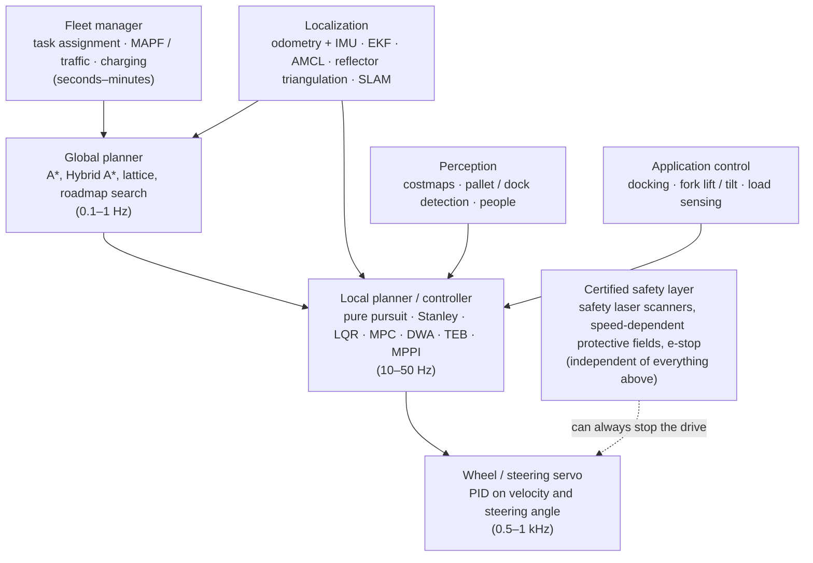

# Controlling forklifts, AGVs and AMRs: model, reward, or reference?

*An analysis of control methods for wheeled industrial mobile robots, written in the same format as the humanoid analysis in [`../robot-learning-control`](../robot-learning-control/). Equations are derived in the companion [cookbook](cookbook/COOKBOOK.md) (recipes M1–M22), and every paper is listed in the [catalog](CATALOG.md). Quantitative claims were checked against paper abstracts or primary sources on 26 Oct 2026.*

## Summary

- **Industry still runs on model-based control, for good reasons.** The physics of a wheeled vehicle on a flat floor is simple and well known: a few kinematic equations. Safety standards ([ISO 3691-4:2023](https://www.iso.org/standard/83545.html)) demand predictable, verifiable behaviour. The hard problems are mostly localization, planning, traffic and safety, not motor control. Every certified forklift, AGV and AMR stack I'm aware of uses classical tracking controllers under a certified safety layer.
- **Learning has entered from the top and the edges, not the core.**
  - *Fleet coordination:* Amazon's DeepFleet foundation model, announced with the company's millionth robot in 2025.
  - *Perception:* pallet and obstacle detection.
  - *Crowd navigation research:* CADRL, Long et al. 2018.
  - *General visual navigation:* GNM, ViNT, NoMaD.
  - *Simulation results:* DD-PPO "essentially solves" PointGoal navigation in simulation, but that hasn't translated into certified industrial controllers.
- **The humanoid story runs in reverse.** For humanoids, contact-rich dynamics made model-based control brittle and RL won the low level. For wheeled robots the low level is easy, so learning's value is in the open-ended parts: unstructured perception, interaction with people, and fleet-scale optimization.
- **Reference-based control dominates mobile robotics too, in a different form.** Guide wires, magnetic tape, taught routes and visual teach-and-repeat are references the vehicle tracks. The modern AMR replaces a physical reference with a planned path in a map.

---

## 1. The vehicles

| Family | Typical kinematics | How it knows where it is | Paths | Typical speed / precision | Typical control stack |
|---|---|---|---|---|---|
| **AGV** (tugger, unit-load carrier) | Differential drive or steered-drive tricycle | Follows a physical reference: inductive wire, magnetic tape, floor QR grid, or laser reflectors | Fixed guide paths or a fixed roadmap | ~1–2 m/s; ±5–10 mm at stations | Line/path following (PID, pure pursuit); central traffic manager |
| **Autonomous forklift (AGF)**: pallet truck, counterbalance, reach truck | Tricycle: one steered drive wheel plus a fixed load axle (M4) | Laser reflectors (triangulation) or natural-contour lidar localization | Roadmap of lanes and pick/drop stations | ~1–2 m/s loaded, slower with raised load; ±10 mm at the pallet | Roadmap planner, path tracking (pure pursuit / LQR / MPC), pallet detection + final approach, load-dependent speed limits |
| **AMR** (cart, tote, goods mover) | Differential drive or omnidirectional (mecanum, swerve) | Lidar SLAM / AMCL against a map of the building | Free paths re-planned around obstacles | ~1–2 m/s; ±10–50 mm except docking | Nav2-style stack: localization + global planner + local controller (DWB, MPPI, regulated pure pursuit) |
| **Goods-to-person shelf robot** (Kiva / Amazon Drive) | Differential drive, rotates in place under a shelf | Floor fiducial grid plus odometry | Grid cells reserved by a central planner | Many hundreds of robots per site | Centralized multi-agent path finding and reservation; simple low-level cell-to-cell motion |
| **Very-narrow-aisle truck** | Steered-drive, very long wheelbase | Rail or inductive wire inside the aisle, free navigation outside | Fixed in-aisle | Low lateral clearance | Mechanical or wire guidance in-aisle; model-based elsewhere |

**AGV vs AMR** is the key industry distinction (Fragapane et al. 2021). An AGV follows a predefined reference and is dispatched centrally. An AMR plans its own path in a map, avoids obstacles locally, and can negotiate with other systems, which moves decisions from a central controller to the vehicle. De Ryck et al. (2020) see the same shift in AGV control research, from central toward decentral techniques.

## 2. The control stack

Each layer has its own recipe in the cookbook. The safety layer is deliberately *separate*. Safety laser scanners switch protective fields by speed (M14) and can stop the drive no matter what the planners command. This is why learning-based components can be added above it without re-certifying the whole vehicle.

## 3. Why mobile-robot control is hard

The wheel–floor physics is easy. The difficulty sits elsewhere:

| Difficulty | What it means | Cookbook |
|---|---|---|
| **Nonholonomic constraints** | Wheels can't slide sideways ($\dot x\sin\theta-\dot y\cos\theta=0$). By Brockett's theorem, no smooth time-invariant feedback can stabilize a unicycle to a parking pose, so docking needs path following, approach poses or time-varying control. | M3 |
| **Forklift geometry** | Rear-steered tricycle with steering-angle and steering-rate limits. The load axle has no steering. Driving forks-first means the main sensors may be blocked by the load. | M4 |
| **Load-dependent dynamics and tip-over** | Capacity derates with load centre and lift height. Braking with a raised load and turning fast both create tipping moments, so speed and acceleration limits must depend on load mass and height. | M19 |
| **Localization in repetitive spaces** | Long identical aisles, moved pallets, glass and people confuse lidar matching. Odometry drift grows with distance. | M6–M9 |
| **Precision at the pallet or dock** | ±10 mm lateral at the end of the approach, from a vehicle that can't move sideways. | M15, M18 |
| **Mixed traffic with people** | Pedestrians and manual forklifts are unpredictable. Too much caution stalls throughput; too little is unsafe. | M14, M17, M21 |
| **Fleet-scale coordination** | Hundreds of robots in shared aisles cause congestion and deadlock. Optimal multi-agent path finding is NP-hard. | M20 |
| **Certification** | Personnel detection and stopping must be provably reliable. Neural networks are hard to certify, which is why they sit above the safety layer. | M14, standards |

## 4. Three paradigms, side by side

Same three families as the humanoid analysis: **MB** model-based, **RL** self-exploration reinforcement learning, **REF** reference/imitation learning.

| Criterion | MB: model-based control and planning | RL: self-exploration learning | REF: reference following and imitation |
|---|---|---|---|
| Typical methods | Pure pursuit, Stanley, Kanayama, LQR, MPC; A*, Hybrid A*; DWA, TEB, MPPI; EKF/AMCL; MAPF | Mapless and crowd-navigation RL (Tai 2017, CADRL, Long 2018), DD-PPO, RL dispatching | Guide wires and tape, teach-and-repeat, behavior cloning (Bojarski 2016, Pfeiffer 2017), GNM/ViNT/NoMaD, fleet models trained on logs (DeepFleet) |
| Model needed | Kinematic model + map | Simulator (or real-world data, as in BADGR) | Demonstrations, taught routes or operational logs |
| Precision docking | Excellent with good localization | Weak; hard to reach ±10 mm by reward alone | Excellent for taught routes; behavior cloning is weak |
| Crowds, unknown obstacles | Conservative; tuning-heavy | Strongest research results (26% better paths than ORCA in CADRL's simulations) | Generalizes only as far as the data |
| Certification | Analyzable; standard practice | Not certifiable as a safety function | Physical guidance is easy to certify; learned models are not |
| Data / compute | Low | High (DD-PPO: 2.5B steps, 64 GPUs, under 3 days) | Moderate (GNM: 60 h from 6 robots) |
| Industrial maturity | Dominant | Research, plus pilots above the safety layer | Guide paths dominant in AGVs; learned imitation emerging |

**What the surveys say.**
- Xiao et al. (2022) organize learning-based navigation by how it relates to the classical stack. They note there had been little direct comparison between classical and learned approaches.
- Fragapane et al. (2021) and De Ryck et al. (2020) treat AGV/AMR control as primarily an operations and coordination problem: dispatching, routing, deadlock avoidance and decentralization. Learning appears there mainly as an optimization tool.

## 5. Reference-based vs self-exploration control

In mobile robotics a "reference" is usually a **path**: a wire in the floor, a taught route, a planned trajectory, or a human demonstration.

| Dimension | Reference-based (guide path, teach-and-repeat, imitation) | Self-exploration (RL, self-supervised) |
|---|---|---|
| Setup cost | Install wire, tape or reflectors, or teach routes. Fast to validate. | Build a simulator or collect experience; design rewards. |
| Reliability | Very high on the taught path: Furgale & Barfoot's visual teach-and-repeat drove 32+ km, 99.6% autonomously, without GPS. | Good in distribution; failures in unseen conditions. |
| Flexibility | Low: layout changes mean re-teaching or re-installing. | High: re-plans or generalizes to new layouts and crowds. |
| Behaviour around people | Stop-and-wait; predictable. | Can learn socially compliant passing (SA-CADRL), but is less predictable. |
| Optimality | Bounded by the taught path. | Can find better strategies, e.g. faster multi-robot passing (Long 2018). |
| Certification | Straightforward. | Must sit behind a safety filter (M14, M21). |

**The practical synthesis.** References and maps define *where* the vehicle may go, and classical controllers track them with known precision. Learning helps decide *how* to behave where references run out: crowds, unknown obstacles, fleet traffic, perception of pallets and docks. A certified safety layer bounds the result.

## 6. Which method for which task

| | Tractable model and structured site | Simulatable but open-ended (people, clutter, many robots) | Hard to simulate (outdoor terrain, visual semantics) |
|---|---|---|---|
| **Goal easy to score** | **MB.** Path tracking + MPC on a roadmap; reflector or contour localization; central traffic control | **RL / optimization.** Crowd navigation, multi-robot collision avoidance, learned fleet routing above MB tracking | **Self-supervised learning.** Learned traversability from real data (BADGR) |
| **Behaviour easier to show** | **Reference following.** Guide wire, tape, QR grid, teach-and-repeat | **Imitation of planners and operators.** Learned local planners, tuned from demonstrations | **Navigation foundation models.** GNM, ViNT, NoMaD |

Fit: ●●● strong, ●● viable, ● niche, ○ rarely used.

| Task | Main difficulty | Best-suited approach | Fit MB · RL · REF | Evidence / example |
|---|---|---|---|---|
| Fixed-route tugger, tow train | Reliability, simple routes | Guide path or taught route + PID / pure pursuit; zone-based traffic control | ●●● ○ ●●● | Wire-guided AGVs since the 1950s |
| Pallet transport with autonomous forklifts | Precision at the pallet, load stability, mixed traffic | Reflector or contour localization, roadmap planning, LQR/MPC tracking, perception-based final approach, load-dependent speed limits | ●●● ● ●● | MIT voice-commandable forklift (2010); industrial AGF practice |
| Goods-to-person shelf robots at scale | Congestion and deadlock among hundreds of robots | Central MAPF / reservation; learned traffic models on top | ●●● ●● ●● | Kiva (productivity "factor of two or more", authors' claim); RHCR up to 1,000 agents; DeepFleet (10% travel-efficiency aim, company-reported) |
| Hospital, retail and office AMRs | People, doors, elevators, changing layouts | Nav2-style stack (AMCL + global planner + MPPI/DWB/regulated pure pursuit); social-navigation research | ●●● ●● ● | Office Marathon (2010); Nav2 Marathon 2 (2020) |
| Docking to chargers and conveyors | ±5–10 mm final pose with nonholonomic kinematics | Fiducial or reflector feedback; approach pose + Kanayama or visual servoing | ●●● ○ ●● | Standard practice; see M18 |
| Outdoor yards, mixed terrain | GPS dropouts, vegetation, slopes | Lidar/GNSS fusion + MPC; learned traversability; teach-and-repeat | ●● ●● ●● | Visual teach and repeat (32 km); BADGR |
| Exploration and mapping of unknown sites | No map, open-ended goals | SLAM + frontier exploration; learned exploration policies | ●● ●● ●● | NoMaD (diffusion exploration) |
| Multi-vendor mixed fleets | Interoperability between vendors | Standard interface (VDA 5050) + central coordination | ●●● ○ ○ | VDA 5050 v2.0 (2022), v2.1 (2024) |

**Decision rule.**
1. Any personnel-safety function → certified model-based safety layer, always.
2. Is a fixed path acceptable? → Reference following (cheapest and most reliable).
3. Otherwise, with a map of a structured site → MB planning + tracking (Nav2-class).
4. Crowds or many robots → add learned interaction or fleet models *above* the MB controller.
5. Unstructured or visual-semantic environments → navigation foundation models or self-supervised learning, still behind a safety filter.

## 7. Breakthroughs, year by year

| Year | Breakthrough | Problem it solved | Evidence | Real-world reach |
|---|---|---|---|---|
| 1953–54 | Barrett "Guide-O-Matic" driverless tow tractor (REF) | Moving goods without a driver | Tracked a wire signal (sources differ on ceiling vs floor wire, and 1953 vs 1954) | Start of wire-guided AGVs |
| 1968 | A* search (MB) | Optimal paths with a heuristic | Hart, Nilsson & Raphael, for SRI's Shakey | Every global planner since |
| 1983 | Brockett's theorem (MB) | Why parking a nonholonomic vehicle is subtle | No smooth static feedback can stabilize a unicycle to a point | Shapes docking strategies |
| 1990–92 | Kanayama tracking; pure pursuit (MB) | Stable path tracking for wheeled robots | Lyapunov stability proof; CMU Navlab implementation | Standard AGV/AMR trackers |
| 1991 | EKF localization from geometric beacons (MB) | Where am I, from known landmarks? | Leonard & Durrant-Whyte | Laser-reflector navigation in AGVs and forklifts |
| 1997 | Dynamic window approach + RHINO museum robot (MB) | Fast, safe local obstacle avoidance among people | RHINO: 6 days, more than 2,000 visitors, museum attendance up more than 50% | DWA and its descendants (ROS DWB) |
| 1999 | Monte Carlo localization (MB) | Global localization and kidnapped-robot recovery | Particle filters handle multimodal beliefs | AMCL in ROS and Nav2 |
| 2006–08 | Kiva goods-to-person fleet (MB + fleet optimization) | Pickers walking to shelves | First permanent installation in 2006; 500+ vehicles per site; productivity "factor of two or more" (authors' claim) | Amazon bought Kiva in 2012 |
| 2007–10 | Hybrid A* (MB) | Kinematically feasible planning for car-like vehicles | Stanford's Junior in the Urban Challenge: parking lots and U-turns, 50–300 ms replanning | Forklift and car parking planners |
| 2010 | ROS navigation stack; visual teach-and-repeat; MIT robotic forklift (MB / REF) | Reusable navigation software; GPS-free route repeating; forklifts near people | Office Marathon (PR2, ICRA 2010); 32+ km at 99.6% autonomy (VT&R) | Open-source AMR baseline; route-repeating systems |
| 2016 | Cartographer; end-to-end driving (MB / REF) | Real-time lidar loop closure; learning to steer from pixels | Hess et al. 2016; Bojarski et al. 2016 | Cartographer in many AMRs; imitation for driving |
| 2017 | Deep RL for navigation (RL) | Mapless and crowd-aware local planning | Tai et al.: sim-to-real mapless planner; CADRL: 26%+ better paths than ORCA; MPPI for aggressive driving | Research; MPPI later becomes a Nav2 controller |
| 2019–20 | DD-PPO; Nav2; first edition of ISO 3691-4 (RL / MB) | Scale; modern ROS 2 stack; a safety standard for driverless trucks | DD-PPO: 2.5B steps on 64 GPUs in under 3 days; Nav2 ran safely among students over a marathon distance | Nav2 adopted widely; ISO 3691-4 used for certification |
| 2020–21 | Lifelong MAPF at warehouse scale (MB) | Continuous re-tasking of hundreds of robots | RHCR: up to 1,000 agents (38.9% of empty cells) in simulation | Fleet-manager algorithms |
| 2022 | VDA 5050 v2.0; GNM (REF) | Mixed-vendor fleets; navigation across robot types | VDA 5050 published Feb 2022; GNM trained on 60 h from 6 robots | Interoperable fleets; cross-robot policies |
| 2023 | ISO 3691-4:2023; ViNT and NoMaD (REF) | Updated safety requirements; navigation foundation models | ViNT: kilometer-scale navigation; NoMaD: diffusion exploration | Certification baseline; research toward general navigation |
| 2025 | Amazon's millionth robot and DeepFleet (REF / learned fleet model) | Fleet-wide traffic efficiency | Company-reported aim of 10% better travel efficiency | Learning at the fleet level, above classical vehicle control |

## 8. Safety and standards

- **ISO 3691-4:2023** (2nd edition; first edition 2020) sets safety requirements and verification for driverless industrial trucks, explicitly including AGVs, AMRs, bots, tunnel tuggers and under-carts. It excludes trucks guided solely by mechanical means and remotely controlled trucks.
- **In practice,** personnel detection uses safety-rated laser scanners with speed-dependent protective fields (M14). Everything that isn't safety-rated, including learned planners, must be unable to override them.
- **VDA 5050** (v2.0.0, February 2022; v2.1.0, May 2024) is a vendor-neutral MQTT interface between vehicles and a master control. It makes mixed-vendor fleets and central traffic management practical.
- **Control barrier functions** (M21) give a mathematical way to filter any controller, including an RL policy, so that it stays inside a safe set. That is the research counterpart of the safety-scanner layer.

## 9. Quick start: textbooks and tutorials

| Resource | Access | Start with | Covers |
|---|---|---|---|
| *Introduction to Autonomous Mobile Robots*, Siegwart, Nourbakhsh & Scaramuzza (MIT Press, 2nd ed. 2011) | Book | Chapters on locomotion, kinematics, localization and planning | M1–M17 overview |
| [Modern Robotics](https://hades.mech.northwestern.edu/index.php/Modern_Robotics), Lynch & Park (2017) | Free PDF + videos | Chapter 13, wheeled mobile robots | M2–M5, M15 |
| *Probabilistic Robotics*, Thrun, Burgard & Fox (MIT Press, 2005) | Book | Gaussian filters, particle filters, Markov/Monte Carlo localization, occupancy grids | M6–M10 |
| [State Estimation for Robotics](https://asrl.utias.utoronto.ca/~tdb/bib/barfoot_ser24.pdf), Tim Barfoot (2nd ed., 2024) | Free PDF | Linear-Gaussian estimation, then the 3D geometry and pose-graph chapters | M7, M9 |
| [Planning Algorithms](https://planning.cs.uiuc.edu/), Steven LaValle (2006) | Free online | Discrete planning, sampling-based planning, nonholonomic planning | M11–M13 |
| [Nav2 documentation](https://docs.nav2.org/) | Free, hands-on | Concepts, then tuning the controller and planner plugins (MPPI, regulated pure pursuit, Smac Hybrid-A*) | M10–M17 in practice |
| [Mobile Sensing and Robotics courses](https://www.ipb.uni-bonn.de/teaching/), Cyrill Stachniss (Uni Bonn) | Free lectures | SLAM, localization and occupancy-grid lectures | M6–M10 |
| [Underactuated Robotics](https://underactuated.mit.edu/), Tedrake | Free | LQR and trajectory-optimization chapters, for MPC tracking | M15, M16 |
| [Spinning Up in Deep RL](https://spinningup.openai.com/) | Free | Introduction parts 1–3, PPO | M21 |
| Fleet operations: Vis (2006), Le-Anh & De Koster (2006), Fragapane et al. (2021) | Papers | Sections on dispatching, routing and deadlocks | M20 |

The general math (linear algebra, optimization, Kalman filter, LQR, deep learning, RL) is in the humanoid collection's [cookbook](../robot-learning-control/cookbook/COOKBOOK.md); this collection's cookbook covers only what is specific to wheeled vehicles.

## 10. Sources

Every work above is in [CATALOG.md](CATALOG.md) with a DOI or arXiv link (8 local PDFs). Industry sources used:
- Amazon / DeepFleet: [Robotics 24/7](https://www.robotics247.com/article/amazon_launches_new_ai_foundation_model_to_power_its_robotic_fleet_deploys_millionth_robot/amazon_robotics).
- Barrett Guide-O-Matic: [Robotics 24/7](https://robotics247.com/article/lets_remember_mac_barrett_father_of_the_agv) and [Wikipedia](https://en.wikipedia.org/wiki/Automated_guided_vehicle). Sources disagree on the date and the wire placement.
- ISO 3691-4: [ISO catalogue](https://www.iso.org/standard/83545.html).
- VDA 5050: [VDA 5050 v2.1.0 PDF](https://vda.de/dam/jcr:f0c9c019-1506-4dee-998a-e92723fbf025/VDA5050-V2p1p0.pdf) and [Power Progress on v2.0.0](https://www.powerprogress.com/news/vda-5050-2.0.0-for-agvs-is-launched/8018127.article).
