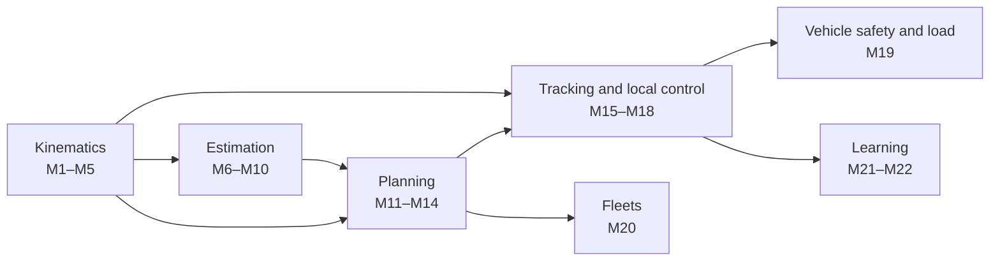

# The Mobile Robot Control Cookbook

*The mathematics behind forklifts, AGVs and AMRs, one recipe at a time. A companion to [REPORT.md](../REPORT.md) and to the general [Control-to-Learning Math Cookbook](../../robot-learning-control/cookbook/COOKBOOK.md), whose recipes are cited as "R1–R39".*

Each recipe has the same parts:
- **Problem:** what the tool is for.
- **Recipe:** the equations, built step by step.
- **Worked example:** numbers produced by [`examples.py`](examples.py). Run `python3 examples.py m15` to reproduce recipe M15; only NumPy is needed.
- **Used in:** works from [`../CATALOG.md`](../CATALOG.md).
- **Pitfalls:** what goes wrong in practice.

Background assumed: vectors, matrices and derivatives (R1–R2), the Kalman filter (R9), and basic RL (R23–R28).

## Contents

- **Kinematics:** [M1 Poses in SE(2)](#m1-poses-and-motion-in-the-plane-se2) · [M2 Differential drive](#m2-differential-drive-kinematics) · [M3 Nonholonomic constraints](#m3-nonholonomic-constraints-and-brocketts-theorem) · [M4 Forklift tricycle](#m4-forklift-and-tricycle-kinematics) · [M5 Omnidirectional](#m5-omnidirectional-bases-mecanum-and-swerve)
- **Estimation:** [M6 Odometry error](#m6-odometry-and-its-error-growth) · [M7 EKF with reflectors](#m7-ekf-localization-with-reflectors-and-landmarks) · [M8 Monte Carlo localization](#m8-monte-carlo-localization-amcl) · [M9 Scan matching and SLAM](#m9-scan-matching-icp-and-pose-graph-slam) · [M10 Occupancy grids and costmaps](#m10-occupancy-grids-and-costmaps)
- **Planning:** [M11 Graph search](#m11-graph-search-dijkstra-and-a) · [M12 Car-like planning](#m12-kinematically-feasible-planning-dubins-reedsshepp-hybrid-a-lattices) · [M13 Sampling planners](#m13-sampling-based-planning-rrt-and-rrt) · [M14 Speed profiles and safety fields](#m14-speed-profiles-stopping-distance-and-protective-fields)
- **Tracking and local control:** [M15 Path tracking](#m15-path-tracking-pure-pursuit-stanley-kanayama-lqr) · [M16 MPC and MPPI](#m16-model-predictive-control-and-mppi) · [M17 Local obstacle avoidance](#m17-local-obstacle-avoidance-dwa-velocity-obstacles-teb) · [M18 Docking and pallet engagement](#m18-docking-and-pallet-engagement)
- **Vehicle, fleets, learning:** [M19 Forklift stability](#m19-forklift-load-stability) · [M20 Fleet management](#m20-fleet-management-assignment-mapf-deadlock-sizing) · [M21 RL navigation and safety filters](#m21-reinforcement-learning-for-navigation-and-safety-filters) · [M22 Imitation and navigation foundation models](#m22-imitation-learning-and-navigation-foundation-models)

---

# Kinematics

## M1. Poses and motion in the plane, SE(2)

**Problem.** Represent where the vehicle is, and chain movements together.

**Recipe.**
- **Pose.** A pose is $p=(x,y,\theta)$, a position plus a heading. As a homogeneous matrix,

  $$T(p)=\begin{bmatrix}\cos\theta&-\sin\theta&x\\\sin\theta&\cos\theta&y\\0&0&1\end{bmatrix}$$

- **Composition.** A relative motion $d=(d_x,d_y,d_\theta)$ expressed in the robot's own frame updates the pose as $T(p')=T(p)\,T(d)$. Written out: $x'=x+d_x\cos\theta-d_y\sin\theta$, $y'=y+d_x\sin\theta+d_y\cos\theta$, $\theta'=\theta+d_\theta$.
- **Inverse.** $T(p)^{-1}$ maps world coordinates into the robot frame. Tracking errors (M15) are computed this way.
- **Angle wrapping.** Always wrap heading differences into $(-\pi,\pi]$.

**Worked example (`m01`).** A robot at $(2,1,90°)$ drives 1 m forward and then turns −90°. It ends at $(2,2,0°)$, because "forward" pointed along world $+y$.

**Pitfalls.** Mixing robot-frame and world-frame increments. Forgetting to wrap angles, which makes a 359° error look huge.

## M2. Differential-drive kinematics

**Problem.** Map left and right wheel speeds to vehicle motion, and back.

**Recipe.** Wheel radius $r$, track width $b$, wheel angular speeds $\omega_L,\omega_R$.

$$v=\frac r2(\omega_R+\omega_L),\qquad\omega=\frac rb(\omega_R-\omega_L),\qquad\dot x=v\cos\theta,\ \dot y=v\sin\theta,\ \dot\theta=\omega$$

- **Inverse (what the motor controller needs):** $\omega_{R,L}=(v\pm\omega b/2)/r$.
- **Turning radius:** $R=v/\omega$. Equal and opposite wheel speeds turn the robot in place.
- **Exact integration over a step** for constant $(v,\omega)$ follows an arc: $\Delta x=\frac v\omega[\sin(\theta+\omega\Delta t)-\sin\theta]$, $\Delta y=-\frac v\omega[\cos(\theta+\omega\Delta t)-\cos\theta]$.

**Worked example (`m02`).** With $r=0.1$ m and $b=0.5$ m, wheel speeds $\omega_L=8$ and $\omega_R=10$ rad/s give $v=0.90$ m/s and $\omega=0.40$ rad/s, a turn radius of 2.25 m. Commanding $v=1$, $\omega=0.5$ needs 8.75 and 11.25 rad/s.

**Used in.** Most AMRs, Kiva-style shelf robots, and many AGVs.

**Pitfalls.** The track width $b$ is the effective contact distance and changes with tyre wear and load; calibrate it (M6).

## M3. Nonholonomic constraints and Brockett's theorem

**Problem.** Why can't a wheeled robot simply "servo" to a parking pose?

**Recipe.**
- **The constraint.** Rolling without slipping forbids sideways motion: $\dot x\sin\theta-\dot y\cos\theta=0$. It restricts velocities but not reachable positions. That combination is called **nonholonomic**: any pose is reachable, but not directly.
- **Brockett's theorem (1983).** A necessary condition for stabilizing an equilibrium with smooth, time-invariant state feedback is that the map $(x,u)\mapsto f(x,u)$ covers an open neighbourhood of zero. The unicycle fails it: no velocity can point sideways. So **no smooth static feedback law $u=k(x)$ drives a unicycle to a fixed pose**.
- **What practitioners do instead:**
  - **Path or trajectory tracking.** Stabilize the *error* to a moving reference (M15). That is allowed, because the reference moves.
  - **Approach poses.** Plan to a pre-dock pose aligned with the target, then drive straight in (M18).
  - **Discontinuous or time-varying feedback**, e.g. polar-coordinate controllers. These are mathematically valid but less used in industry.

**Used in.** The reason docking and pallet engagement are planned, not simply servoed.

**Pitfalls.** Tuning a pose controller that "almost" parks and then oscillates or spirals near the goal.

## M4. Forklift and tricycle kinematics

**Problem.** Model a counterbalance forklift or pallet truck. It has one steered drive wheel and a fixed, unsteered load axle (the forks or front wheels).

**Recipe.** Put the reference point at the midpoint of the fixed axle. The wheelbase is $L$ (fixed axle to steered wheel), the steering angle is $\delta$, and the drive-wheel speed is $v_s$.

$$\dot x=v_s\cos\delta\cos\theta,\qquad\dot y=v_s\cos\delta\sin\theta,\qquad\dot\theta=\frac{v_s}{L}\sin\delta$$

- **Turning radius** about the fixed axle: $R=L/\tan\delta$. Many trucks steer to about ±90°, which rotates the truck about the load axle; that is how they turn in narrow aisles.
- **Steering limits:** $\lvert\delta\rvert\le\delta_{\max}$ and $\lvert\dot\delta\rvert\le\dot\delta_{\max}$. The rate limit matters most: the steering motor needs time to swing across.
- **Direction.** Forklifts often drive *forks-first* to pick up a pallet and *steer-first* to travel. The planner must handle reversing (Reeds–Shepp, M12). The sensors facing the forks may be blocked by the load.
- **Bicycle model for cars and front-steer AGVs:** $\dot x=v\cos\theta$, $\dot y=v\sin\theta$, $\dot\theta=\frac vL\tan\delta$, with $v$ measured at the rear axle.

**Worked example (`m04`).** For $L=1.6$ m:

| Steer angle | Radius about the load axle | Yaw rate per 1 m/s of drive speed | Load-axle speed per 1 m/s |
|---:|---:|---:|---:|
| 30° | 2.77 m | 0.312 rad/s | 0.87 m/s |
| 60° | 0.92 m | 0.541 rad/s | 0.50 m/s |
| 85° | 0.14 m | 0.623 rad/s | 0.087 m/s |

**Used in.** Autonomous forklifts (AGFs), tuggers, front-steer AGVs, and Hybrid A* for cars.

**Pitfalls.** Taking the reference point at the steered wheel instead of the fixed axle; the equations change. Ignoring the steering rate limit, which causes overshoot when entering curves.

## M5. Omnidirectional bases: mecanum and swerve

**Problem.** Some AMRs and pallet movers need to move sideways, for example along a conveyor.

**Recipe.**
- **Mecanum** (four wheels with 45° rollers, half-lengths $l_x,l_y$, wheel radius $r$, $k=l_x+l_y$):

  $$\begin{bmatrix}\omega_{FL}\\\omega_{FR}\\\omega_{RL}\\\omega_{RR}\end{bmatrix}=\frac1r\begin{bmatrix}1&-1&-k\\1&1&k\\1&1&-k\\1&-1&k\end{bmatrix}\begin{bmatrix}v_x\\v_y\\\omega\end{bmatrix}$$

  Sign conventions depend on roller orientation; check them against your wheel layout. The forward kinematics is the pseudo-inverse (R1).
- **Swerve** (each wheel steers and drives). The velocity of wheel $i$ at position $r_i$ is $v_i=[v_x,v_y]^\top+\omega\times r_i$. Steer each wheel to the angle of $v_i$ and drive it at $\lVert v_i\rVert$.
- **Holonomic** bases have no nonholonomic constraint, so M3 doesn't apply. They pay for that with roller slip, lower load capacity, and lower odometry accuracy.

**Worked example (`m05`).** With $r=0.076$ m, $l_x=0.25$ m, $l_y=0.2$ m:
- 0.5 m/s forward: all four wheels at 6.58 rad/s;
- 0.5 m/s sideways: wheels at $[-6.58,6.58,6.58,-6.58]$;
- 1 rad/s rotation: $[-5.92,5.92,-5.92,5.92]$.

**Pitfalls.** Mecanum odometry is poor because the rollers slip, so lean on lidar or visual localization.

# Estimation

## M6. Odometry and its error growth

**Problem.** Wheel encoders give motion between scans, but errors accumulate.

**Recipe.**
- **Integration.** Integrate the M2/M4 kinematics from encoder ticks, usually fused with a gyro for heading.
- **Systematic errors:** unequal wheel diameters, wrong track width. Calibrate them by driving squares in both directions and measuring the end-point error, as in Borenstein & Feng's UMBmark (1996).
- **Random errors.** A small heading error per metre makes lateral error grow faster than linearly: roughly as distance$^{1.5}$ for random-walk heading noise.
- **Uncertainty propagation.** With motion Jacobians $F$ and $G$, $P_{k+1}=FP_kF^\top+GQG^\top$ (R9). This is the prediction step of every localization filter.

**Worked example (`m06`).** A heading noise of 0.5° per metre gives a lateral standard deviation of 1.82 m after a 50 m straight run. A 0.5% wheel-diameter mismatch on a 0.5 m track adds a heading drift of 0.57° per metre. That is why AGVs re-localize on reflectors or features every few metres.

**Pitfalls.** Wheel slip on wet or dusty floors. Odometry alone can't detect a robot that was picked up and moved (the kidnapped robot, M8).

## M7. EKF localization with reflectors and landmarks

**Problem.** Correct drifting odometry using landmarks at known positions. Laser-reflector navigation, used by many AGVs and forklifts, works this way.

**Recipe.** State $s=(x,y,\theta)$. A landmark at $(m_x,m_y)$ is measured as a range and bearing:

$$h(s)=\begin{bmatrix}\sqrt{\Delta x^2+\Delta y^2}\\\operatorname{atan2}(\Delta y,\Delta x)-\theta\end{bmatrix},\quad\Delta x=m_x-x,\ \Delta y=m_y-y$$

$$H=\frac{\partial h}{\partial s}=\begin{bmatrix}-\Delta x/\sqrt q&-\Delta y/\sqrt q&0\\\Delta y/q&-\Delta x/q&-1\end{bmatrix},\qquad q=\Delta x^2+\Delta y^2$$

Then apply the Kalman update (R9): $K=PH^\top(HPH^\top+R)^{-1}$, $s\leftarrow s+K(z-h(s))$, $P\leftarrow(I-KH)P$. Wrap the bearing in the innovation.

- **Data association.** Reflectors all look the same, so match each detection to the map by predicted position (gating on the Mahalanobis distance).
- **Triangulation.** With three or more reflectors you can solve for the pose directly (least squares), which is useful for initialization.

**Worked example (`m07`).** The prior is $(0,0.2,0)$ with 0.2 m standard deviations; the true pose is $(0,0,0)$, and a reflector sits at $(5,0)$. One range-and-bearing measurement:
- moves $y$ to 0.089 m;
- shrinks the $x$ standard deviation from 0.20 m to 0.021 m (range is informative along the line of sight);
- shrinks the $y$ standard deviation only to 0.134 m.

A second reflector at a different angle is needed to pin down $y$. That is why reflector layouts must be planned so the vehicle always sees a good geometric spread.

**Used in.** Leonard & Durrant-Whyte (1991); laser-reflector AGV and forklift navigation.

**Pitfalls.** Poor geometry (all reflectors in a line). Mis-association near shiny surfaces.

## M8. Monte Carlo localization (AMCL)

**Problem.** Localize in a lidar map when the belief may be multimodal: identical aisles, or a robot that was moved.

**Recipe.** Represent the belief with particles $\{s^{(i)},w^{(i)}\}$.
1. **Predict:** sample each particle through a noisy motion model (M2, M6).
2. **Weight:** $w^{(i)}\propto p(z\mid s^{(i)},\text{map})$, using a likelihood-field or beam model for the lidar scan.
3. **Resample** in proportion to the weights. Low-variance resampling reduces sampling noise.
4. **KLD-sampling** (Fox 2003) adapts the particle count. With $k$ occupied histogram bins, error bound $\epsilon$ and confidence $1-\delta$:

   $$n=\frac{k-1}{2\epsilon}\Big\{1-\frac{2}{9(k-1)}+\sqrt{\frac{2}{9(k-1)}}\,z_{1-\delta}\Big\}^3$$

   Many particles are used while the belief is spread out, few once it has converged.
5. **Recovery.** Inject random particles when the measurement likelihood collapses (the kidnapped robot).

**Worked example (`m08`).** In a 1-D corridor with doors at 2, 4 and 9 m, a robot at 4 m sees a door. The belief splits roughly evenly between the doors: masses 0.32 / 0.35 / 0.33 in $[0,3)$, $[3,6)$, $[6,12)$. After "move 2 m, see no door, move 3 m, see a door", 94% of particles lie within 0.5 m of the true 9.0 m.

**Used in.** Dellaert et al. 1999; AMCL in ROS and Nav2; most AMRs.

**Pitfalls.** Too few particles in long, symmetric aisles. Maps that are outdated after pallets move: use features that don't move (walls, racks) or relocalize.

## M9. Scan matching (ICP) and pose-graph SLAM

**Problem.** Build the map in the first place, and match lidar scans to estimate motion.

**Recipe.**
- **Point-to-point ICP:**
  1. Pair each point $p_i$ with its nearest neighbour $q_i$.
  2. Solve $\min_{R,t}\sum_i\lVert Rp_i+t-q_i\rVert^2$ in closed form. Centre both sets, form $W=\sum(p_i-\bar p)(q_i-\bar q)^\top=U\Sigma V^\top$, then $R=VU^\top$ (fix the sign if $\det R<0$) and $t=\bar q-R\bar p$.
  3. Repeat until convergence.
- **Pose-graph SLAM.** The nodes are robot poses $X_i$; the edges are relative-pose measurements $Z_{ij}$ from odometry, scan matching and loop closures. Solve

  $$\min_{X}\sum_{(i,j)}e_{ij}^\top\Omega_{ij}e_{ij},\qquad e_{ij}=\mathrm{v}\big(Z_{ij}^{-1}X_i^{-1}X_j\big)$$

  where $\mathrm{v}(\cdot)$ turns a transform into $(x,y,\theta)$ and $\Omega$ is the information matrix. Solve with Gauss–Newton or Levenberg–Marquardt (R4); the system is sparse, so this is fast.
- **Loop closure.** Recognizing a revisited place adds a long-range edge that removes accumulated drift. Cartographer finds these with branch-and-bound scan matching.

**Worked example (`m09`).** For 40 points rotated by 10° and shifted by $(0.3,-0.2)$ m with 1 cm noise, the SVD step recovers 10.00° and $(0.299,-0.199)$ m.

**Used in.** GMapping, Cartographer, ORB-SLAM2 (visual), and natural-contour navigation on AMRs and forklifts.

**Pitfalls.** ICP needs a good initial guess (from odometry). False loop closures corrupt the whole map, so use robust kernels.

## M10. Occupancy grids and costmaps

**Problem.** Represent free and occupied space for planning and obstacle avoidance.

**Recipe.**
- **Log-odds update per cell:** $l_t=l_{t-1}+\log\frac{p(m\mid z_t)}{1-p(m\mid z_t)}-l_0$, with $p=1-1/(1+e^{l})$. Hits along the beam end add evidence for "occupied"; cells the beam passes through add evidence for "free".
- **Costmaps** (Nav2 style) stack layers: a static map, obstacles from current sensors, and **inflation**. Inflation cost decays with distance $d$ from an obstacle, e.g. $c(d)=c_{\max}e^{-\alpha(d-r_{\text{inscribed}})}$, so planners keep a margin.
- **Footprints.** Forklifts and carts are not circles. Collision checking uses the oriented footprint, including the load.

**Worked example (`m10`).** With a sensor model $p(\text{occ}\mid\text{hit})=0.7$ and $p(\text{occ}\mid\text{miss})=0.4$, the readings hit, hit, miss, hit give $p=0.70\to0.845\to0.784\to0.894$.

**Pitfalls.** Inflation set too large blocks narrow aisles; too small makes paths graze racks. Moving people leave "ghost" obstacles unless cells decay.

# Planning

## M11. Graph search: Dijkstra and A*

**Problem.** Find the shortest route on a grid or on a roadmap of lanes and stations.

**Recipe.**
- **Dijkstra.** Expand nodes in order of path cost $g(n)$. It is optimal for non-negative edge costs.
- **A*.** Expand in order of $f(n)=g(n)+h(n)$. If $h$ never overestimates the remaining cost (it is *admissible*), A* is still optimal and expands fewer nodes. On a 4-connected grid the Manhattan distance is admissible.
- **Roadmaps.** Industrial AGVs and forklifts plan on a hand-designed graph of lanes, with direction rules and speed zones. The graph is small, so search is instant, and the real work is in the traffic rules (M20).

**Worked example (`m11`).** On a 6×8 grid with a wall, Dijkstra and A* both find the 11-step optimal path. A* expands 28 nodes against Dijkstra's 41.

**Pitfalls.** Grid paths are not drivable by nonholonomic vehicles; smooth them or use M12.

## M12. Kinematically feasible planning: Dubins, Reeds–Shepp, Hybrid A*, lattices

**Problem.** Produce paths a car-like vehicle or forklift can actually drive, given its minimum turning radius and the option to reverse.

**Recipe.**
- **Minimum radius.** $R_{\min}=L/\tan\delta_{\max}$ (M4). Comfort and safety also give a speed-dependent radius $R\ge v^2/a_{\text{lat}}$.
- **Dubins paths** (forward only) and **Reeds–Shepp paths** (forward and reverse). The shortest path between two poses with a minimum radius is one of a few combinations of maximum-curvature arcs and straight segments; check each in closed form.
- **Hybrid A*** (Dolgov et al. 2010):
  - search over $(x,y,\theta)$ cells while keeping *continuous* states inside them;
  - expand by simulating short arcs at a few steering angles, forwards and backwards;
  - take the maximum of two heuristics: one non-holonomic (obstacle-free Reeds–Shepp distance) and one holonomic (grid distance around obstacles);
  - try an analytic Reeds–Shepp "shot" to the goal when close;
  - smooth the result by optimization.
- **State lattices.** Precompute a set of feasible motion primitives and search over them with A*. This is common for forklifts and in Nav2's Smac planners.
- **Curvature continuity.** Arc–line paths jump in curvature, which a steering motor can't follow. Use clothoids (curvature changing linearly with arc length) where precision matters.

**Worked example (`m12`).** With a lateral-acceleration limit of 0.5 m/s², the minimum radius is 2 m at 1 m/s and 8 m at 2 m/s. Driving speed changes which paths are feasible.

**Used in.** Junior in the Urban Challenge (50–300 ms replanning); forklift and parking planners.

**Pitfalls.** Planning to a pallet pose without a straight final segment; see M18.

## M13. Sampling-based planning: RRT and RRT*

**Problem.** Plan in high-dimensional or awkward spaces, such as a forklift plus its mast, or articulated tuggers, where grids are too fine.

**Recipe.**
- **RRT:** sample a random state, find the nearest tree node, steer a short step toward the sample, keep the step if it is collision-free, and repeat. It explores quickly but its paths are poor.
- **RRT\*:** when adding a node, choose the best parent within a shrinking radius $\propto(\log n/n)^{1/d}$ and rewire neighbours through the new node. It is *asymptotically optimal* (Karaman & Frazzoli 2011).
- **Kinodynamic variants** steer with the vehicle model (M4) instead of straight lines.

**Pitfalls.** Random paths need smoothing. Results are not repeatable from run to run, which industrial users dislike. That is one reason roadmaps and lattices dominate in warehouses.

## M14. Speed profiles, stopping distance and protective fields

**Problem.** Decide how fast to drive along a path, and how large the safety scanner's protective field must be.

**Recipe.**
- **Curvature limit:** $v\le\sqrt{a_{\text{lat}}/\kappa}$ on a path of curvature $\kappa$.
- **Acceleration limits.** Forward and backward passes over the path give a time-optimal profile under $\lvert\dot v\rvert\le a$. Use jerk limits for load stability (M19).
- **Stopping distance:** $d_{\text{stop}}=v\,t_r+\dfrac{v^2}{2a_b}$, where $t_r$ adds up the sensor, controller and brake response times and $a_b$ is the guaranteed braking deceleration.
- **Protective field.** The field length must be at least $d_{\text{stop}}$ plus margins for measurement error and stopping-distance degradation. Fields are switched by speed (and by steering for turns), so the vehicle slows instead of stopping when something enters a larger warning field. This is a simplified version; real values come from the standard and the scanner and brake data.
- **Speed and separation** is the general principle: speed must always be low enough to stop before reaching anything the sensors can see.

**Worked example (`m14`).**
- At curvature 0.2 m⁻¹ the speed limit is 1.58 m/s; at 1.0 m⁻¹ it is 0.71 m/s.
- With $t_r=0.3$ s, $a_b=1$ m/s² and a 0.1 m margin, 1 m/s needs a field of at least 0.90 m, while 2 m/s needs at least 2.70 m.

Doubling the speed triples the field. That is why AMRs slow down in busy areas.

**Used in.** Every certified vehicle (ISO 3691-4).

**Pitfalls.** Ignoring degraded braking (wet floors, heavy loads). Fields so long that the vehicle stops constantly in narrow aisles.

# Tracking and local control

## M15. Path tracking: pure pursuit, Stanley, Kanayama, LQR

**Problem.** Keep the vehicle on its planned path.

**Recipe.**
- **Errors in the path frame.** The cross-track error is $e$ and the heading error is $\psi_e=\theta_{\text{path}}-\theta$.
- **Pure pursuit.** Choose a goal point on the path at lookahead distance $L_d$, at angle $\alpha$ from the vehicle heading. Drive the arc through it: curvature $\kappa=2\sin\alpha/L_d$, then steering $\delta=\arctan(L\kappa)$ for a bicycle/tricycle (M4).
  - A larger $L_d$ is smoother but cuts corners; a smaller one tracks tightly but oscillates.
  - Scaling $L_d$ with speed is the usual fix. Nav2's *regulated* pure pursuit also slows down in tight curves and near obstacles.
- **Stanley** (Hoffmann et al. 2007): $\delta=\psi_e+\arctan\dfrac{k\,e}{v}$, with errors measured at the front axle. The cross-track term shrinks at speed.
- **Kanayama** (1990). Track a reference pose $(x_r,y_r,\theta_r)$ moving at $(v_r,\omega_r)$. Take the errors in the robot frame, $[e_x,e_y]^\top=R(\theta)^\top[x_r-x,\,y_r-y]^\top$ and $e_\theta=\theta_r-\theta$. Then

  $$v=v_r\cos e_\theta+k_xe_x,\qquad\omega=\omega_r+v_r\big(k_ye_y+k_\theta\sin e_\theta\big)$$

  Lyapunov analysis shows the error converges for positive gains and $v_r>0$. This is legal under Brockett (M3) because the reference moves.
- **LQR on linearized errors.** For small errors at speed $v$, $\dot e=v\psi_e$ and $\dot\psi_e=-v\kappa+\dots$. Discretize, then design $K$ with R8. The gains are easy to schedule with speed.

**Worked example (`m15`).**
- Pure pursuit with $L_d=1.5$ m and a target at 20° gives curvature 0.456 m⁻¹.
- Stanley with a 5° heading error, 0.3 m cross-track error and $v=1$ m/s steers 21.7°.
- Kanayama ($k_x=1$, $k_y=k_\theta=4$) on a straight line from a 0.5 m offset: the lateral error is 0.200 m after 1 s, 0.045 m after 2 s, and 0.0002 m after 5 s.

**Used in.** Nearly every AGV, forklift and AMR controller; Nav2's regulated pure pursuit.

**Pitfalls.** Pure pursuit with a short lookahead at high speed oscillates. Tracking the rear axle while the forks need precision at the front end.

## M16. Model predictive control and MPPI

**Problem.** Track a path while respecting speed, acceleration, steering-rate and obstacle constraints, and preview curves.

**Recipe.**
- **Tracking MPC.** Linearize the error dynamics (M15) or the kinematics (M4) along the reference. Solve a QP over $N$ steps every cycle:

  $$\min_{u}\sum_{k}\lVert e_k\rVert_Q^2+\lVert u_k-u^{\text{ref}}_k\rVert_R^2+\lVert\Delta u_k\rVert_S^2$$

  subject to $\lvert\delta\rvert\le\delta_{\max}$, $\lvert\Delta\delta\rvert\le\dot\delta_{\max}\Delta t$ and speed limits (R11).
- **MPPI** (model predictive path integral; Williams et al.). Sampling instead of gradients:
  1. Sample $K$ noisy control sequences $u+\epsilon^{(i)}$ and roll each out through the model.
  2. Score each rollout with a cost $S^{(i)}$ that can be any function: costmap values, distance to path, obstacles.
  3. Update $u\leftarrow u+\sum_iw^{(i)}\epsilon^{(i)}$, with $w^{(i)}\propto\exp(-S^{(i)}/\lambda)$.

  MPPI handles non-convex costs and runs on GPUs or CPUs in parallel. Nav2 ships an MPPI controller.

**Worked example (`m16`).** For rollout costs $[10,11,15,30]$:
- the temperature $\lambda=1$ gives weights $[0.727,0.268,0.005,0]$, nearly "pick the best";
- $\lambda=5$ gives $[0.454,0.371,0.167,0.008]$, a smoother average.

**Used in.** Information-theoretic MPC (aggressive driving); Nav2 MPPI; forklift trajectory tracking.

**Pitfalls.** Model mismatch at low speed and with steering delay. MPPI's sampling noise causes jitter, so smooth the output.

## M17. Local obstacle avoidance: DWA, velocity obstacles, TEB

**Problem.** React to obstacles not in the map (people, pallets, other robots) within a fraction of a second.

**Recipe.**
- **Dynamic window approach** (Fox, Burgard & Thrun 1997).
  1. Consider only the velocities $(v,\omega)$ reachable within one control period given the acceleration limits.
  2. Keep only *admissible* velocities, from which the robot can still stop before the nearest obstacle on that arc: $v\le\sqrt{2\,d(v,\omega)\,\dot v_b}$.
  3. Pick the one maximizing $\alpha\cdot\text{heading}+\beta\cdot\text{clearance}+\gamma\cdot\text{velocity}$.
- **Velocity obstacles / ORCA.** For each moving obstacle, the set of own velocities leading to a collision within time $\tau$ is a cone. ORCA has each agent take half the responsibility for avoiding the other, which gives smooth multi-agent avoidance.
- **TEB (timed elastic band).** Optimize a short time-parameterized trajectory with soft constraints for obstacles, kinematics and time. It explores alternative topologies (left vs right of an obstacle).

**Worked example (`m17`).** The goal is 5 m ahead with an obstacle 1.2 m directly in the way, a 3 s horizon and a required 0.4 m clearance. DWA rejects every straight-ahead option and the fast turns that clip the obstacle, and picks a slow avoiding turn: $v=0.3$ m/s, $\omega=-0.6$ rad/s.

**Used in.** ROS DWB (successor to DWA), TEB, ORCA in multi-robot simulators; the RL methods in M21 compare against ORCA.

**Pitfalls.** Local minima (U-shaped traps) need the global planner. Oscillation between left and right choices.

## M18. Docking and pallet engagement

**Problem.** End at a charger, a conveyor or inside pallet pockets with ±5–10 mm accuracy, using a vehicle that can't move sideways (M3).

**Recipe.**
1. **Detect the target.**
   - Pallets: fit the pocket geometry in lidar or depth data (line/plane fitting with RANSAC), or use a learned detector.
   - Docks: reflectors or fiducials.
   - Estimate the target pose $T^{\text{target}}$ relative to the vehicle.
2. **Plan to a pre-approach pose.** Stop a fixed distance $d_a$ back along the target's axis, already aligned with it. Reeds–Shepp or Hybrid A* gets you there (M12).
3. **Final approach.** Drive straight in at low speed with a tracking controller (M15) on the line through the target, and keep updating $T^{\text{target}}$ from perception (visual servoing). Lateral error is corrected over $d_a$: a longer approach means smaller steering corrections.
4. **Verify and act.** Check the fork tips are in the pockets (sensors or lidar), then lift. For chargers, confirm electrical contact.

**Feasibility check.** A lateral correction of $\Delta y$ needs roughly an S-curve of length $\approx2\sqrt{R_{\min}\Delta y}$, from two opposite arcs of radius $R_{\min}$. With $R_{\min}=1$ m and $\Delta y=5$ cm, that is about 0.45 m. If the approach is shorter, back out and retry.

**Used in.** MIT voice-commandable forklift (2010); every AGF and charging dock.

**Pitfalls.** Pallets that are damaged or skewed in racking. Sensors blocked by the forks or the load. Docking at a speed that can't absorb the final error.

# Vehicle, fleets, learning

## M19. Forklift load stability

**Problem.** Keep a loaded forklift from tipping forward or sideways, and set speed and acceleration limits that depend on the load.

**Recipe.**
- **Longitudinal static stability.** About the front (load) axle, the load moment must not exceed the truck's counter-moment:

  $$m_\ell\,g\,d_\ell\le m_t\,g\,d_t$$

  - $d_\ell$ is the distance from the axle to the load's centre of gravity (axle-to-fork-face distance plus the *load centre* $c$);
  - $d_t$ is the distance from the axle to the truck's centre of gravity.
- **Rated capacity** is quoted at a standard load centre (often 500 mm) and **derates** as $c$ grows, and with lift height (residual capacity). ISO 22915 specifies the stability tests.
- **Dynamic effects:**
  - braking or reversing with the load raised adds a forward overturning moment $m_\ell\,a\,h$;
  - mast tilt shifts the centre of gravity;
  - in a turn the lateral acceleration $v^2/R$ acts at the combined centre-of-gravity height $h$.

  With an effective half-base $b_{\text{eff}}$ (the distance from the centre of gravity to the stability-triangle edge), lateral tipping starts near $v^2/R\approx g\,b_{\text{eff}}/h$.
- **Control consequences.** Speed, acceleration and turn-rate limits should be functions of load mass, load centre and lift height. AGFs typically travel with the load lowered, slow down in turns, and limit deceleration when the load is raised.

**Worked example (`m19`).** Truck: 3,000 kg with its centre of gravity 0.9 m behind the front axle, so the counter-moment is 2,700 kg·m. The fork face is 0.45 m ahead of the axle.

| Load | Load centre | Load moment | Result |
|---|---:|---:|---|
| 1,500 kg | 0.5 m | 1,425 kg·m | Stable |
| 2,200 kg | 0.6 m | 2,310 kg·m | Stable |
| 2,500 kg | 0.8 m | 3,125 kg·m | **Tips forward** |

- The rated capacity at a 0.5 m load centre is 2,842 kg, derating to 2,160 kg at 0.8 m.
- Braking at 1.5 m/s² with 1,500 kg raised 3 m adds about 688 kg·m of forward moment.
- With the centre of gravity 1.2 m high, an effective half-base of 0.35 m and a 2 m radius, lateral tipping starts near 2.39 m/s.

This is a simplified rigid-body model. Real limits come from the manufacturer's capacity plates and ISO 22915 testing.

**Pitfalls.** Unknown or shifted loads: measure the mass with hydraulic pressure or load cells. Slopes. Tipping is most often caused by turning too fast with a raised load.

## M20. Fleet management: assignment, MAPF, deadlock, sizing

**Problem.** Decide which robot does which job and how hundreds of robots share aisles without collisions or gridlock.

**Recipe.**
- **Task assignment.** Minimize total cost over a robot × task cost matrix (travel time, battery). The Hungarian algorithm solves it optimally in $O(n^3)$; auctions and greedy rules are faster but suboptimal.
- **Multi-agent path finding (MAPF).** Find collision-free paths in space and time.
  - *Prioritized planning:* plan robots one by one in a space-time reservation table. Fast, but incomplete.
  - *Conflict-based search (CBS):* a high-level tree resolves pairwise conflicts by adding constraints, and a low level re-plans single agents. Optimal, but exponential in the worst case.
  - *Lifelong MAPF:* RHCR resolves collisions only inside a rolling time window, which scales to about 1,000 agents in simulation.
- **Deadlock.** Build a wait-for graph (robot A waits for a cell held by B). A cycle means deadlock. Industrial systems prevent it with zone locks, one-way aisles, or reservation of whole corridors.
- **Fleet sizing.** Little's law, $L=\lambda W$: the average number of busy robots equals the job arrival rate times the average cycle time. Add slack for charging, congestion and peaks.
- **Interoperability.** VDA 5050 lets a master control send orders (node and edge graphs) to vehicles from different vendors over MQTT.

**Worked example (`m20`).**
- For the cost matrix $[[1,2,8],[2,9,9],[8,9,3]]$ minutes, greedy nearest-task assignment costs 13 min. The optimal assignment costs 7 min: robot 0 takes task 1 and robot 1 takes task 0.
- For 120 jobs/hour at a 6-minute average cycle, 12 robots are busy on average; a target utilization of 85% gives 15 robots.

**Used in.** Kiva/Amazon, CBS, RHCR, and learned fleet models (DeepFleet) on top of these.

**Pitfalls.** Optimizing travel distance while congestion dominates. Charging schedules that empty the floor at shift change.

## M21. Reinforcement learning for navigation, and safety filters

**Problem.** Learn local navigation in crowds or among other robots, where hand-tuned rules are conservative.

**Recipe.**
- **MDP** (R23):
  - observation: lidar ranges (sparse, e.g. Tai 2017 used 10), the goal in polar coordinates relative to the robot, and the current velocity;
  - action: $(v,\omega)$;
  - reward: progress toward the goal, a small time penalty, a collision penalty and a goal bonus. For example, $r=c_p(d_{t-1}-d_t)-c_t-c_c\mathbb 1[\text{collision}]+c_g\mathbb 1[\text{goal}]$.
- **Training.** PPO or actor-critic in fast 2D or 3D simulators with randomized obstacles and agents (R28). Multi-robot policies train many robots sharing one policy (Long et al. 2018).
- **Value-based crowd navigation** (CADRL). Learn $V(\text{joint state})$ = estimated time to goal, then pick the velocity maximizing one-step reward plus discounted value of the propagated joint state.
- **Safety filter** (control barrier function). Define a safe set $h(x)\ge0$, e.g. distance to the nearest obstacle minus a margin. Filter any nominal command, including an RL action:

  $$u^*=\arg\min_u\lVert u-u_{\text{RL}}\rVert^2\quad\text{s.t.}\quad\dot h(x,u)\ge-\alpha\,h(x)$$

  Forward invariance of the safe set then holds by construction, under the model assumptions. Industrial vehicles additionally keep the certified scanner layer (M14) underneath.

**Worked example (`m21`).** Moving from 3.20 m to 3.05 m from the goal with $c_p=10$ and $c_t=0.01$ gives $r=1.49$.

**Used in.** Tai et al. 2017; CADRL and SA-CADRL; Long et al. 2018; DD-PPO (2.5B steps, near-perfect PointGoal navigation in simulation); BADGR (self-supervised from real data).

**Pitfalls.** Sim-to-real gaps in lidar noise and human behaviour. Reward shaping that learns to stop and wait forever. No certification path for the policy alone.

## M22. Imitation learning and navigation foundation models

**Problem.** Learn navigation behaviour from demonstrations or logs instead of rewards.

**Recipe.**
- **Behavior cloning** (R32): $\min_\theta\mathbb E_{(o,a)\sim\mathcal D}\lVert\pi_\theta(o)-a\rVert^2$, from human driving (Bojarski 2016) or by imitating a classical planner (Pfeiffer 2017). Covariate shift (R17) is the main failure mode, so add recovery data or use DAgger.
- **Goal-conditioned navigation models.** GNM, ViNT and NoMaD predict actions or waypoints from the current image plus a goal image, trained on many robots' logs. GNM used 60 h from 6 robots. A **normalized action space** (waypoints, not wheel speeds) lets one model drive different vehicles. Diffusion (R22) gives NoMaD multimodal choices for exploration.
- **Teach and repeat.** The simplest reference-based learning: record a route once, then localize against it while repeating (32+ km at 99.6% autonomy).
- **Fleet-level models trained on logs.** Amazon's DeepFleet is described as a foundation model trained on operational data to coordinate robot movement, with a company-reported aim of improving travel efficiency by 10%.

**Used in.** Bojarski 2016, Pfeiffer 2017, GNM, ViNT, NoMaD, visual teach and repeat, DeepFleet.

**Pitfalls.** Demonstrations that never show recovery. Models that can't guarantee the ±10 mm precision docking needs: keep M18's classical final approach.

---

# Appendix · Quick reference

| Idea | Equation |
|---|---|
| Diff drive | $v=\frac r2(\omega_R+\omega_L)$, $\omega=\frac rb(\omega_R-\omega_L)$ |
| Nonholonomic constraint | $\dot x\sin\theta-\dot y\cos\theta=0$ |
| Forklift tricycle | $\dot\theta=\frac{v_s}{L}\sin\delta$, $R=L/\tan\delta$ |
| Range-bearing model | $h=[\sqrt q,\ \operatorname{atan2}(\Delta y,\Delta x)-\theta]$ |
| Log-odds | $l_t=l_{t-1}+\operatorname{logit}p(m\mid z)-l_0$ |
| A* | $f=g+h$, $h$ admissible |
| Curvature speed limit | $v\le\sqrt{a_{\text{lat}}/\kappa}$ |
| Stopping distance | $v\,t_r+v^2/(2a_b)$ |
| Pure pursuit | $\kappa=2\sin\alpha/L_d$ |
| Stanley | $\delta=\psi_e+\arctan(ke/v)$ |
| Kanayama | $v=v_r\cos e_\theta+k_xe_x$, $\omega=\omega_r+v_r(k_ye_y+k_\theta\sin e_\theta)$ |
| MPPI weights | $w_i\propto e^{-S_i/\lambda}$ |
| DWA admissible | $v\le\sqrt{2d\,\dot v_b}$ |
| Forklift tip | $m_\ell d_\ell\le m_td_t$ |
| Little's law | $L=\lambda W$ |
| CBF filter | $\min\lVert u-u_{\text{nom}}\rVert^2$ s.t. $\dot h\ge-\alpha h$ |
