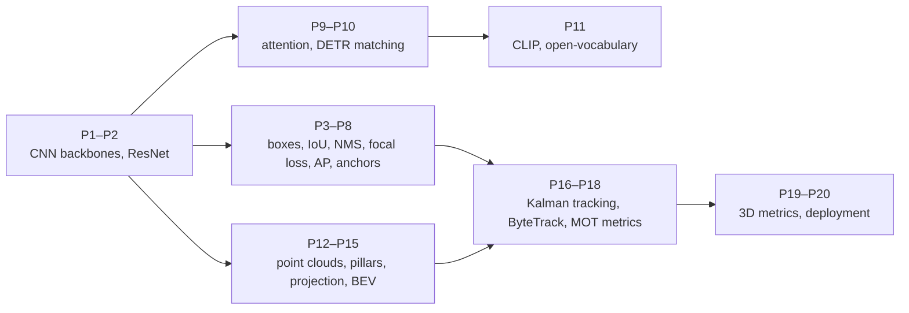

# The Perception Cookbook: detection and tracking in images and point clouds

*The mathematics behind object detectors and trackers, from ResNet to YOLO to vision-language models, one recipe at a time. A companion to [REPORT.md](../REPORT.md). General deep-learning background is in the [Control-to-Learning cookbook](../../robot-learning-control/cookbook/COOKBOOK.md) ("R18–R22"), camera geometry in the [SLAM cookbook](../../slam-localization/cookbook/COOKBOOK.md) ("S6"), and the Kalman filter in the [control cookbook](../../control-estimation-theory/cookbook/COOKBOOK.md) ("E3").*

Each recipe has the same parts: **Problem**, **Recipe**, **Worked example**, **Used in** and **Pitfalls**. The worked examples come from [`examples.py`](examples.py): `python3 examples.py p06` runs recipe P6. Only NumPy is needed.

## Contents

- **Backbones:** [P1 Convolution arithmetic](#p1-convolution-arithmetic-receptive-fields-and-cost) · [P2 Residual learning](#p2-residual-learning-resnet)
- **2D detection:** [P3 IoU and GIoU](#p3-iou-and-giou) · [P4 Box encoding](#p4-anchors-and-box-encoding) · [P5 NMS](#p5-non-maximum-suppression) · [P6 Focal loss](#p6-class-imbalance-and-focal-loss) · [P7 Average precision](#p7-average-precision-and-map) · [P8 Dense vs sparse prediction](#p8-dense-vs-sparse-prediction-yolo-retinanet-detr)
- **Transformers and language:** [P9 Attention cost](#p9-attention-and-vision-transformers) · [P10 Hungarian matching](#p10-set-prediction-and-hungarian-matching-detr) · [P11 CLIP and open vocabulary](#p11-contrastive-language-image-learning-and-open-vocabulary-detection)
- **3D:** [P12 PointNet](#p12-pointnet-and-permutation-invariance) · [P13 Voxels and pillars](#p13-voxels-and-pillars) · [P14 LiDAR–camera projection](#p14-lidarcamera-projection-and-fusion) · [P15 Lifting images to BEV](#p15-lifting-images-to-birds-eye-view)
- **Tracking and evaluation:** [P16 Kalman box tracking](#p16-kalman-filtering-for-box-tracking-sort) · [P17 Association and ByteTrack](#p17-data-association-and-bytetrack) · [P18 MOT metrics](#p18-tracking-metrics-mota-idf1-hota) · [P19 3D detection metrics](#p19-3d-detection-metrics-nuscenes-nds) · [P20 Deployment budgets](#p20-latency-and-deployment-budgets)

---

# Backbones

## P1. Convolution arithmetic, receptive fields and cost

**Problem.** Know what a convolutional layer sees and what it costs.

**Recipe.**
- **Output size:** $H_{\text{out}}=\big\lfloor\frac{H+2p-k}{s}\big\rfloor+1$ for kernel $k$, padding $p$, stride $s$.
- **Receptive field.** Stacking $n$ stride-1 $k\times k$ convolutions sees $n(k-1)+1$ pixels. Strides multiply the growth. Two 3×3 layers see 5×5 with fewer weights than one 5×5, which is VGG's insight.
- **Cost.** A layer has $k^2C_{\text{in}}C_{\text{out}}$ weights. Multiply by $H_{\text{out}}W_{\text{out}}$ for the multiply-adds.
- **Feature pyramids.** Deeper layers have large receptive fields but coarse resolution. FPN adds top-down connections so every scale has strong semantics, which helps small objects.

**Worked example (`p01`).**
- A 3×3 convolution with stride 1 and padding 1 keeps a 224×224 map at 224; with stride 2 it gives 112.
- 1, 2 and 5 stacked 3×3 layers see 3×3, 5×5 and 11×11 pixels.
- One 3×3 layer from 256 to 256 channels on a 56×56 map has 0.59 M weights and 1.85 G multiply-adds.

**Pitfalls.** The effective receptive field is smaller than the theoretical one. Striding early loses small objects.

## P2. Residual learning (ResNet)

**Problem.** Deeper networks should be more accurate, but plain deep stacks train *worse*.

**Recipe.**
- **Residual block:** $y=x+F(x;W)$. The layers learn a correction to the identity rather than a whole mapping.
- **Gradient flow.** $\dfrac{\partial y}{\partial x}=I+\dfrac{\partial F}{\partial x}$, so the identity term carries gradients through any depth. Compare plain stacks, where gradients are products of Jacobians that vanish or explode (R21).
- **Bottleneck blocks** (1×1 reduce, 3×3, 1×1 expand) make 50–152-layer networks affordable. ResNet-50 and ResNet-101 became the standard detection backbones (Faster R-CNN, RetinaNet, DETR, CenterPoint's 2D parts).

**Worked example (`p02`).** As a stylized illustration: if each plain layer scales gradients by 0.9, 50 layers leave 0.005 of the signal. With residual blocks whose branches contribute a small 2% each, the scale stays order one (2.7).

**Used in.** ResNet (152 layers, 3.57% ImageNet error, ILSVRC and COCO 2015 wins). Residual connections are also in every transformer.

**Pitfalls.** Downsampling blocks need projection shortcuts. Very deep nets still need normalization (batch norm or layer norm).

# 2D detection

## P3. IoU and GIoU

**Problem.** Measure how well two boxes overlap, both for evaluation and as a training loss.

**Recipe.**
- **Intersection over union:** $\mathrm{IoU}(A,B)=\dfrac{\lvert A\cap B\rvert}{\lvert A\cup B\rvert}$, between 0 and 1. A detection is usually a true positive at IoU ≥ 0.5 (VOC). COCO averages over thresholds 0.50:0.05:0.95.
- **GIoU.** Let $C$ be the smallest box enclosing both. $\mathrm{GIoU}=\mathrm{IoU}-\dfrac{\lvert C\setminus(A\cup B)\rvert}{\lvert C\rvert}$, between −1 and 1. It still gives a gradient when the boxes don't overlap, which plain IoU doesn't.
- DIoU and CIoU add centre-distance and aspect terms. YOLO generations use them as box losses.

**Worked example (`p03`).** Two 10×10 boxes offset by (5, 5) have IoU 0.143 and GIoU −0.079. Disjoint boxes have IoU 0 but GIoU −0.778: still informative.

**Pitfalls.** IoU is harsh on small objects, where a few pixels change it a lot. Rotated 3D boxes need polygon intersection.

## P4. Anchors and box encoding

**Problem.** Regressing raw coordinates is badly scaled. Detectors predict offsets relative to a reference box (an anchor or a grid cell).

**Recipe** (Faster R-CNN style). For an anchor $(x_a,y_a,w_a,h_a)$ and ground truth $(x,y,w,h)$:

$$t_x=\frac{x-x_a}{w_a},\quad t_y=\frac{y-y_a}{h_a},\quad t_w=\log\frac{w}{w_a},\quad t_h=\log\frac{h}{h_a}$$

- Decode by inverting the formulas. The log makes width and height errors scale-invariant.
- **Label assignment.** An anchor is positive if its IoU with a ground truth exceeds about 0.5–0.7, negative below about 0.4, and ignored in between. Modern YOLOs use learned or dynamic assignment (SimOTA, task-aligned).
- **Anchor-free** detectors (FCOS, CenterNet, YOLOX/v8) regress distances to the box sides from a point, or the size from a centre.

**Worked example (`p04`).** Anchor (50, 50, 100, 60) and ground truth (60, 45, 120, 50) give targets $t=(0.100,-0.083,0.182,-0.182)$. Decoding returns the ground truth exactly.

**Pitfalls.** Anchor sizes that don't match the data's objects. Assignment rules dominate accuracy more than architecture does.

## P5. Non-maximum suppression

**Problem.** Dense detectors fire several boxes per object; keep one.

**Recipe** (greedy NMS).
1. Sort the boxes by score.
2. Keep the top box.
3. Remove every remaining box with IoU above a threshold (≈0.5) against it.
4. Repeat until no boxes remain.

- **Variants:** class-wise NMS; Soft-NMS (decay scores instead of deleting); learned NMS.
- **NMS-free designs.** DETR's one-to-one matching (P10), YOLOv10's dual assignments and RT-DETR remove NMS. That removes a hand-tuned threshold and a variable-latency step.

**Worked example (`p05`).** Five raw detections of two objects become two after NMS at IoU 0.5: the 0.90 and 0.80 boxes survive.

**Pitfalls.** Crowded scenes: true neighbours get suppressed (pedestrians, stacked boxes). The threshold trades duplicates against missed objects.

## P6. Class imbalance and focal loss

**Problem.** A dense detector evaluates on the order of $10^5$ candidates per image, nearly all background. Plain cross-entropy is dominated by easy negatives.

**Recipe** (RetinaNet).

$$\mathrm{FL}(p_t)=-\alpha_t(1-p_t)^\gamma\log p_t$$

- $p_t$ is the predicted probability of the true class. The factor $(1-p_t)^\gamma$ shrinks the loss of well-classified examples.
- $\gamma=2$ and $\alpha=0.25$ are the defaults.
- This let one-stage detectors match two-stage accuracy (Lin et al. 2017), and variants live on in YOLO and DETR training.

**Worked example (`p06`).** 100,000 easy negatives ($p=0.99$) against 10 hard positives ($p=0.3$):

| Loss | Easy negatives' total | Hard positives' share |
|---|---:|---:|
| Cross-entropy | 1,005 | 1.2% |
| Focal ($\gamma=2$) | 0.03 | 98.3% |

**Pitfalls.** Too large a $\gamma$ under-trains on moderately easy examples. Class-level imbalance (long tail) needs other remedies, such as re-sampling or equalization losses.

## P7. Average precision and mAP

**Problem.** Score a ranked list of detections against ground truth.

**Recipe.**
1. Sort detections by score. Mark each as a true positive if it matches an unmatched ground truth at IoU ≥ τ, otherwise as a false positive.
2. Compute cumulative precision $P=\dfrac{TP}{TP+FP}$ and recall $R=\dfrac{TP}{\#GT}$.
3. Make precision monotone (take the running maximum from the right) and integrate under the curve: **AP**.
4. **mAP** averages AP over classes. **COCO AP** also averages over IoU thresholds 0.50–0.95 and uses 101 recall points.

**Worked example (`p07`).** 10 ranked detections against 6 objects, matched as TP TP FP TP FP TP FP FP TP FP. That gives AP 0.662 (all-point and 101-point agree here) and a maximum recall of 0.83: one object is never found.

**Pitfalls.** AP@0.5 vs AP@[.5:.95] are different numbers. Comparing across datasets or IoU definitions is meaningless.

## P8. Dense vs sparse prediction (YOLO, RetinaNet, DETR)

**Problem.** How many candidate boxes a detector evaluates shapes its speed, its loss and its post-processing.

**Recipe.**
- **YOLOv1.** An $S\times S$ grid; each cell predicts $B$ boxes plus class probabilities. One forward pass and one regression problem gave 45 FPS.
- **SSD and RetinaNet.** Anchors on every cell of several FPN levels. That means very many candidates, which needs focal loss (P6) and NMS (P5).
- **YOLOv3 → YOLO11.** Multi-scale heads, anchors then anchor-free, decoupled classification and box heads, better assignment, NMS-free (v10).
- **DETR.** A small fixed set of learned **object queries** (e.g. 100) attends to the image. One query per object, matched in training by P10, so no NMS.

**Worked example (`p08`).**

| Detector | Candidate predictions |
|---|---:|
| YOLOv1 (7×7 grid, 2 boxes) | 98 boxes |
| RetinaNet (1024×1024 image, P3–P7, 9 anchors per location) | 196,416 anchors |
| DETR | 100 queries |

**Pitfalls.** A grid limits how many objects can share a cell (YOLOv1's crowded-scene weakness). Too few queries cap the number of detections.

# Transformers and language

## P9. Attention and vision transformers

**Problem.** Let every image region interact with every other.

**Recipe.**
- **Attention:** $\mathrm{Attn}(Q,K,V)=\mathrm{softmax}(QK^\top/\sqrt d)V$ (R20).
- **ViT.** Split the image into $p\times p$ patches, treat them as $N=(H/p)(W/p)$ tokens, add position embeddings, and run a transformer.
- **Cost.** Self-attention costs $O(N^2)$, which explodes at detection resolutions.
  - Swin uses windowed attention.
  - Deformable DETR attends to a few learned sampling points per query.
  - RT-DETR uses a hybrid CNN-transformer encoder.

**Worked example (`p09`).** With 16 px patches:

| Image | Tokens | Attention-matrix entries per head per layer |
|---|---:|---:|
| 224² | 196 | 0.04 M |
| 512² | 1,024 | 1.05 M |
| 1024² | 4,096 | 16.8 M |

**Pitfalls.** Data hunger without strong pre-training. Small objects at coarse patch size.

## P10. Set prediction and Hungarian matching (DETR)

**Problem.** Train a detector that outputs a set, with no duplicates, without NMS.

**Recipe.**
1. For $N$ predictions and $M\le N$ ground truths, build a cost matrix $C_{ij}=-\hat p_i(c_j)+\lambda_1\lVert b_i-b_j\rVert_1+\lambda_2\big(1-\mathrm{GIoU}(b_i,b_j)\big)$.
2. Find the one-to-one assignment $\hat\sigma=\arg\min_\sigma\sum_jC_{\sigma(j),j}$ with the **Hungarian algorithm** (Kuhn 1955), $O(n^3)$.
3. Matched predictions get classification and box losses; unmatched ones are trained to predict "no object".

The same assignment problem is the core of tracking-by-detection (P17).

**Worked example (`p10`).** Four predictions against three ground truths, with cost $1-\mathrm{IoU}$:
- the optimal matching pairs each ground truth with the prediction that overlaps it (gt0→pred1, gt1→pred0, gt2→pred2);
- prediction 3 overlaps nothing and is trained as "no object".

**Pitfalls.** Unstable matching early in training slows convergence. Deformable DETR and DINO's denoising queries address this.

## P11. Contrastive language-image learning and open-vocabulary detection

**Problem.** Recognize categories that were never in the label set, specified in words.

**Recipe.**
- **CLIP.** An image encoder $f$ and a text encoder $g$ produce unit embeddings. Train on $N$ matched pairs per batch with a symmetric InfoNCE loss:

  $$\mathcal L=-\frac1{2N}\sum_i\Big[\log\frac{e^{s_{ii}/\tau}}{\sum_je^{s_{ij}/\tau}}+\log\frac{e^{s_{ii}/\tau}}{\sum_je^{s_{ji}/\tau}}\Big],\qquad s_{ij}=f(x_i)^\top g(t_j)$$

- **Zero-shot classification.** Embed prompts such as "a photo of a {class}", then $p(c\mid x)=\mathrm{softmax}_c\big(f(x)^\top g(t_c)/\tau\big)$.
- **Open-vocabulary detection** replaces the detector's fixed classifier with region–text similarity:
  - OWL-ViT and YOLO-World score region embeddings against text embeddings;
  - GLIP and Grounding DINO treat detection as phrase grounding, fusing text and image features inside the detector.
- **VLMs** (Kosmos-2, Qwen-VL, Florence-2, PaliGemma) put an LLM decoder on a vision encoder and emit boxes as location tokens in text. They are flexible and good at reasoning, but slower.

**Worked example (`p11`).** A toy image embedding near "a pallet" and "a cardboard box" splits its probability 0.44 / 0.55 between them, with "a forklift" and "a person" near zero: prompt wording matters. A 4-pair batch with modest similarity margins has a symmetric InfoNCE loss of 0.257.

**Pitfalls.** Prompt sensitivity. Poorly calibrated scores across prompts. Weak on rare fine-grained classes. VLM hallucination of objects that aren't there.

# 3D: point clouds and BEV

## P12. PointNet and permutation invariance

**Problem.** A point cloud is an unordered set. Shuffling the points mustn't change the output.

**Recipe.**
- **PointNet:** $f(\{x_1,\dots,x_n\})=\gamma\big(\max_ih(x_i)\big)$. A shared MLP $h$ is applied to each point, then a **symmetric** pooling (max) and an MLP $\gamma$. Max-pooling makes the result invariant to point order.
- **PointNet++** applies this hierarchically on local neighbourhoods (farthest-point sampling, then ball query), capturing local geometry.
- **Point-based detectors** (PointRCNN) segment foreground points and propose boxes from them.

**Worked example (`p12`).** For 500 random points through a random shared layer: the max-pooled feature is identical after shuffling the points (`True`). Reading the features in input order instead is not (`False`).

**Pitfalls.** Neighbourhood queries are expensive for large outdoor scans. Density varies with range.

## P13. Voxels and pillars

**Problem.** Make sparse 3D scans efficient for convolutional detectors.

**Recipe.**
- **Voxels** (VoxelNet). Bin points into a 3D grid, encode each non-empty voxel with a mini-PointNet, run 3D convolutions. **SECOND** uses sparse convolution: compute only at occupied voxels.
- **Pillars** (PointPillars). Bin only in $x,y$ (vertical columns), encode each pillar's points, scatter them to a 2D pseudo-image, and run a fast 2D CNN. This ran at 62 Hz.
- **Centre heads** (CenterPoint). Predict a BEV heatmap of object centres, then regress size, height, yaw (as sin/cos) and velocity. It is rotation-friendly, and tracking reduces to matching centres across frames.

**Worked example (`p13`).** A synthetic 70×80 m scene with 0.16 m pillars:
- the grid has 218,500 pillars, of which only 13% are occupied;
- the median pillar holds 1 point, the busiest 32.

Most of the grid is empty, which is why sparse and pillar encodings pay off.

**Pitfalls.** Voxel size trades detail against memory. Few points on distant or dark objects.

## P14. LiDAR–camera projection and fusion

**Problem.** Put LiDAR points and camera pixels in one geometry, for fusion, labelling or validation.

**Recipe.**
- **Projection.** Transform to the camera frame, $X_c=R\,X_\ell+t$ (the extrinsics from calibration, S18). Keep points with $z_c>0$, then project with the intrinsics: $[u,v,1]^\top\sim K\,X_c$ (S6).
- **Fusion levels:**
  - *early*: paint points with image features;
  - *mid*: fuse features in BEV (BEVFusion);
  - *late*: fuse boxes or tracks.

  Mid-level BEV fusion keeps both geometry and semantics. BEVFusion found point-level painting throws away camera semantic density.

**Worked example (`p14`).** A lidar point 15 m ahead, 2 m left and 0.5 m up maps to the camera point $(-2,-0.8,15.1)$ and pixel $(544.6,321.9)$. A point 5 m behind the vehicle has $z_c<0$ and is discarded.

**Pitfalls.** Mis-calibration and time offsets: at 20 m/s, 10 ms is 0.2 m (S18). Rolling-shutter cameras vs spinning lidars.

## P15. Lifting images to bird's-eye view

**Problem.** Detect in 3D from cameras alone, in the same BEV space as lidar and maps.

**Recipe.**
- **Lift-Splat-Shoot.**
  1. For each pixel, predict a categorical depth distribution over $D$ bins and a context feature $c$.
  2. Their outer product places features along the camera ray at every depth.
  3. "Splat" (sum-pool) all frustum points into a BEV grid; run a BEV detector.
- **Query-based** (DETR3D, BEVFormer). Define 3D or BEV queries, project their reference points into each camera (P14), and sample image features there with (deformable) attention. BEVFormer adds temporal self-attention over previous BEV maps and reached 56.9 NDS camera-only.

**Worked example (`p15`).** A 32×88 feature map with 41 depth bins and 64 channels lifts to 115,456 frustum points per camera, 30 MB in fp32. Six cameras give 692,736 points to splat. That is why BEVFusion's optimized BEV pooling (more than 40× faster) mattered.

**Pitfalls.** Depth ambiguity grows with range (S6). Calibration dependence. Memory.

# Tracking and evaluation

## P16. Kalman filtering for box tracking (SORT)

**Problem.** Predict where each tracked object will be in the next frame, including during short occlusions.

**Recipe** (SORT).
- **State:** $x=[u,v,s,r,\dot u,\dot v,\dot s]$: box centre, area (scale), aspect ratio, and their rates. Constant velocity: $x_{k+1}=Fx_k$.
- **Measurement:** $z=[u,v,s,r]$ from the matched detection.
- Run the standard Kalman predict/update (E3). Unmatched tracks coast on prediction for a few frames, then are deleted.
- **3D tracking** (AB3DMOT, CenterPoint) uses the same filter in metric 3D, with yaw and velocity.

**Worked example (`p16`).** An object at (100, 200) moving at (+4, −1) px/frame, occluded for 5 frames, is predicted at (120, 195), ready to re-associate when it reappears.

**Pitfalls.** Constant-velocity models drift during long or non-linear occlusions. OC-SORT re-anchors the state on new observations to fix this. Camera ego-motion (BoT-SORT compensates).

## P17. Data association and ByteTrack

**Problem.** Assign new detections to existing tracks.

**Recipe.**
- **Cost:** $C_{ij}=1-\mathrm{IoU}(\text{predicted track }i,\ \text{detection }j)$. Optionally blend in appearance distance (DeepSORT) or a Mahalanobis gate.
- **Solve** with the Hungarian algorithm (P10) and reject matches above a cost threshold. Unmatched detections start tentative tracks.
- **ByteTrack** associates in two passes:
  1. match high-score detections to all tracks;
  2. match the *remaining tracks* to **low-score** detections.

  Occluded objects often have low scores, so they keep their identity; low-score boxes that match nothing are treated as background. ByteTrack reports 80.3 MOTA, 77.3 IDF1 and 63.1 HOTA on MOT17 at 30 FPS, and 1–10 points of IDF1 gain when added to 9 other trackers.

**Worked example (`p17`).** Track 1 matches a 0.91-score detection in the first pass. Track 2 is half-occluded: its detection scores only 0.32, but the second pass recovers it. A stray 0.25 box matches nothing and is dropped. A single high threshold would have lost track 2.

**Pitfalls.** Crowded scenes with similar appearance. Detector score calibration. Long occlusions need re-ID.

## P18. Tracking metrics: MOTA, IDF1, HOTA

**Problem.** Measure both detection quality and identity consistency.

**Recipe.**
- **MOTA** (CLEAR MOT): $1-\dfrac{\mathrm{FN}+\mathrm{FP}+\mathrm{IDSW}}{\mathrm{GT}}$. Dominated by detection errors; identity switches barely register.
- **IDF1:** $\dfrac{2\,\mathrm{IDTP}}{2\,\mathrm{IDTP}+\mathrm{IDFP}+\mathrm{IDFN}}$, the F1 of identity-consistent matches over whole trajectories.
- **HOTA:** $\sqrt{\mathrm{DetA}\cdot\mathrm{AssA}}$ per IoU threshold, averaged over thresholds. It balances detection accuracy and association accuracy.
- **AMOTA** for 3D (nuScenes) averages MOTA over recall thresholds.

**Worked example (`p18`).** For 1,000 ground-truth boxes with 120 misses, 80 false positives and 15 identity switches: MOTA 0.785. The 15 switches cost MOTA only 0.015. With the stated identity counts, IDF1 is 0.792, and for DetA 0.62 and AssA 0.55, HOTA is 0.584.

**Pitfalls.** Optimizing MOTA alone yields trackers that switch identities freely. Report HOTA with DetA and AssA.

## P19. 3D detection metrics (nuScenes NDS)

**Problem.** Score 3D detections on more than overlap.

**Recipe.**
- **KITTI:** 3D and BEV AP at class-specific IoU thresholds (e.g. 0.7 for cars), by difficulty level.
- **nuScenes:**
  - mAP uses **centre distance** thresholds (0.5–4 m) instead of IoU;
  - it adds five true-positive error terms: translation (ATE), scale (ASE), orientation (AOE), velocity (AVE) and attribute (AAE);
  - the **nuScenes Detection Score** combines them:

  $$\mathrm{NDS}=\frac1{10}\Big[5\,\mathrm{mAP}+\sum_{\mathrm{mTP}}\big(1-\min(1,\mathrm{mTP})\big)\Big]$$

**Worked example (`p19`).** mAP 0.60 with errors (0.25 m, 0.24, 0.30 rad, 0.25 m/s, 0.19) gives NDS 0.677. For scale, CenterPoint reported 65.5 NDS and BEVFormer 56.9.

**Pitfalls.** Distance-based matching rewards near-correct centres even if the box shape is wrong. Compare only on the same split (validation vs test).

## P20. Latency and deployment budgets

**Problem.** Fit perception into a real-time robot or vehicle.

**Recipe.**
- **Budget.** At $f$ FPS, the whole pipeline (capture, pre-processing, network, NMS, tracking, publish) has $1000/f$ ms.
- **Throughput is not latency.** Batching raises FPS but adds delay; control loops care about latency.
- **Compression.** fp16 halves and INT8 quarters weight memory and bandwidth. Prune, distil (large model to small detector), and export with TensorRT, ONNX or OpenVINO. Re-validate accuracy on in-domain data after quantization.
- **Architecture choices.** NMS-free heads (P5), pillars instead of voxels (P13), resolution and tiling for small objects (P1).
- **Where VLMs fit.** Run them asynchronously at low rate for semantics, and hand boxes to the fast detector and tracker.

**Worked example (`p20`).** 10, 30 and 60 FPS leave 100, 33.3 and 16.7 ms per frame. A 25 M-parameter model is 100 MB in fp32, 50 MB in fp16 and 25 MB in INT8.

**Pitfalls.** Benchmarking on a different GPU from the one deployed. Ignoring pre-processing and copy time. Accuracy drop after INT8 on small objects.

---

# Appendix · Quick reference

| Idea | Equation |
|---|---|
| Conv output size | $\lfloor(H+2p-k)/s\rfloor+1$ |
| Receptive field (stride-1 stack) | $n(k-1)+1$ |
| Residual block | $y=x+F(x)$, $\partial y/\partial x=I+\partial F/\partial x$ |
| IoU / GIoU | $\lvert A\cap B\rvert/\lvert A\cup B\rvert$; $\mathrm{IoU}-\lvert C\setminus(A\cup B)\rvert/\lvert C\rvert$ |
| Box deltas | $t_x=(x-x_a)/w_a$, $t_w=\log(w/w_a)$ |
| Focal loss | $-\alpha(1-p_t)^\gamma\log p_t$ |
| Precision / recall | $TP/(TP+FP)$, $TP/\#GT$ |
| Attention | $\mathrm{softmax}(QK^\top/\sqrt d)V$, cost $O(N^2)$ |
| Hungarian matching | $\arg\min_\sigma\sum C_{\sigma(j),j}$ |
| CLIP zero-shot | $\mathrm{softmax}_c(f(x)^\top g(t_c)/\tau)$ |
| PointNet | $\gamma(\max_ih(x_i))$ |
| Projection | $[u,v,1]^\top\sim K(RX+t)$ |
| MOTA | $1-(\mathrm{FN}+\mathrm{FP}+\mathrm{IDSW})/\mathrm{GT}$ |
| IDF1 | $2\,\mathrm{IDTP}/(2\,\mathrm{IDTP}+\mathrm{IDFP}+\mathrm{IDFN})$ |
| HOTA | $\sqrt{\mathrm{DetA}\cdot\mathrm{AssA}}$ |
| NDS | $[5\,\mathrm{mAP}+\sum(1-\min(1,\mathrm{mTP}))]/10$ |
