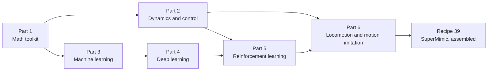

# The Control-to-Learning Math Cookbook

*From PID and LQR to deep reinforcement learning, world models and humanoid locomotion: the mathematics behind the papers in this collection, one recipe at a time.*

This cookbook is written to be read on its own. Every symbol is defined where it first appears and again in [Appendix A](#appendix-a--notation). Each recipe follows the same pattern:

- **Problem**: what question the tool answers.
- **Recipe**: the equations, derived step by step.
- **Worked example**: concrete numbers. Each one is produced by a function in [`examples.py`](examples.py) (`python3 examples.py r08` runs recipe 8).
- **Used in**: the papers from [`../CATALOG.md`](../CATALOG.md) that rely on it.
- **Pitfalls**: what goes wrong in practice.

Prerequisites: high-school algebra and the idea of a derivative. Everything else is built up here.

**Minimum quick-start path.** If you only have time for one resource per part, use these (all free):
1. *Math:* [Mathematics for Machine Learning](https://mml-book.github.io/), chapters 2, 5, 6 and 7.
2. *Control:* [Underactuated Robotics](https://underactuated.mit.edu/), the LQR and trajectory-optimization chapters.
3. *Machine learning:* [Probabilistic Machine Learning: An Introduction](https://probml.github.io/pml-book/book1.html), the regression and classification chapters.
4. *Deep learning:* [Dive into Deep Learning](https://d2l.ai/), the MLP and optimization chapters.
5. *Reinforcement learning:* [Spinning Up](https://spinningup.openai.com/) for practice, and [Sutton & Barto](http://incompleteideas.net/book/the-book-2nd.html) chapters 3–6 and 13 for theory.
6. *Locomotion:* [Modern Robotics](https://hades.mech.northwestern.edu/index.php/Modern_Robotics) chapters 3–6, then train a G1 tracker in [mjlab](https://github.com/mujocolab/mjlab).

Each Part below opens with a longer quick-start table that maps each resource to the recipes it covers.

## Contents

- **Part 1 · Math toolkit:** [R1 Linear algebra](#r1-linear-algebra-for-robots) · [R2 Derivatives, Jacobians, chain rule](#r2-derivatives-jacobians-and-the-chain-rule) · [R3 Probability](#r3-probability-and-expectations) · [R4 Unconstrained optimization](#r4-unconstrained-optimization)
- **Part 2 · Dynamics and classical control:** [R5 State space and discretization](#r5-state-space-models-and-discretization) · [R6 Linearization and stability](#r6-linearization-and-stability) · [R7 PID and PD](#r7-pid-and-pd-control) · [R8 LQR](#r8-linear-quadratic-regulator-lqr) · [R9 Kalman filter](#r9-kalman-filter) · [R10 Rigid-body dynamics and contact](#r10-rigid-body-dynamics-and-contact) · [R11 Trajectory optimization and MPC](#r11-trajectory-optimization-and-model-predictive-control) · [R12 Constrained optimization and whole-body QP](#r12-constrained-optimization-kkt-and-whole-body-qp-control) · [R13 Locomotion templates](#r13-locomotion-templates-lipm-zmp-capture-point-centroidal-dynamics)
- **Part 3 · Machine learning:** [R14 Regression and maximum likelihood](#r14-regression-and-maximum-likelihood) · [R15 Classification, cross-entropy, KL](#r15-classification-cross-entropy-and-kl-divergence) · [R16 Gaussian processes](#r16-gaussian-processes-and-uncertainty) · [R17 Generalization and distribution shift](#r17-generalization-and-distribution-shift)
- **Part 4 · Deep learning:** [R18 Neural networks and backpropagation](#r18-neural-networks-and-backpropagation) · [R19 Optimizers](#r19-optimizers-sgd-momentum-adam-clipping-schedules) · [R20 Architectures](#r20-architectures-cnn-rnn-transformer) · [R21 BPTT and gradient stability](#r21-backpropagation-through-time-and-gradient-stability) · [R22 Generative models](#r22-generative-models-vae-gan-diffusion-flow-matching)
- **Part 5 · Reinforcement learning:** [R23 MDPs and returns](#r23-mdps-pomdps-and-returns) · [R24 Bellman equations and DP](#r24-bellman-equations-and-dynamic-programming) · [R25 TD and Q-learning](#r25-temporal-difference-learning-q-learning-dqn) · [R26 Policy gradients](#r26-policy-gradients-score-function-vs-pathwise) · [R27 Advantages and GAE](#r27-advantages-gae-and-λ-returns) · [R28 TRPO and PPO](#r28-trpo-and-ppo) · [R29 Off-policy actor-critic](#r29-off-policy-actor-critic-ddpg-and-sac) · [R30 Model-based RL](#r30-model-based-rl-and-world-models) · [R31 Analytic-gradient actor-critic](#r31-short-horizon-actor-critic-with-analytic-gradients) · [R32 Imitation learning](#r32-imitation-learning-bc-dagger-gailamp-irl) · [R33 Sim-to-real](#r33-sim-to-real-domain-randomization-teacherstudent-actuator-models)
- **Part 6 · Locomotion and motion imitation:** [R34 Kinematics and retargeting](#r34-kinematics-jacobians-inverse-kinematics-retargeting) · [R35 Rotations](#r35-rotations-matrices-quaternions-log-map) · [R36 Tracking rewards](#r36-motion-tracking-rewards) · [R37 Locomotion task rewards](#r37-locomotion-task-rewards-terminations-curricula) · [R38 Reset sampling](#r38-reference-state-initialization-and-adaptive-sampling) · [R39 SuperMimic, assembled](#r39-supermimic-assembled-from-the-recipes)
- **Appendices:** [A Notation](#appendix-a--notation) · [B Cheat sheet](#appendix-b--one-page-cheat-sheet) · [C Recipe → paper map](#appendix-c--recipe--paper-map) · [D Further reading](#appendix-d--further-reading)

---

# Part 1 · Math toolkit

**Quick start.** Read these first if the math in this part is new to you.

| Resource | Access | Start with | Covers |
|---|---|---|---|
| [Mathematics for Machine Learning](https://mml-book.github.io/), Deisenroth, Faisal & Ong (2020) | Free PDF | Chapters on linear algebra, vector calculus, probability, continuous optimization | R1–R4 |
| [Essence of Linear Algebra](https://www.3blue1brown.com/topics/linear-algebra), 3Blue1Brown | Free videos | The whole series (about 3 hours) for geometric intuition | R1 |
| [MIT 18.06 Linear Algebra](https://ocw.mit.edu/courses/18-06-linear-algebra-spring-2010/), Gilbert Strang | Free course | Lectures on eigenvalues and positive-definite matrices | R1, R6 |
| [Convex Optimization](https://web.stanford.edu/~boyd/cvxbook/), Boyd & Vandenberghe (2004) | Free PDF | The duality chapter (Lagrangians, KKT conditions) | R4, R12 |
| [The Matrix Cookbook](https://www.math.uwaterloo.ca/~hwolkowi/matrixcookbook.pdf), Petersen & Pedersen | Free PDF | Look up matrix derivatives as you need them | R2, R18 |

## R1. Linear algebra for robots

**Problem.** Robot states, forces and network layers are all vectors and matrices. You need to multiply them, solve equations with them, and know when a matrix "amplifies" or "shrinks" things.

**Recipe.**

- **Vectors and matrices.** A state $x\in\mathbb R^n$ is a column of $n$ numbers. A matrix $A\in\mathbb R^{m\times n}$ maps $\mathbb R^n\to\mathbb R^m$ by $y = Ax$, where $y_i=\sum_j A_{ij}x_j$.
- **Transpose and inner product.** $(A^\top)_{ij}=A_{ji}$, and $x^\top y=\sum_i x_iy_i$. The norm is $\lVert x\rVert=\sqrt{x^\top x}$.
- **Solving $Ax=b$.** If $A$ is square and invertible, $x=A^{-1}b$. Never form $A^{-1}$ in code; call a linear solver.
- **Eigenvalues.** $Av=\lambda v$. For a linear system $x_{k+1}=Ax_k$, the state shrinks along $v$ if $\lvert\lambda\rvert<1$ and grows if $\lvert\lambda\rvert>1$. The **spectral radius** $\rho(A)=\max\lvert\lambda_i\rvert$ decides stability (R6) and gradient explosion (R21).
- **Positive definite.** A symmetric $P\succ0$ means $x^\top Px>0$ for all $x\neq0$. Quadratic costs $x^\top Qx$ use $Q\succeq0$ ("never negative").
- **Pseudo-inverse.** For a non-square $J$, the minimum-norm solution of $J\dot q = v$ is $\dot q = J^\top(JJ^\top)^{-1}v$, used in inverse kinematics (R34).
- **Cross product as a matrix.** $a\times b = [a]_\times b$ with $[a]_\times=\begin{bmatrix}0&-a_3&a_2\\a_3&0&-a_1\\-a_2&a_1&0\end{bmatrix}$. This appears in torques (R13) and rotations (R35).

**Used in.** Everything. Eigenvalues return in R6, R8 and R21.

**Pitfalls.** Mixing row and column conventions. Inverting ill-conditioned matrices; add damping $\lambda^2I$.

## R2. Derivatives, Jacobians and the chain rule

**Problem.** Optimization and learning need to know how outputs change when inputs change.

**Recipe.**

- **Gradient.** For a scalar function $f:\mathbb R^n\to\mathbb R$, $\nabla f=[\partial f/\partial x_1,\dots,\partial f/\partial x_n]^\top$. It points uphill.
- **Jacobian.** For a vector function $g:\mathbb R^n\to\mathbb R^m$, $J_{ij}=\partial g_i/\partial x_j$, an $m\times n$ matrix. The robot Jacobian $J(q)$ maps joint velocities to end-effector velocities (R34). The world-model Jacobians $\partial f_\omega/\partial\hat s$ and $\partial f_\omega/\partial a$ carry policy gradients (R31).
- **Chain rule.** If $y=g(x)$ and $L=h(y)$, then $\dfrac{\partial L}{\partial x}=\dfrac{\partial L}{\partial y}\dfrac{\partial y}{\partial x}$. For a composition of $T$ functions, gradients are **products of $T$ Jacobians**. This one fact explains backpropagation (R18), backpropagation through time (R21) and analytic policy gradients (R26, R31).
- **Taylor expansion.** $f(x+\delta)\approx f(x)+\nabla f^\top\delta+\tfrac12\delta^\top H\delta$, with Hessian $H_{ij}=\partial^2f/\partial x_i\partial x_j$. Linearization (R6), Newton's method (R4) and iLQR (R11) are all truncated Taylor series.
- **Reverse vs forward mode.** For a scalar loss of many parameters, *reverse mode* (backprop) computes the whole gradient in about the cost of one forward pass. This is why deep learning is feasible.

**Used in.** R4, R6, R11, R18, R21, R26, R31, R34.

**Pitfalls.** Non-smooth functions such as contact, `max` and `clip` have undefined or misleading derivatives at their kinks (R10, R31).

## R3. Probability and expectations

**Problem.** Sensors are noisy, simulators are randomized, and policies are stochastic. You need to reason about averages and uncertainty.

**Recipe.**

- **Expectation.** $\mathbb E_{x\sim p}[f(x)]=\int f(x)p(x)\,dx$. The **Monte Carlo** estimate is $\frac1N\sum_i f(x_i)$ with $x_i\sim p$, and its error shrinks like $1/\sqrt N$. All of RL estimates expectations this way.
- **Variance.** $\mathrm{Var}[x]=\mathbb E[(x-\mathbb E x)^2]$. Low-variance gradient estimators need fewer samples (R26).
- **Gaussian.** $\mathcal N(\mu,\Sigma)$ has density $\propto\exp(-\tfrac12(x-\mu)^\top\Sigma^{-1}(x-\mu))$. Linear maps keep Gaussians Gaussian: if $x\sim\mathcal N(\mu,\Sigma)$ then $Ax+b\sim\mathcal N(A\mu+b,A\Sigma A^\top)$. This is the engine of the Kalman filter (R9).
- **Reparameterization.** A sample $a\sim\mathcal N(\mu,\sigma^2)$ can be written $a=\mu+\sigma\varepsilon$ with $\varepsilon\sim\mathcal N(0,1)$. The randomness moves into $\varepsilon$, so $a$ becomes a differentiable function of $\mu$ and $\sigma$ (R22, R26).
- **Bayes' rule.** $p(\theta\mid D)=p(D\mid\theta)p(\theta)/p(D)$: posterior ∝ likelihood × prior (R9, R16).
- **Entropy and KL.** $H(p)=-\mathbb E_p[\log p]$ measures spread. $\mathrm{KL}(p\Vert q)=\mathbb E_p[\log p-\log q]\ge0$ measures mismatch (R15, R22, R28, R29).
- **Uniform randomization.** $\xi\sim\mathcal U[a,b]$ is how simulators randomize friction and masses (R33). SuperMimic uses $\mu\sim\mathcal U[0.3,1.2]$.

**Used in.** R9, R14–R16, R22, R26–R29, R33.

**Pitfalls.** Monte Carlo averages over too few samples. Confusing $\mathrm{KL}(p\Vert q)$ with $\mathrm{KL}(q\Vert p)$; they are not symmetric.

## R4. Unconstrained optimization

**Problem.** Find parameters $x$ that minimize a cost $f(x)$: controller gains, network weights, trajectories.

**Recipe.**

- **Gradient descent.** $x\leftarrow x-\alpha\nabla f(x)$ with step size (learning rate) $\alpha$. On the quadratic $f=\tfrac12x^\top Ax-b^\top x$ it converges only if $\alpha<2/\lambda_{\max}(A)$. Badly scaled problems (large ratio $\lambda_{\max}/\lambda_{\min}$) converge slowly.
- **Newton's method.** $x\leftarrow x-H^{-1}\nabla f$. It solves a quadratic in one step, but needs second derivatives.
- **Stochastic gradient descent.** Replace $\nabla f$ with a noisy minibatch estimate. That is enough for learning (R19).
- **Line search and trust regions.** Limit each step so the local model stays valid. This idea reappears as TRPO/PPO's trust region on policies (R28).

**Worked example (`r04`).** For $A=\begin{bmatrix}3&0.5\\0.5&1\end{bmatrix}$ and $b=[1,2]^\top$, the minimizer is $x^*=[0,2]$. Gradient descent with $\alpha=0.3$ reaches it in 50 steps, and Newton's method in one. The eigenvalues are 0.88 and 3.12, so gradient descent diverges for $\alpha>2/3.12=0.64$.

**Used in.** Every training loop. Newton and Gauss–Newton steps appear inside MPC solvers (R11).

**Pitfalls.** A learning rate that is too large diverges; one that is too small stalls. Non-convex costs have many local minima.

---

# Part 2 · Dynamics and classical control

**Quick start.**

| Resource | Access | Start with | Covers |
|---|---|---|---|
| [Underactuated Robotics](https://underactuated.mit.edu/), Russ Tedrake (MIT course notes) | Free, with runnable code | Chapters "Linear Quadratic Regulators", "Trajectory Optimization" and "Simple Models of Walking and Running" | R6, R8, R11, R13 |
| [Feedback Systems](https://fbswiki.org/), Åström & Murray | Free PDF | Chapters on state feedback and on PID control | R5–R7 |
| [Modern Robotics](https://hades.mech.northwestern.edu/index.php/Modern_Robotics), Lynch & Park (2017) | Free PDF + video lectures | Chapters on dynamics of open chains and on robot control | R10, R12 |
| [Kalman and Bayesian Filters in Python](https://github.com/rlabbe/Kalman-and-Bayesian-Filters-in-Python), Roger Labbe | Free Jupyter book | From the start through the multivariate Kalman filter | R9 |
| [Model Predictive Control: Theory, Computation, and Design](https://sites.engineering.ucsb.edu/~jbraw/mpc/), Rawlings, Mayne & Diehl (2nd ed.) | Free PDF | Chapter 1, getting started with MPC | R11 |
| *Rigid Body Dynamics Algorithms*, Featherstone (Springer, 2008) | Book | Reference for the algorithms inside simulators | R10 |
| *Introduction to Humanoid Robotics*, Kajita et al. (Springer, 2014) | Book | ZMP and linear inverted pendulum chapters | R13 |
| *Probabilistic Robotics*, Thrun, Burgard & Fox (MIT Press, 2005) | Book | Gaussian filters chapter | R9 |

## R5. State-space models and discretization

**Problem.** Describe how a system evolves and turn continuous physics into computer-friendly time steps.

**Recipe.**

- **Continuous time:** $\dot x=f(x,u)$. In the linear case, $\dot x=A_cx+B_cu$.
- **Discrete time:** $x_{k+1}=f_d(x_k,u_k)$, with step $\Delta t$.
- **Forward Euler:** $x_{k+1}=x_k+\Delta t\,f(x_k,u_k)$, so $A=I+\Delta tA_c$ and $B=\Delta tB_c$. Simple, but can go unstable for stiff systems.
- **Zero-order hold (exact for linear systems with constant input over the step):** $A=e^{A_c\Delta t}$ and $B=\int_0^{\Delta t}e^{A_c\tau}d\tau\,B_c$.
- **Control rates in practice.** Learned humanoid policies act at 50 Hz ($\Delta t=0.02$ s). MuJoCo Warp computes each SuperMimic step as four 5 ms physics substeps. Joint PD loops run at 0.5–1 kHz.

**Worked example (`r05`).** For the double integrator ($\ddot p=u$, state $[p,\dot p]$) with $\Delta t=0.1$, Euler and ZOH give the same $A=\begin{bmatrix}1&0.1\\0&1\end{bmatrix}$. Their $B$ matrices differ: Euler gives $[0,0.1]^\top$, while ZOH gives $[0.005,0.1]^\top$ and correctly includes the $\tfrac12u\Delta t^2$ position change.

**Used in.** Every simulator and every MPC (R11). A learned world model $\hat s_{t+1}=f_\omega(\hat s_t,a_t,\xi)$ is a learned $f_d$ (R30).

**Pitfalls.** Too large a $\Delta t$ for stiff contact. Inconsistent rates between policy, PD loop and simulator.

## R6. Linearization and stability

**Problem.** Is an equilibrium stable? How does a nonlinear system behave near it?

**Recipe.**

- **Linearize** around an equilibrium $(x^*,u^*)$ with $f(x^*,u^*)=0$: $\dot{\delta x}\approx A\,\delta x+B\,\delta u$, where $A=\partial f/\partial x$ and $B=\partial f/\partial u$, both evaluated at the equilibrium.
- **Stability test.** Continuous time: stable if every eigenvalue of $A$ has negative real part. Discrete time: stable if every $\lvert\lambda\rvert<1$.
- **Lyapunov's method.** If some $V(x)>0$ (an "energy") satisfies $\dot V<0$ away from $x^*$, then $x^*$ is stable. For linear systems, $V=x^\top Px$ with $A^\top P+PA\prec0$. The LQR value function in R8 is exactly such a $V$.

**Worked example (`r06`).** For the pendulum $\ddot\theta=-(g/l)\sin\theta$ with $g/l=9.81$:
- hanging down, the eigenvalues are $\pm3.13i$: it oscillates and is marginally stable;
- inverted, the eigenvalues are $\pm3.13$: the positive one makes it unstable.

A balancing robot is an inverted pendulum (R13), and that positive eigenvalue is why it needs feedback.

**Used in.** R8, R13. The intuition carries over to gradient stability (R21).

**Pitfalls.** A linearization is only valid near the equilibrium. Contact switches change $A$ abruptly.

## R7. PID and PD control

**Problem.** Drive a measured quantity, such as a joint angle, to a target with simple feedback.

**Recipe.**

- **PID:** $u=K_pe+K_i\int e\,dt+K_d\dot e$, where $e=q^{\text{ref}}-q$.
- **Joint PD (used under almost every learned policy):** $\tau=K_p(q^{\text{sp}}-q)-K_d\dot q$. The policy outputs the set-point $q^{\text{sp}}$, and the PD loop turns it into torque at high rate.
- **Second-order intuition.** For unit inertia, the closed loop is $\ddot q+K_d\dot q+K_pq=K_pq^{\text{ref}}$, with natural frequency $\omega_n=\sqrt{K_p}$ and damping $\zeta=K_d/(2\sqrt{K_p})$. $\zeta=1$ means no overshoot; $\zeta<1$ means it rings.
- **Low-gain PD as torque control.** BeyondMimic and SuperMimic use low gains, so the set-point acts as a proxy for torque rather than a position command. SuperMimic writes $q^{\text{sp}}=\alpha a_t+q^0$.

**Worked example (`r07`).** With $K_p=100$, $K_d=20$: $\omega_n=10$ rad/s, $\zeta=1.0$, overshoot 0%. With $K_d=5$: $\zeta=0.25$, overshoot 44.4%.

**Used in.** All learned locomotion and humanoid papers. Raibert-era and industrial controllers.

**Pitfalls.** Integral windup. Derivative noise. Gains that differ between simulator and robot (R33).

## R8. Linear-quadratic regulator (LQR)

**Problem.** Find the optimal feedback $u=-Kx$ for a linear system with a quadratic cost. It is the one optimal control problem with a closed-form answer.

**Recipe.**

1. **Problem:** minimize $\sum_{k=0}^\infty(x_k^\top Qx_k+u_k^\top Ru_k)$ subject to $x_{k+1}=Ax_k+Bu_k$.
2. **Guess** that the optimal cost-to-go is quadratic, $V(x)=x^\top Px$. This is the Bellman equation (R24) for this problem.
3. **Bellman step:** $x^\top Px=\min_u\big[x^\top Qx+u^\top Ru+(Ax+Bu)^\top P(Ax+Bu)\big]$.
4. **Set the derivative in $u$ to zero:** $2Ru+2B^\top P(Ax+Bu)=0$, so $u=-Kx$ with $K=(R+B^\top PB)^{-1}B^\top PA$.
5. **Substitute back** to get the discrete algebraic **Riccati equation**:

   $$P=Q+A^\top PA-A^\top PB(R+B^\top PB)^{-1}B^\top PA$$

6. **Solve** by iterating that equation from $P=Q$ until it converges (the finite-horizon version runs it backward in time).

**Worked example (`r08`).** Double integrator, $\Delta t=0.1$, $Q=\mathrm{diag}(1,0.1)$, $R=0.01$. The gain is $K=[7.61,\,4.58]$ and the closed-loop eigenvalues are $0.75\pm0.12i$ (inside the unit circle, so stable). Starting from 1 m, the position is 0.113 m after 1 s and below 5 mm after 2 s.

**Used in.** LQR is DP's special case (R24). iLQR/DDP (R11) applies it repeatedly to nonlinear systems. Recht's survey uses it to benchmark RL sample complexity.

**Pitfalls.** It needs an accurate linear model. Constraints are not handled; that is MPC's job (R11).

## R9. Kalman filter

**Problem.** Estimate a hidden state, such as base velocity or position, from noisy sensors and a motion model.

**Recipe.** Model: $x_{k+1}=Ax_k+Bu_k+w$ with $w\sim\mathcal N(0,Q)$, and measurements $z_k=Hx_k+v$ with $v\sim\mathcal N(0,R)$.

1. **Predict:** $\hat x^-=A\hat x+Bu$ and $P^-=APA^\top+Q$.
2. **Gain:** $K=P^-H^\top(HP^-H^\top+R)^{-1}$. This weights the measurement by how much you trust it relative to the prediction.
3. **Update:** $\hat x=\hat x^-+K(z-H\hat x^-)$ and $P=(I-KH)P^-$.

The filter is Bayes' rule (R3) for Gaussians. The extended Kalman filter (EKF) linearizes a nonlinear $f$ and $h$ at each step (R6).

**Worked example (`r09`).** Estimating a constant 2.0 m position from measurements with 0.5 m noise, starting at $\hat x=0$ with $P=1$:
- after 1 measurement: $\hat x=1.65$, $K=0.80$;
- after 5: $\hat x=1.92$, $P=0.048$;
- after 20: $P=0.013$ and $K=0.05$, so new data barely moves the estimate.

**Used in.** State estimation on every legged robot (IMU plus leg kinematics). Learned policies see the filter's outputs or raw proprioception. Teacher–student methods (R33) learn an implicit estimator from history.

**Pitfalls.** Wrong noise covariances. Slipping feet break leg-odometry assumptions.

## R10. Rigid-body dynamics and contact

**Problem.** Write the equations of motion of an articulated robot touching the world.

**Recipe.**

1. **Lagrangian for one link** (pendulum, mass $m$, length $l$, angle $\theta$ from hanging): $L=T-U=\tfrac12ml^2\dot\theta^2+mgl\cos\theta$. The Euler–Lagrange equation $\frac{d}{dt}\frac{\partial L}{\partial\dot\theta}-\frac{\partial L}{\partial\theta}=\tau$ gives $ml^2\ddot\theta+mgl\sin\theta=\tau$.
2. **Many links** give the **manipulator equation**:

   $$M(q)\ddot q+C(q,\dot q)\dot q+g(q)=S^\top\tau+\sum_cJ_c(q)^\top\lambda_c$$

   - $M$ is the mass matrix (symmetric, positive definite) and $C\dot q$ collects Coriolis and centrifugal terms. Write $h(q,\dot q)=C\dot q+g$ for short.
   - $S$ selects the actuated joints. A floating base adds 6 unactuated coordinates (a G1 has $6+29=35$), so $S$ has no rows for them: the robot is **underactuated**.
   - $J_c$ is the Jacobian of contact point $c$, and $\lambda_c$ is the contact force it receives.
3. **Contact conditions.** With gap function $\phi_c(q)$ and normal force $\lambda_{c,n}$:
   - **Complementarity:** $0\le\lambda_{c,n}\perp\phi_c(q)\ge0$. Force can push but not pull, and only acts at zero gap.
   - **Coulomb friction cone:** $\lVert\lambda_{c,t}\rVert\le\mu\lambda_{c,n}$.
   - While a contact holds, it doesn't move: $J_c\ddot q+\dot J_c\dot q=0$.
4. **Simulators** (MuJoCo, Isaac, MuJoCo Warp) solve these equations each step, usually relaxing complementarity into a convex problem.

**Worked example (`r10`).** With $\mu=0.6$:
- $f=[10,0,30]$ N is inside the cone ($10\le18$);
- $[25,0,30]$ slips ($25>18$);
- $[5,0,-2]$ is invalid because it pulls on the ground.

**Used in.** Every model-based controller (R11–R13) and every simulator used for RL. Its non-smoothness is why SuperMimic learns a smooth surrogate (R31; Suh et al. 2022).

**Pitfalls.** Contact makes the dynamics hybrid: the set of active contacts switches discretely. Gradients through the switches can be zero, infinite or misleading.

## R11. Trajectory optimization and model predictive control

**Problem.** Plan a whole sequence of controls that minimizes cost while respecting dynamics and constraints, and re-plan as the world changes.

**Recipe.**

- **Optimal control problem:**

  $$\min_{x_{0:N},\,u_{0:N-1}}\ \sum_{k=0}^{N-1}\ell(x_k,u_k)+\ell_f(x_N)\quad\text{s.t. } x_{k+1}=f(x_k,u_k),\ h(x_k,u_k)\le0,\ x_0=\hat x$$

- **Shooting** optimizes only $u$ and rolls the dynamics forward. **Direct transcription/collocation** optimizes $x$ and $u$ together with dynamics as equality constraints, which is better conditioned.
- **iLQR / DDP** works on nonlinear dynamics by repeating LQR along the current trajectory.
  1. Linearize dynamics as $f_x,f_u$ and quadratize cost as $\ell_x,\ell_u,\ell_{xx},\ell_{uu},\ell_{ux}$.
  2. Backward pass, with $V'$ the next step's value terms:
     - $Q_x=\ell_x+f_x^\top V'_x$ and $Q_u=\ell_u+f_u^\top V'_x$;
     - $Q_{xx}=\ell_{xx}+f_x^\top V'_{xx}f_x$, $Q_{uu}=\ell_{uu}+f_u^\top V'_{xx}f_u$, $Q_{ux}=\ell_{ux}+f_u^\top V'_{xx}f_x$.
  3. Gains: $k=-Q_{uu}^{-1}Q_u$ and $K=-Q_{uu}^{-1}Q_{ux}$.
  4. Forward pass: $u_k\leftarrow u_k+\alpha k+K(x_k-\bar x_k)$.
- **MPC (receding horizon).** Solve the problem above every control tick from the current estimate $\hat x$, apply only $u_0$, and repeat. Feedback comes from re-planning.
- **Convex MPC for legged robots** (MIT Cheetah 3). Use single-rigid-body dynamics (R13) with small-angle rotations and fixed foot contacts. The dynamics become linear in the ground forces, and the friction cone is approximated by a pyramid. Each tick is then a QP solved in about a millisecond.
- **Contact-implicit trajectory optimization** (Posa 2014) adds the complementarity conditions from R10 as constraints, so the optimizer also chooses *when* contact happens.

**Used in.** Atlas (Kuindersma 2016), MIT Cheetah (Di Carlo 2018, Kim 2019), guided policy search, DTC (RL tracking trajectory-optimization plans). TD-MPC and SuperMimic's short horizon plus terminal value both borrow MPC's structure (R31).

**Pitfalls.** Local minima. Fixed gait schedules. Solve time limits horizon length and model detail.

## R12. Constrained optimization, KKT and whole-body QP control

**Problem.** Minimize a cost subject to equality and inequality constraints, for example torques that realize desired motions without slipping.

**Recipe.**

- **Lagrangian:** $\mathcal L(x,\nu,\mu)=f(x)+\nu^\top g(x)+\mu^\top h(x)$ for constraints $g=0$ and $h\le0$.
- **KKT conditions at an optimum:**
  - stationarity: $\nabla f+\nabla g^\top\nu+\nabla h^\top\mu=0$;
  - feasibility: $g=0$, $h\le0$;
  - complementary slackness: $\mu\ge0$ and $\mu_ih_i=0$.

  Complementary slackness has the same structure as contact complementarity in R10.
- **Quadratic program (QP):** $\min\tfrac12x^\top Hx+c^\top x$ subject to linear constraints. It is convex if $H\succeq0$ and solvable in milliseconds.
- **Whole-body control (WBC) as a QP.** Choose $(\ddot q,\tau,\lambda)$ to track several task accelerations $\ddot x_i^{\text{des}}$ (center of mass, swing foot, torso orientation):

  $$\min_{\ddot q,\tau,\lambda}\ \sum_iw_i\lVert J_i\ddot q+\dot J_i\dot q-\ddot x_i^{\text{des}}\rVert^2$$

  subject to:
  - the dynamics: $M\ddot q+h=S^\top\tau+J_c^\top\lambda$;
  - no-slip contacts: $J_c\ddot q+\dot J_c\dot q=0$;
  - friction pyramids on $\lambda$;
  - torque limits.

**Used in.** The Atlas stack, the MIT Cheetah whole-body impulse controller, and most model-based humanoids. Learned policies replace this whole layer with a network plus PD.

**Pitfalls.** Conflicting tasks need a priority order. An infeasible QP needs slack variables.

## R13. Locomotion templates: LIPM, ZMP, capture point, centroidal dynamics

**Problem.** A 35-dimensional humanoid is too complex to plan with directly. Reduced "template" models capture the physics of balance.

**Recipe.**

- **Linear inverted pendulum (LIPM).** Assume the center of mass (COM) stays at constant height $z_0$ with no angular momentum. Then

  $$\ddot x=\omega^2(x-p),\qquad\omega=\sqrt{g/z_0}$$

  where $p$ is the center of pressure, also called the zero-moment point (ZMP).
- **ZMP criterion.** The robot doesn't tip as long as $p$ stays inside the support polygon (the convex hull of the feet). ASIMO-era walking plans COM trajectories to keep it there.
- **Capture point (divergent component of motion).** Define $\xi=x+\dot x/\omega$. Then $\dot\xi=\omega(\xi-p)$, which is unstable. To stop, step onto (or put the ZMP at) $\xi$. This is the core of step-placement and push recovery.
- **Centroidal dynamics (exact for any robot):** $m\ddot c=mg+\sum_if_i$ and $\dot k=\sum_i(r_i-c)\times f_i$. Here $c$ is the COM, $k$ the angular momentum about it, and $f_i$ the force at contact $r_i$.
- **Single rigid body dynamics (SRBD).** Treat the robot as one body with inertia $I$: $I\dot\omega+\omega\times I\omega=\sum_i(r_i-c)\times f_i$. This is the model inside convex MPC (R11).

**Worked example (`r13`).** At COM height 0.8 m, $\omega=3.50\ \text{s}^{-1}$. A COM at $x=0$ moving at 0.5 m/s has its capture point at 0.143 m: step there to stop. At 1.0 m/s from $x=0.05$, the capture point moves to 0.336 m.

**Used in.** Model-based humanoids and quadrupeds. It also explains what learned policies discover implicitly: fast steps under pushes in SuperMimic's push-recovery test.

**Pitfalls.** LIPM ignores arm swing and height changes, and breaks down for running, flips and side rolls. Those are the motions where learned tracking (R36) shines.

---

# Part 3 · Machine learning

**Quick start.**

| Resource | Access | Start with | Covers |
|---|---|---|---|
| [Probabilistic Machine Learning: An Introduction](https://probml.github.io/pml-book/book1.html), Kevin Murphy (2022) | Free PDF | Chapters on linear regression, logistic regression and information theory | R14, R15, R17 |
| [Pattern Recognition and Machine Learning](https://www.microsoft.com/en-us/research/publication/pattern-recognition-machine-learning/), Christopher Bishop (2006) | Free PDF | Chapter 3 (linear models for regression) and chapter 4 (classification) | R14, R15 |
| [Gaussian Processes for Machine Learning](https://gaussianprocess.org/gpml/), Rasmussen & Williams (2006) | Free PDF | Chapter 2 (regression) | R16 |

## R14. Regression and maximum likelihood

**Problem.** Fit a function to data: an actuator model, a dynamics model, a value function.

**Recipe.**

- **Least squares.** Minimize $\lVert Xw-y\rVert^2$. Setting the gradient to zero gives the normal equations, $w=(X^\top X)^{-1}X^\top y$.
- **Why squares? Maximum likelihood.** If $y=f_w(x)+\varepsilon$ with $\varepsilon\sim\mathcal N(0,\sigma^2)$, then $-\log p(y\mid x,w)=\frac{1}{2\sigma^2}(y-f_w(x))^2+\text{const}$. Minimizing mean squared error *is* maximum likelihood under Gaussian noise.
- **Ridge regularization.** $\lVert Xw-y\rVert^2+\lambda\lVert w\rVert^2$ gives $w=(X^\top X+\lambda I)^{-1}X^\top y$. It trades bias for lower variance and is a Gaussian prior on $w$ (R3).
- **Nonlinear regression.** Replace $Xw$ with a neural network $f_\theta(x)$ (R18) and minimize the same loss by SGD.

**Worked example (`r14`).** For 50 noisy samples of $y=0.5-2x$, least squares recovers $w=[0.509,-1.988]$. Ridge with $\lambda=1$ shrinks the slope to $-1.872$.

**Used in.**
- Actuator networks (Hwangbo 2019).
- World-model state and reward losses, the squared terms of SuperMimic's Eq. 1 (R30).
- Critic regression to returns (R27).
- Behavior-cloning regression (R32).

**Pitfalls.** Outliers dominate squared losses. Extrapolating outside the data.

## R15. Classification, cross-entropy and KL divergence

**Problem.** Predict probabilities, for example "will the robot fall?" or "is this motion from the dataset?"

**Recipe.**

- **Logistic model:** $p=\sigma(z)=1/(1+e^{-z})$, where $z=f_\theta(x)$.
- **Binary cross-entropy (BCE)** is the negative log-likelihood of a Bernoulli label $y\in\{0,1\}$: $\mathrm{BCE}(p,y)=-[y\log p+(1-y)\log(1-p)]$.
- **Multiclass:** softmax $p_i=e^{z_i}/\sum_je^{z_j}$ with cross-entropy $-\log p_{\text{true}}$.
- **Cross-entropy and KL.** Cross-entropy minus the entropy of the data is $\mathrm{KL}(\text{data}\Vert\text{model})$. Minimizing cross-entropy pulls the model distribution toward the data.
- **KL between Gaussians:** $\mathrm{KL}(\mathcal N_1\Vert\mathcal N_2)=\log\frac{\sigma_2}{\sigma_1}+\frac{\sigma_1^2+(\mu_1-\mu_2)^2}{2\sigma_2^2}-\frac12$. Used for TRPO's trust region (R28) and the VAE (R22).

**Worked example (`r15`).** For label $y=1$:
- $p=0.9$ costs 0.105;
- $p=0.6$ costs 0.511;
- $p=0.1$ costs 2.303.

Confident mistakes are punished hardest.

**Used in.** SuperMimic's termination head, $\mathrm{BCE}(\hat d,d)$ in Eq. 1. GAN and AMP discriminators (R22, R32). Language and vision-language-action model token losses.

**Pitfalls.** $\log0$: clamp $p$ or work from logits. Class imbalance, since falls are rare.

## R16. Gaussian processes and uncertainty

**Problem.** Learn a function from little data *and* know where you are uncertain.

**Recipe.**

- **Prior:** $f\sim\mathcal{GP}(0,k)$, with a kernel such as $k(x,x')=s^2\exp(-\lVert x-x'\rVert^2/2\ell^2)$.
- **Posterior at a new point $x_*$**, given data $(X,y)$ with noise $\sigma_n^2$ and $k_*=k(X,x_*)$:
  - mean: $\mu_*=k_*^\top(K+\sigma_n^2I)^{-1}y$;
  - variance: $\sigma_*^2=k(x_*,x_*)-k_*^\top(K+\sigma_n^2I)^{-1}k_*$.
- **Why it matters for control.** PILCO propagates the variance through a rollout, so the policy avoids regions where the model is unsure. That defeats model bias with very little data.
- **Neural alternatives.** Ensembles of networks (MBPO, RWM-U) estimate uncertainty when GPs don't scale. Cost is $O(n^3)$ in the number of data points.

**Used in.** PILCO (2011), uncertainty-aware world models (RWM-U), learning-based MPC (Hewing 2020).

**Pitfalls.** Scaling beyond about $10^4$ points. Choice of kernel length-scale.

## R17. Generalization and distribution shift

**Problem.** Training error is low; will it work on new data, a new robot, or real hardware?

**Recipe.**

- **Train/validation/test splits** estimate performance on unseen data.
- **Bias–variance.** Expected error = bias² + variance + noise. Bigger models reduce bias, and more data reduces variance.
- **Covariate shift.** Training inputs come from $p_{\text{train}}(x)$ but deployment sees $p_{\text{test}}(x)$. In control, *the policy itself changes the input distribution*. This is the root cause of:
  - compounding errors in behavior cloning (R32);
  - model exploitation in model-based RL (R30);
  - the sim-to-real gap (R33).
- **Coverage vs generalization.** SuperMimic's 129,514-motion benchmark contains its training motions. Its failure count measures coverage, not generalization to new motions.

**Used in.** Interpreting every result table in the catalog.

**Pitfalls.** Evaluating on training motions or training terrains and calling it generalization.

---

# Part 4 · Deep learning

**Quick start.**

| Resource | Access | Start with | Covers |
|---|---|---|---|
| [Dive into Deep Learning](https://d2l.ai/), Zhang, Lipton, Li & Smola | Free, runnable code | Chapters on MLPs, optimization algorithms, RNNs and attention | R18–R21 |
| [Understanding Deep Learning](https://udlbook.github.io/udlbook/), Simon Prince (2023) | Free PDF + notebooks | Chapters on backpropagation, fitting models and diffusion | R18, R19, R22 |
| [Neural Networks: Zero to Hero](https://karpathy.ai/zero-to-hero.html), Andrej Karpathy | Free videos | The first lecture, backpropagation from scratch | R18 |
| [Deep Learning](https://www.deeplearningbook.org/), Goodfellow, Bengio & Courville (2016) | Free online | Chapters 6 (deep feedforward networks), 8 (optimization) and 10 (sequence modeling) | R18–R21 |
| [Deep Learning: Foundations and Concepts](https://www.bishopbook.com/), Bishop & Bishop (2024) | Free online | Chapters on generative models | R22 |
| [What are Diffusion Models?](https://lilianweng.github.io/posts/2021-07-11-diffusion-models/), Lilian Weng | Free blog post | The whole post | R22 |

## R18. Neural networks and backpropagation

**Problem.** Represent complex functions such as policies, critics and dynamics models, and compute their gradients efficiently.

**Recipe.**

- **Multilayer perceptron (MLP):** $h_1=\phi(W_1x+b_1)$, then $h_2=\phi(W_2h_1+b_2)$, …, output $y=W_Lh_{L-1}+b_L$. The activation $\phi$ can be tanh, ReLU ($\max(0,z)$) or ELU/SiLU.
- **Backpropagation** is the chain rule (R2) applied from the loss backward. For $z=Wx+b$, $h=\phi(z)$ and loss $L$:
  1. Upstream gradient $\delta_h=\partial L/\partial h$.
  2. $\delta_z=\delta_h\odot\phi'(z)$; for tanh, $\phi'=1-h^2$.
  3. $\partial L/\partial W=\delta_z\,x^\top$ and $\partial L/\partial b=\delta_z$.
  4. Pass $\delta_x=W^\top\delta_z$ to the layer below.
- **Universal approximation.** Wide enough MLPs can approximate any continuous function on a bounded domain. Depth makes this efficient.

**Worked example (`r18`).** For a 2–3–1 tanh MLP with squared loss, the backpropagated $\partial L/\partial W_1$ matches central finite differences to $9\times10^{-12}$. Use this check whenever you hand-derive a gradient.

**Network sizes in the papers.**
- SuperMimic's dynamics model is an MLP with three hidden layers of 2048 units.
- Its policy encoder has hidden layers (2048, 1024, 512, 256) and its decoder the same.
- Its critic has hidden layers (256, 128).

**Pitfalls.** Dead ReLUs. Saturated tanh units. Forgetting to normalize inputs.

## R19. Optimizers: SGD, momentum, Adam, clipping, schedules

**Problem.** Train networks quickly and stably on noisy gradients.

**Recipe.**

- **SGD:** $\theta\leftarrow\theta-\alpha g$.
- **Momentum:** $m\leftarrow\beta m+g$, then $\theta\leftarrow\theta-\alpha m$.
- **Adam** (per-parameter scaling):
  - $m\leftarrow\beta_1m+(1-\beta_1)g$ and $v\leftarrow\beta_2v+(1-\beta_2)g^2$;
  - bias correction $\hat m=m/(1-\beta_1^t)$ and $\hat v=v/(1-\beta_2^t)$;
  - update $\theta\leftarrow\theta-\alpha\hat m/(\sqrt{\hat v}+\epsilon)$.

  The step size is roughly $\alpha$ whatever the gradient's scale.
- **Gradient clipping.** By global norm, $g\leftarrow g\cdot\min(1,c/\lVert g\rVert)$. Element-wise, $g_i\leftarrow\mathrm{clip}(g_i,-c,c)$. This is essential when gradients pass through long products of Jacobians (R21).
- **Cosine schedule:** $\alpha_t=\alpha_{\min}+\tfrac12(\alpha_0-\alpha_{\min})(1+\cos(\pi t/T))$.

**Worked example (`r19`).** Minimizing $x^2$ from $x=1$, Adam with $\alpha=0.1$ reaches $x=0.7016$ after 3 steps. It gives the same result when the gradient is multiplied by 1000, which shows the scale invariance.

**SuperMimic's settings.**
- Adam with $\beta=(0.9,0.95)$ and learning rate $2\times10^{-4}$.
- Policy gradients clipped to global norm 1.0, then element-wise to 0.1.
- Cosine decay to 0.03× over 250k iterations.

**Pitfalls.** Too high a learning rate with BPTT. Clipping that hides a real bug.

## R20. Architectures: CNN, RNN, transformer

**Problem.** Handle images, histories and sequences.

**Recipe.**

- **Convolution.** Shared local filters, $y[i]=\sum_kw[k]x[i+k]$, give translation equivariance for images (end-to-end visuomotor policies, 2016).
- **History stacking.** Feed the last $H$ observations into an MLP. This is the simplest memory; SuperMimic uses 10 frames.
- **RNN/GRU/LSTM.** $h_t=\phi(W_hh_{t-1}+W_xx_t)$, trained by BPTT (R21). They are used to estimate hidden terrain and mass from history (R33).
- **Attention:** $\mathrm{Attn}(Q,K,V)=\mathrm{softmax}(QK^\top/\sqrt d)V$. Each output is a weighted average of values, with weights given by query–key similarity. A causal transformer over an observation–action history adapts in context (Radosavovic 2024).
- **Encoder–decoder with a latent.** $z=\mathrm{enc}(g)$, $a=\mathrm{dec}(z,o)$. Different goal interfaces share one motor decoder (SONIC, SuperMimic, NPMP, PULSE).

**Pitfalls.** Long histories are costly. Attention needs more data than MLPs.

## R21. Backpropagation through time and gradient stability

**Problem.** Differentiate a loss that depends on a whole unrolled sequence: RNNs, imagined rollouts, trajectories.

**Recipe.**

- **Unroll** $s_{t+1}=f(s_t,a_t)$ for $T$ steps. The gradient of a late loss with respect to an early state contains the product $\prod_{t}\partial f/\partial s_t$.
- **Exploding/vanishing gradients.** If the Jacobians have spectral radius $\rho$, gradients scale like $\rho^T$. With $\rho>1$ they explode; with $\rho<1$ they vanish.
- **Remedies:**
  - short horizons, plus a value function for the tail (R31);
  - gradient clipping (R19);
  - smooth learned models instead of stiff contact simulators (R10);
  - truncated BPTT.

**Worked example (`r21`).** For $\rho=1.1$, the gain is 2.1 after 8 steps, 21 after 32 steps, and $2\times10^5$ after 128 steps. For $\rho=0.9$, the 128-step gain is $10^{-6}$. This is why SuperMimic uses $H=32$: going from $H=64$ to $128$ nearly tripled the time to reach the target return and lowered the final return.

**Used in.** Dreamer, SHAC, SuperTrack, ControlVAE, SuperMimic, and every RNN.

**Pitfalls.** Memory grows linearly with $T$; $H=128$ was the longest horizon that fit on an H100 for SuperMimic.

## R22. Generative models: VAE, GAN, diffusion, flow matching

**Problem.** Model whole *distributions* of motions or actions, not single answers. This is needed when several actions are equally good (multimodality).

**Recipe.**

- **VAE.** Maximize the evidence lower bound

  $$\log p(x)\ge\mathbb E_{q(z|x)}[\log p(x|z)]-\mathrm{KL}(q(z|x)\Vert p(z))$$

  using the reparameterization $z=\mu+\sigma\varepsilon$ (R3). Used for skill latents (ControlVAE, PhysicsVAE).
- **GAN.** $\min_G\max_D\ \mathbb E_{x\sim\text{data}}[\log D(x)]+\mathbb E_z[\log(1-D(G(z)))]$. The discriminator's output can serve as a reward (GAIL, AMP; R32).
- **Diffusion (DDPM).**
  - Noise the data: $x_t=\sqrt{\bar\alpha_t}x_0+\sqrt{1-\bar\alpha_t}\,\varepsilon$.
  - Train a denoiser with $\mathbb E\lVert\varepsilon-\varepsilon_\theta(x_t,t)\rVert^2$.
  - Sample by iterating denoising steps from pure noise.

  Diffusion Policy applies this to action sequences, conditioned on observations. BeyondMimic guides a diffusion model with a task cost.
- **Flow matching.** Interpolate between noise $x_0$ and data $x_1$ as $x_\tau=(1-\tau)x_0+\tau x_1$, and regress a velocity field with $\mathbb E\lVert v_\theta(x_\tau,\tau)-(x_1-x_0)\rVert^2$. Sample by integrating $\dot x=v_\theta$. π0 generates action chunks this way; conventions for the direction of $\tau$ vary between papers.

**Used in.** AMP and ASE (adversarial), Diffusion Policy, BeyondMimic guidance, π0, MaskedMimic, PULSE (latent priors).

**Pitfalls.** GAN instability and mode collapse. Diffusion sampling latency at control rates; action chunking amortizes it.

---

# Part 5 · Reinforcement learning

**Quick start.**

| Resource | Access | Start with | Covers |
|---|---|---|---|
| [Reinforcement Learning: An Introduction](http://incompleteideas.net/book/the-book-2nd.html), Sutton & Barto (2nd ed., 2018) | Free PDF | Chapters 3 (finite MDPs), 4 (dynamic programming), 6 (TD learning), 12 (eligibility traces / λ-returns), 13 (policy gradients) | R23–R27 |
| [Spinning Up in Deep RL](https://spinningup.openai.com/), OpenAI | Free, with code | "Introduction to RL" parts 1–3, then the VPG, PPO, DDPG and SAC algorithm pages | R26–R29 |
| [CS 285: Deep Reinforcement Learning](https://rail.eecs.berkeley.edu/deeprlcourse/), Sergey Levine (UC Berkeley) | Free lectures | Lectures on imitation, policy gradients, actor-critic and model-based RL | R26–R32 |
| [Policy Gradient Algorithms](https://lilianweng.github.io/posts/2018-04-08-policy-gradient/), Lilian Weng | Free blog post | One-page derivations from REINFORCE to PPO and SAC | R26–R29 |
| [Hugging Face Deep RL Course](https://huggingface.co/learn/deep-rl-course) | Free, hands-on | Units on Q-learning, DQN, policy gradients and PPO | R25–R28 |
| [RL lectures](https://www.davidsilver.uk/teaching/), David Silver (UCL) | Free lectures | Lectures 1–7 | R23–R26 |
| [Reinforcement Learning and Optimal Control](https://web.mit.edu/dimitrib/www/RLbook.html), Dimitri Bertsekas (2019) | Book + free slides | The exact dynamic programming chapter; links RL to LQR and MPC | R8, R24 |
| Surveys in this collection: [model-based RL](../papers/01-surveys/moerland2023mbrl.pdf), [imitation learning](../papers/01-surveys/osa2018algorithmic.pdf), [sim-to-real](../papers/01-surveys/zhao2020sim2real.pdf) | Local PDFs | Introductions and taxonomies | R30, R32, R33 |

## R23. MDPs, POMDPs and returns

**Problem.** Formalize "act to maximize long-term reward".

**Recipe.**

- **Markov decision process (MDP):** states $s$, actions $a$, transition probability $P(s'|s,a)$, reward $r(s,a)$, discount $\gamma\in[0,1)$.
- **POMDP.** The agent sees only an observation $o\sim O(\cdot|s)$, so it must infer the rest from history (R20, R33). Real robots are POMDPs: no direct measurement of friction or terrain.
- **Policy:** $a\sim\pi_\theta(a|s)$ (stochastic) or $a=\pi_\theta(s)$ (deterministic).
- **Return:** $G_t=\sum_{k\ge0}\gamma^kr_{t+k+1}$. **Objective:** $J(\theta)=\mathbb E_{\tau\sim\pi_\theta}[G_0]$.
- **Effective horizon** is about $1/(1-\gamma)$ steps.
- **Terminations.** Ending an episode on a fall stops reward accumulation. SuperMimic makes this differentiable with a survival weight $c_{t+1}=c_t(1-d_{t+1})$ and $J=\mathbb E[\sum_t\gamma^tc_tr_{t+1}]$, where $\hat d\in[0,1]$ is a predicted termination probability.

**Worked example (`r23`).** $\gamma=0.99$ at 50 Hz looks about 100 steps, or 2.0 s, ahead. $\gamma=0.95$ looks 0.4 s ahead.

**Used in.** Every RL paper.

**Pitfalls.** Too small a $\gamma$ ignores recovery behavior. Too large a $\gamma$ gives high-variance returns.

## R24. Bellman equations and dynamic programming

**Problem.** Compute values and optimal policies when the model is known.

**Recipe.**

- **Value functions:** $V^\pi(s)=\mathbb E_\pi[G_t\mid s_t=s]$ and $Q^\pi(s,a)=\mathbb E_\pi[G_t\mid s,a]$.
- **Bellman expectation equation:** $V^\pi(s)=\mathbb E_{a\sim\pi,s'}[r+\gamma V^\pi(s')]$.
- **Bellman optimality equation:** $Q^*(s,a)=\mathbb E_{s'}[r+\gamma\max_{a'}Q^*(s',a')]$, and $\pi^*(s)=\arg\max_aQ^*(s,a)$.
- **Value iteration.** Repeat $V\leftarrow\max_a\mathbb E[r+\gamma V(s')]$; it converges because the update is a $\gamma$-contraction.
- **Policy iteration.** Alternate evaluating $V^\pi$ and acting greedily with respect to it.
- **LQR is DP** with a linear model and quadratic cost: $V(x)=x^\top Px$ exactly (R8).
- **Curse of dimensionality.** A grid with 10 cells per dimension over a 70-dimensional state has $10^{70}$ cells. Hence function approximation (R18) and sampling (R25–R28).

**Worked example (`r24`).** On a 5-state chain with reward 1 for entering the goal and $\gamma=0.9$, value iteration gives $V^*=[0.729,0.81,0.9,1.0]$ for the non-terminal states. That is $\gamma^{\text{distance}-1}$.

**Used in.** The theory under all of RL. Directly in LQR and MPC terminal costs.

**Pitfalls.** A model is required. Tabular methods don't scale.

## R25. Temporal-difference learning, Q-learning, DQN

**Problem.** Learn values from experience without knowing $P$.

**Recipe.**

- **TD(0):** $V(s)\leftarrow V(s)+\alpha[\underbrace{r+\gamma V(s')-V(s)}_{\delta,\ \text{TD error}}]$. It bootstraps from its own estimate.
- **Q-learning:** $Q(s,a)\leftarrow Q(s,a)+\alpha[r+\gamma\max_{a'}Q(s',a')-Q(s,a)]$. It is off-policy: it learns $Q^*$ from any behavior.
- **DQN** adds three things:
  - a CNN $Q_\theta$ over pixels;
  - a replay buffer, to decorrelate samples;
  - a target network $Q_{\theta^-}$ copied periodically, so the target doesn't move with every update.

  Its loss is $\big(r+\gamma\max_{a'}Q_{\theta^-}(s',a')-Q_\theta(s,a)\big)^2$.
- **Monte Carlo vs TD.** Monte Carlo returns are unbiased but high-variance; TD is biased but low-variance. λ-returns interpolate between them (R27).

**Used in.** DQN (2013/2015), QT-Opt (continuous grasping Q-function), and critics everywhere.

**Pitfalls.** The "deadly triad": function approximation + bootstrapping + off-policy data can diverge. Overestimation from the $\max$.

## R26. Policy gradients: score function vs pathwise

**Problem.** Improve a policy directly by gradient ascent on $J(\theta)$. The difficulty is that the environment can't be differentiated.

**Recipe.**

1. **Log-derivative trick.** $\nabla_\theta p_\theta(\tau)=p_\theta(\tau)\nabla_\theta\log p_\theta(\tau)$. The trajectory probability is $\log p_\theta(\tau)=\sum_t\log\pi_\theta(a_t|s_t)+\sum_t\log P(s_{t+1}|s_t,a_t)$, and the dynamics terms don't depend on $\theta$, so they drop out:

   $$\nabla_\theta J=\mathbb E_\tau\Big[\sum_t\nabla_\theta\log\pi_\theta(a_t|s_t)\,(G_t-b(s_t))\Big]$$

   This is the **score-function** or **likelihood-ratio** estimator (REINFORCE). The baseline $b$ (usually $V(s)$) leaves it unbiased and lowers its variance. It needs no model, but it only knows whether an action was better than average.
2. **Pathwise (reparameterized) gradient.** If the dynamics and reward are differentiable, write $a=\mu_\theta(s)+\sigma\varepsilon$ and differentiate through everything:

   $$\nabla_\theta J=\mathbb E_\varepsilon\Big[\sum_t\frac{\partial J}{\partial a_t}\frac{\partial a_t}{\partial\theta}\Big]$$

   with $\partial J/\partial a_t$ flowing back through $\partial f/\partial s$ and $\partial f/\partial a$ (R21). It knows *which direction* to move each action.
3. **The trade-off.** The pathwise estimator usually has far lower variance but needs a differentiable model. It can be biased when the dynamics are stiff or discontinuous (Suh et al. 2022). SuperMimic gets differentiability from a smooth learned world model (R30–R31).

**Worked example (`r26`).** Take $J(\theta)=\mathbb E_{a\sim\mathcal N(\theta,0.5^2)}[-(a-2)^2]$ at $\theta=0$, where the true gradient is 4. Over $10^5$ samples, all three estimators average about 4.0, but their per-sample standard deviations differ:

| Estimator | Per-sample std |
|---|---:|
| Score function | 11.2 |
| Score function + baseline | 5.9 |
| Pathwise | 1.0 |

Fewer samples are needed for the same accuracy. SuperMimic's ablation sees the same effect at scale: about 64× fewer imagined steps than PPO trained on the same world model.

**Used in.** REINFORCE, PPO and TRPO (score function). SVG, Dreamer, SHAC, SuperMimic (pathwise). DDPG and SAC's actor updates (pathwise through $Q$; R29).

**Pitfalls.** Score-function gradients need many samples in high-dimensional action spaces; the G1 has 29 actions. Pathwise gradients need $\rho\lesssim1$ Jacobians (R21).

## R27. Advantages, GAE and λ-returns

**Problem.** Reduce policy-gradient variance and train critics with a controllable bias–variance trade-off.

**Recipe.**

- **Advantage:** $A(s,a)=Q(s,a)-V(s)$, how much better $a$ is than average.
- **TD error:** $\delta_t=r_t+\gamma V(s_{t+1})-V(s_t)$. This is a one-step estimate of the advantage.
- **Generalized advantage estimation (GAE):** $\hat A_t=\sum_{l\ge0}(\gamma\lambda)^l\delta_{t+l}$, computed backward as $\hat A_t=\delta_t+\gamma\lambda\hat A_{t+1}$. $\lambda=0$ gives the TD error (low variance, biased); $\lambda=1$ gives the Monte Carlo advantage (unbiased, high variance).
- **λ-return target** for the critic: $R^\lambda_t=\hat A_t+V(s_t)$. Equivalently, $R^\lambda_t=r_{t+1}+\gamma[(1-\lambda)V_{t+1}+\lambda R^\lambda_{t+1}]$. That second form is SuperMimic's Eq. 3, with an extra $(1-\hat d_{t+1})$ factor for predicted termination and the recursion starting at $R_H=V_H$.

**Worked example (`r27`).** Rewards $[1,1,1,0]$, values $[2.5,2.0,1.2,0.5,0]$, $\gamma=0.99$, $\lambda=0.95$:
- TD errors: $[0.48,0.188,0.295,-0.5]$;
- GAE advantages: $[0.502,0.023,-0.175,-0.5]$.

**Used in.** PPO in every locomotion paper, Dreamer's λ-returns, SuperMimic's critic. SuperMimic uses $\gamma=0.99$ and $\lambda=0.95$.

**Pitfalls.** Bootstrapping across episode boundaries: mask with $(1-d)$.

## R28. TRPO and PPO

**Problem.** Take the largest safe policy-improvement step using data from the current policy.

**Recipe.**

- **Importance ratio:** $\rho_t(\theta)=\pi_\theta(a_t|s_t)/\pi_{\theta_{\text{old}}}(a_t|s_t)$. The surrogate $\mathbb E[\rho_t\hat A_t]$ estimates improvement near $\theta_{\text{old}}$.
- **TRPO:** maximize $\mathbb E[\rho_t\hat A_t]$ subject to $\mathbb E[\mathrm{KL}(\pi_{\theta_{\text{old}}}\Vert\pi_\theta)]\le\delta$. The KL constraint is a trust region (R4).
- **PPO's clipped surrogate:**

  $$L^{\text{CLIP}}=\mathbb E_t\big[\min\big(\rho_t\hat A_t,\ \mathrm{clip}(\rho_t,1-\epsilon,1+\epsilon)\hat A_t\big)\big]$$

  When an update would move $\rho$ beyond $1\pm\epsilon$ in the direction that helps, the gradient is zero, so the policy stops changing.
- **The full PPO loss** adds a value loss $c_1(V_\theta-R^\lambda)^2$ and an entropy bonus $-c_2H(\pi_\theta)$.
- **Massively parallel PPO** (legged_gym): 4096 environments × 24 steps per update, several epochs over minibatches.

**Worked example (`r28`).** With $\epsilon=0.2$:

| Ratio $\rho$ | Advantage | Objective | Gradient |
|---:|---:|---:|---|
| 1.5 | +1 | 1.20 | zero (clipped) |
| 1.1 | +1 | 1.10 | passes |
| 0.5 | −1 | −0.80 | zero (clipped) |
| 1.5 | −1 | −1.50 | passes, so the policy is pushed back |

**Used in.** DeepMimic, ANYmal, legged_gym, PHC, H2O, BeyondMimic, SONIC: the standard optimizer for simulated robots. It is SuperMimic's baseline (PPO-Sim, PPO-WM).

**Pitfalls.** Sensitive to observation and advantage normalization and to the learning rate. Sample cost grows with the number of action dimensions and motions.

## R29. Off-policy actor-critic: DDPG and SAC

**Problem.** Reuse old data (a replay buffer) to learn continuous control more sample-efficiently.

**Recipe.**

- **DDPG** (deterministic policy gradient):
  - critic: minimize $\big(Q_\phi(s,a)-[r+\gamma Q_{\phi'}(s',\mu_{\theta'}(s'))]\big)^2$;
  - actor: $\nabla_\theta J=\mathbb E\big[\nabla_aQ_\phi(s,a)\vert_{a=\mu_\theta(s)}\nabla_\theta\mu_\theta(s)\big]$. This is a pathwise gradient through a *learned critic* instead of through the dynamics.
- **SAC** (maximum entropy):
  - objective: $J=\mathbb E[\sum_t r_t+\alpha H(\pi(\cdot|s_t))]$;
  - soft Q target: $r+\gamma\big(Q(s',a')-\alpha\log\pi(a'|s')\big)$ with $a'\sim\pi$;
  - actor: minimize $\mathbb E[\alpha\log\pi(a|s)-Q(s,a)]$ through reparameterized $a$.
- **Target networks** are Polyak-averaged: $\phi'\leftarrow\tau\phi+(1-\tau)\phi'$.

**Used in.** Sample-efficient real-robot learning. SVG(0) in NPMP is a close relative. SuperMimic's critic has *no* target network, which differs from these methods (R31).

**Pitfalls.** Q-value overestimation. Brittle hyperparameters at massive parallel scale, where PPO is often preferred.

## R30. Model-based RL and world models

**Problem.** Learn a dynamics model from data and use it to plan or train the policy with far fewer real or simulated steps.

**Recipe.**

- **Dyna.** Fit $\hat P$ from real transitions, generate imagined transitions, and train the policy or value on both.
- **The model-bias problem.** Policies exploit model errors. A simulation-lemma argument bounds the return error by roughly $\gamma\,\epsilon_m\,r_{\max}/(1-\gamma)^2$, where $\epsilon_m$ is the per-step model error. The error grows quickly with the effective horizon.
- **MBPO's fix.** Short imagined rollouts of $k$ steps, *branched from real replay states*, plus an ensemble for uncertainty.
- **Multi-step (autoregressive) model loss.** Train on rolled-out predictions, not just one step, so the model learns to correct its own drift. SuperMimic's Eq. 1:

  $$\mathcal L_{\text{WM}}=\mathbb E\Big[\sum_{j=1}^{k}\lVert\hat s_j-s_j\rVert^2+(\hat r_j-r_j)^2+\lVert\hat{\bar o}_j-\bar o_j\rVert^2+\mathrm{BCE}(\hat d_j,d_j)\Big],\quad\hat s_0=s_0,\ k=8$$

- **Deterministic model with context.** All the simulator's randomness comes from known parameters $\xi$ (friction, offsets, center-of-mass shift) and sensor noise $\eta$. The model can therefore be deterministic, $\hat s_{t+1}=f_\omega(\hat s_t,a_t,\xi)$, with noise added outside it.
- **Latent world models (Dreamer).** Encode images into a latent state, learn latent dynamics, and backpropagate λ-returns through latent imagination.
- **Planning with models (TD-MPC).** Short-horizon MPC in a learned latent space, with a learned terminal value.

**Used in.** PILCO, MBPO, Dreamer and DreamerV3, DayDreamer, TD-MPC, RWM/RWM-U, SuperTrack, ControlVAE, SuperMimic.

**Pitfalls.** Model exploitation. Stochastic events, such as random pushes, that a deterministic model cannot represent; SuperMimic removed them from training for this reason.

## R31. Short-horizon actor-critic with analytic gradients

**Problem.** Combine the low variance of pathwise gradients (R26) with long-horizon credit assignment, without exploding BPTT (R21).

**Recipe.**

1. **Roll out $H$ steps** through a differentiable model, either a simulator (SHAC) or a learned one (SuperMimic). Start from states drawn from real or simulator replay data.
2. **Objective:** the rewards inside the window plus a critic for the tail:

   $$\hat J(\theta)=\mathbb E\Big[\sum_{t=0}^{H-1}\gamma^t\hat c_t\hat r_{t+1}+\gamma^H\hat c_HV_\psi(\hat s_H)\Big],\qquad a_t=\pi_\theta(\hat{\bar o}_t+\eta_t,g_t)$$

3. **Differentiate** $\hat J$ by BPTT through $f_\omega$, holding the model weights $\omega$ fixed.
4. **Fit the critic** to λ-returns over the imagined window (R27).
5. **Repeat.** SuperMimic interleaves this with collecting simulator data and refitting the model, one policy update per model update.

The adjoint form of the gradient makes the Jacobian products explicit. With $\lambda_t=\partial\hat J/\partial\hat s_t$:

$$\nabla_\theta\hat J=\sum_t\Big(\gamma^t\hat c_t\tfrac{\partial\hat r_{t+1}}{\partial a_t}+\lambda_{t+1}\tfrac{\partial f_\omega}{\partial a_t}\Big)\tfrac{\partial\pi_\theta}{\partial\theta},\qquad\lambda_t=\gamma^t\hat c_t\tfrac{\partial\hat r_{t+1}}{\partial\hat s_t}+\lambda_{t+1}\Big(\tfrac{\partial f_\omega}{\partial\hat s_t}+\tfrac{\partial f_\omega}{\partial a_t}\tfrac{\partial\pi_\theta}{\partial o}\tfrac{\partial g_\omega}{\partial\hat s_t}\Big)$$

**Choosing $H$.**
- Too short: the critic must do everything, and SuperMimic failed at $H\le16$ without one.
- Too long: BPTT is unstable and memory-bound (R21).
- SuperMimic's sweep found $H=32$ fastest with the critic.

**Used in.** SHAC (differentiable simulator), Dreamer (latent model), SuperMimic (learned model fit to simulator data).

**Pitfalls.** Without a critic the policy is myopic: SuperMimic's critic-free policy kept stumbling after pushes. Model errors get optimized against, so keep refitting the model on the current policy's data.

## R32. Imitation learning: BC, DAgger, GAIL/AMP, IRL

**Problem.** Learn from demonstrations instead of, or alongside, rewards.

**Recipe.**

- **Behavior cloning (BC):** $\min_\theta\mathbb E_{(o,a)\sim\mathcal D}[-\log\pi_\theta(a|o)]$, or an MSE for deterministic policies.
- **Compounding error.** A per-step mistake rate $\epsilon$ leads the learner into states the expert never visited. The cost bound grows like $T^2\epsilon$ (Ross & Bagnell 2010).
- **DAgger.** Roll out the *learner*, have the expert label the states it visits, aggregate the data and retrain. The bound becomes $uT\epsilon$, linear in $T$.
- **Teacher–student distillation** is DAgger with an RL-trained privileged teacher as the expert: $\min_\phi\mathbb E_{s\sim d^{\pi_\phi}}\lVert\pi_\phi(o_{\text{hist}})-\pi^{\text{teacher}}(s)\rVert^2$.
- **Inverse RL.** Recover a reward $R_\psi$ under which the expert is optimal. Maximum-entropy IRL models $p(\tau)\propto\exp(R_\psi(\tau))$.
- **GAIL and AMP.** A discriminator $D$ separates data transitions from policy transitions and its output becomes the reward. AMP uses a least-squares discriminator with reward $r=\max[0,1-0.25(D(s,s')-1)^2]$: you get a *style* reward without tracking any one clip.

**Worked example (`r32`).** With $\epsilon=0.01$:
- $T=50$: the BC bound is about 25, the DAgger bound about 0.5;
- $T=500$: the BC bound is about 2,500, the DAgger bound about 5.

This is why pure cloning fails on long tasks without corrective data or action chunking.

**Used in.** ALOHA/ACT and Diffusion Policy (BC), H2O, OmniH2O and Lee 2020 (teacher–student), AMP, ASE and Escontrela 2022 (adversarial), BeyondMimic and SONIC (distillation of goal interfaces).

**Pitfalls.** Multimodal demonstrations averaged into a bad mean action (use generative models, R22). Expert queries that are expensive or impossible on hardware.

## R33. Sim-to-real: domain randomization, teacher–student, actuator models

**Problem.** A policy trained in simulation has to work on a real robot whose parameters are unknown and different.

**Recipe.**

- **Domain randomization (robust objective):** $\max_\theta\ \mathbb E_{\xi\sim p(\xi)}[J(\theta;\xi)]$ over friction, masses, motor gains, delays, sensor noise and visuals. The real robot is meant to look like one more sample $\xi$. SuperMimic randomizes:
  - friction $\mathcal U[0.3,1.2]$;
  - joint offsets $\pm0.01$ rad;
  - torso center-of-mass offsets of a few centimetres;
  - sensor noise on every observation.
- **Automatic domain randomization (ADR).** Widen each parameter's range whenever the policy succeeds (used for the Rubik's cube).
- **Implicit system identification from history.** A student or adaptation module infers latent dynamics from recent observations and actions: $\hat z_t=\psi(o_{t-H:t},a_{t-H:t})$, then $a_t=\pi(o_t,\hat z_t)$ (RMA, Lee 2020).
- **Actuator networks.** Regress real motor torque from histories of position error and velocity: $\tau=f_\phi(e_{t-k:t},\dot q_{t-k:t})$. Insert $f_\phi$ into the simulator (Hwangbo 2019).
- **Explicit system identification:** $\min_\xi\sum_t\lVert s^{\text{real}}_{t+1}-\mathrm{sim}(s_t,a_t;\xi)\rVert^2$. A learned *differentiable* world model makes this gradient-based, a direction SuperMimic lists for future work.
- **Delta-action correction (ASAP).** Learn a residual action $\Delta a$ that makes the simulator reproduce real trajectories, then fine-tune the policy in the corrected simulator.

**Used in.** Tobin 2017, Peng 2018, Dactyl, ANYmal (2019–2022), RMA, every humanoid tracker, SuperMimic.

**Pitfalls.** Ranges too narrow fail on hardware; too wide, and the policy becomes overly conservative. Unmodelled effects (Swift's failure under changed lighting).

---

# Part 6 · Locomotion and motion imitation

**Quick start.**

| Resource | Access | Start with | Covers |
|---|---|---|---|
| [Modern Robotics](https://hades.mech.northwestern.edu/index.php/Modern_Robotics), Lynch & Park (2017) | Free PDF + video lectures | Chapters 3 (rigid-body motions), 4 (forward kinematics), 5 (velocity kinematics), 6 (inverse kinematics) | R34, R35 |
| [A Micro Lie Theory for State Estimation in Robotics](https://arxiv.org/abs/1812.01537), Solà, Deray & Atchuthan (2018) | Free paper | The sections on SO(3) and the exp/log maps | R35 |
| [Quaternion Kinematics for the Error-State Kalman Filter](https://arxiv.org/abs/1711.02508), Joan Solà (2017) | Free paper | The quaternion chapters | R35 |
| [Underactuated Robotics](https://underactuated.mit.edu/), Tedrake | Free | Walking and running chapters | R13, R37 |
| [Learning-based legged locomotion survey](../papers/01-surveys/ha2025learning.pdf), Ha et al. (2025) | Local PDF | Sections on reward design, sim-to-real and imitation | R33, R36, R37 |

**Hands-on code.** Each of these runs a recipe from this part end to end.

| Code | What it gives you | Covers |
|---|---|---|
| [MuJoCo documentation](https://mujoco.readthedocs.io/) | The simulator behind SuperMimic's data; its computation chapter explains how contact is solved | R10 |
| [MuJoCo Playground](https://playground.mujoco.org/) | GPU-parallel locomotion and manipulation environments with PPO training | R28, R33, R37 |
| [legged_gym](https://github.com/leggedrobotics/legged_gym) | Massively parallel PPO locomotion with a terrain curriculum (Rudin et al. 2022) | R28, R37 |
| [Isaac Lab](https://isaac-sim.github.io/IsaacLab/) | NVIDIA's robot-learning framework used by most humanoid trackers | R28, R33 |
| [mjlab](https://github.com/mujocolab/mjlab) | Isaac Lab API on MuJoCo Warp, with a Unitree G1 motion-tracking task; where BeyondMimic's code now continues | R34–R38 |
| [whole_body_tracking](https://github.com/HybridRobotics/whole_body_tracking) | BeyondMimic's motion-tracking code (retired, read-only) | R36, R38 |
| [MimicKit](https://github.com/xbpeng/MimicKit) | Peng's motion-imitation suite, successor to [DeepMimic](https://github.com/xbpeng/DeepMimic) | R32, R36, R38 |

## R34. Kinematics, Jacobians, inverse kinematics, retargeting

**Problem.** Map joint angles to body poses and back, and convert human motion capture into robot joint trajectories.

**Recipe.**

- **Forward kinematics.** Chain homogeneous transforms: ${}^0T_n=\prod_{i=1}^nT_i(q_i)$, with each $T_i=\begin{bmatrix}R_i&p_i\\0&1\end{bmatrix}$.
- **Geometric Jacobian:** $\begin{bmatrix}v\\\omega\end{bmatrix}=J(q)\dot q$. The same $J$ maps contact forces to joint torques, $\tau=J^\top f$, which is the $J_c^\top\lambda$ term in R10.
- **Inverse kinematics** by damped least squares: iterate $\Delta q=J^\top(JJ^\top+\lambda^2I)^{-1}e$, where $e$ is the pose error. The damping $\lambda$ avoids blow-up near singularities.
- **Retargeting.** Scale human motion to the robot's proportions, solve IK per frame for key bodies (pelvis, hands, feet) under joint limits, then filter out infeasible frames: foot penetration, sliding, self-collision. SuperMimic dropped about 9% of BONES-SEED clips, including ones with stairs, ladders or boxes.

**Used in.** Every humanoid tracking paper: H2O, ExBody, PHC, BeyondMimic, SONIC, SuperMimic.

**Pitfalls.** Retargeting artifacts ask the policy for physically impossible motion. Joint limits are violated by human poses.

## R35. Rotations: matrices, quaternions, log map

**Problem.** Represent orientations and measure orientation error. The tracking reward needs $\lVert\log(R^{\text{des}}R^\top)\rVert$.

**Recipe.**

- **Rotation matrix:** $R\in SO(3)$, with $R^\top R=I$ and $\det R=1$.
- **Axis–angle** $(u,\theta)$ via Rodrigues' formula: $R=I+\sin\theta[u]_\times+(1-\cos\theta)[u]_\times^2$.
- **Log map.** $\log R=\theta u$, with $\theta=\arccos\frac{\mathrm{tr}R-1}{2}$. The **orientation error** between $R^{\text{des}}$ and $R$ is $\lVert\log(R^{\text{des}}R^\top)\rVert=\theta$, the angle of the relative rotation.
- **Quaternion:** $q=(\cos\tfrac\theta2,\ u\sin\tfrac\theta2)$. The angle between two quaternions is $2\arccos\lvert\langle q_1,q_2\rangle\rvert$. Use the absolute value, because $q$ and $-q$ are the same rotation.
- **Projected gravity.** $g_b=R^\top[0,0,-1]^\top$, gravity expressed in the base frame. It is a standard policy input that tells the robot which way is down without giving it yaw. SuperMimic's tilt termination compares the $z$-components of $g_b$ for the robot and the reference.
- **6D representation.** Networks often output two columns of $R$ and orthonormalize them, which avoids the discontinuities of Euler angles and quaternions.

**Worked example (`r35`).** For a desired yaw of 30° and an actual yaw of 10°, $\lVert\log(R^{\text{des}}R^\top)\rVert=0.349$ rad, or 20°.

**Pitfalls.** Euler-angle gimbal lock. Quaternion sign flips. Subtracting rotation matrices element-wise as an error.

## R36. Motion-tracking rewards

**Problem.** Score how well the robot follows a reference motion with one generic reward that works for thousands of clips.

**Recipe.**

- **Gaussian kernel per quantity:** $r_k=\exp\!\big(-\frac{1}{\lvert\mathcal T\rvert}\sum_{b\in\mathcal T}\lVert e_{k,b}\rVert^2/\sigma_k^2\big)$, averaged over the tracked bodies $\mathcal T$. The reward is 1 for perfect tracking, decays smoothly, and stays bounded, which helps learning.
- **What $\sigma$ means.** At error $e=\sigma$ the reward is $e^{-1}=0.37$. Choose $\sigma$ to be the error you consider "about a third right".
- **BeyondMimic/SuperMimic terms:**

| Quantity | $\sigma$ | Weight |
|---|---|---:|
| Body position | 0.3 m | 1.0 |
| Body orientation | 0.4 rad | 1.0 |
| Body linear velocity | 1.0 m/s | 1.0 |
| Body angular velocity | 3.14 rad/s | 1.0 |
| Root position / orientation | 0.3 m / 0.4 rad | 0.5 each |

  Regularizers: action smoothness $-0.1\lVert a_t-a_{t-1}\rVert^2$ and a joint-limit penalty $-2$.
- **DeepMimic's version:** $r=0.65r^p+0.1r^v+0.15r^e+0.1r^c$, with $r^p=\exp(-2\sum_j\lVert\hat q_j\ominus q_j\rVert^2)$. That is $\sigma^2=0.5$ on summed joint errors.
- **Multiplicative vs additive.** A product of kernels requires all terms to be good at once. A sum tolerates one bad term. Most humanoid trackers use sums.

**Worked example (`r36`).** With $\sigma=0.3$ m, position errors of 0.05, 0.15, 0.30 and 0.60 m give rewards of 0.973, 0.779, 0.368 and 0.018.

**Used in.** DeepMimic, PHC, H2O, BeyondMimic, SONIC, SuperMimic.

**Pitfalls.** A $\sigma$ that is too small gives no gradient signal far from the reference; too large, and tracking gets sloppy. Reward hacking by stochastic policies: BeyondMimic's self-collision penalty existed for this, and SuperMimic's deterministic policy doesn't need it.

## R37. Locomotion task rewards, terminations, curricula

**Problem.** Without a reference, specify "walk where I command, robustly and efficiently".

**Recipe.**

- **Task terms:** velocity tracking $\exp(-\lVert v^{\text{cmd}}_{xy}-v_{xy}\rVert^2/\sigma^2)$ and yaw-rate tracking. SuperMimic's velocity interface uses $\sigma^2=0.5^2$ for linear velocity and $0.5$ for yaw rate, each with weight 2.0.
- **Regularizers:** torque $\lVert\tau\rVert^2$, joint acceleration, action rate $\lVert a_t-a_{t-1}\rVert^2$, base roll/pitch rate, collisions.
- **Shaping:** foot air time (encourages stepping), foot clearance, gait-phase rewards. Each term needs tuning per robot, which is the main cost of self-exploration RL compared with reference tracking.
- **Terminations:** end the episode on a fall (base contact, tilt, or height out of bounds). For tracking, SuperMimic terminates if $\lvert e_{p,z}\rvert>0.25$ m or the tilt error exceeds 0.8.
- **Terrain curriculum** (legged_gym). Move a robot to harder terrain once it walks far enough on the current level, and to easier terrain if it fails.
- **Command curriculum.** Widen the range of velocity commands as tracking improves.

**Used in.** ANYmal (2019–2022), legged_gym, RMA, parkour, Radosavovic 2024, SuperMimic's velocity interface.

**Pitfalls.** Reward hacking, such as vibrating feet to collect air-time reward. Conflicting terms. Weights that work only on one robot.

## R38. Reference-state initialization and adaptive sampling

**Problem.** Spend training time on the parts of a motion library that the policy hasn't mastered yet.

**Recipe.**

- **Reference-state initialization (RSI).** Start episodes at random points along a reference clip, not only at its beginning, so the policy practices the middle of a backflip without first having to learn its start (DeepMimic).
- **Early termination.** Cut episodes that drift off the reference so that no samples are wasted on unrecoverable states.
- **Return-based reset sampling (SuperMimic).** Split the timeline into 1-second bins, each with a running return estimate $G_b$. Sample resets from a mixture:
  - 50% uniform over bins;
  - 40% from $\mathrm{softmax}_b(-25\,G_b/G_{\max})$, which favours bins where the policy currently does poorly;
  - 10% in proportion to each bin's past softmax weight, so learned hard motions keep being practised.
- **Prioritized replay** and **ADR** (R33) apply the same idea to transitions and to environment parameters.

**Worked example (`r38`).** For bin returns $[0.95,0.90,0.40,0.92]$, the reset probabilities are $[0.15,0.15,0.55,0.15]$: the failing bin gets 55% of resets. (The historical term is taken as uniform here.)

**Used in.** DeepMimic, PHC (hard-negative mining), BeyondMimic, SONIC, SuperMimic.

**Pitfalls.** Over-focusing on bins that are infeasible because of retargeting artifacts, and forgetting easy motions; the uniform term guards against both.

## R39. SuperMimic, assembled from the recipes

Every ingredient of [arXiv:2610.28480](https://arxiv.org/abs/2610.28480) appears in an earlier recipe:

| Step | What happens | Recipes |
|---|---|---|
| Robot and simulator | Unitree G1: floating base + 29 joints, low-gain PD at the joints, MuJoCo Warp at 4×5 ms substeps per 50 Hz step | R5, R7, R10 |
| Inputs | Proprioception (joint states, IMU, projected gravity, previous action) ×10 frames of history; goal = next 10 reference frames | R20, R35 |
| Randomization | Friction, joint offsets, torso COM in $\xi$; sensor noise $\eta$ | R3, R33 |
| Data collection | 4096 simulator environments with action noise $\mathcal N(0,0.1^2)$, return-based resets, replay buffer | R38 |
| World model | Deterministic MLP $f_\omega(\hat s,a,\xi)$, trained with the 8-step autoregressive loss: MSE + BCE | R14, R15, R30 |
| Objective | Tracking reward (Gaussian kernels), soft survival weight, $\gamma=0.99$ | R23, R36 |
| Policy update | BPTT through 32 imagined steps + critic tail; Adam, clipped gradients | R19, R21, R26, R31 |
| Critic | λ-return regression, $\lambda=0.95$, no target network | R27 |
| Why it is fast | Pathwise gradients (≈64× fewer imagined steps than PPO-WM), model rollouts >10× faster than the simulator, one model amortized across all clips | R26, R30 |
| Downstream | Goal encoders + shared decoder; a velocity interface trained by RL through the same model | R20, R37 |
| Limits | Deterministic model (no pushes during training), flat ground, simulator-only data | R17, R30, R33 |

---

# Appendix A · Notation

| Symbol | Meaning |
|---|---|
| $x,\ s$ | state (control and RL conventions) |
| $u,\ a$ | control input / action |
| $o,\ \bar o,\ \eta$ | observation, noise-free observation, sensor noise |
| $q,\ \dot q,\ \ddot q$ | generalized coordinates, velocities, accelerations |
| $\tau$ | joint torques |
| $M,\ C,\ g,\ h$ | mass matrix, Coriolis matrix, gravity vector, $h=C\dot q+g$ |
| $J,\ J_c$ | Jacobian, contact Jacobian |
| $\lambda_c,\ f_i$ | contact force |
| $\mu$ | friction coefficient (also a mean or a KKT multiplier, by context) |
| $A,\ B$ | linear dynamics matrices |
| $Q,\ R$ | LQR cost weights / Kalman noise covariances (by context) |
| $K,\ P$ | feedback gain / Kalman gain; Riccati / covariance matrix |
| $\pi_\theta$ | policy with parameters $\theta$ |
| $V,\ Q,\ A$ | state value, action value, advantage (RL context) |
| $r,\ G,\ \gamma,\ \lambda$ | reward, return, discount, GAE / λ-return parameter |
| $\delta$ | TD error |
| $f_\omega$ | learned dynamics (world model) with parameters $\omega$ |
| $\xi$ | simulator context / domain-randomization parameters |
| $g_t$ | goal (e.g. reference frames); not gravity, in RL context |
| $c_t,\ d_t$ | survival weight, termination indicator / probability |
| $H$ | imagination horizon |
| $\sigma$ | standard deviation; kernel width in rewards |
| $\mathbb E,\ \mathrm{Var},\ \mathrm{KL},\ H(\cdot)$ | expectation, variance, KL divergence, entropy |
| $\lVert\cdot\rVert$ | Euclidean norm |
| $[a]_\times$ | cross-product (skew-symmetric) matrix |

# Appendix B · One-page cheat sheet

| Idea | Equation |
|---|---|
| Manipulator equation | $M\ddot q+C\dot q+g=S^\top\tau+J_c^\top\lambda$ |
| Contact | $0\le\lambda_n\perp\phi\ge0$, $\lVert\lambda_t\rVert\le\mu\lambda_n$ |
| PD | $\tau=K_p(q^{\text{sp}}-q)-K_d\dot q$ |
| LQR gain | $K=(R+B^\top PB)^{-1}B^\top PA$ |
| Kalman gain | $K=P^-H^\top(HP^-H^\top+R)^{-1}$ |
| MPC | $\min\sum\ell(x_k,u_k)$ s.t. $x_{k+1}=f(x_k,u_k)$, apply $u_0$, repeat |
| LIPM / capture point | $\ddot x=\omega^2(x-p)$, $\xi=x+\dot x/\omega$ |
| MLE = MSE | $-\log\mathcal N(y;f(x),\sigma^2)\propto(y-f(x))^2$ |
| BCE | $-[y\log p+(1-y)\log(1-p)]$ |
| Adam | $\theta\leftarrow\theta-\alpha\hat m/(\sqrt{\hat v}+\epsilon)$ |
| Attention | $\mathrm{softmax}(QK^\top/\sqrt d)V$ |
| Diffusion loss | $\lVert\varepsilon-\varepsilon_\theta(\sqrt{\bar\alpha}x_0+\sqrt{1-\bar\alpha}\varepsilon,t)\rVert^2$ |
| Bellman optimality | $Q^*=\mathbb E[r+\gamma\max_{a'}Q^*(s',a')]$ |
| TD error | $\delta=r+\gamma V(s')-V(s)$ |
| Policy gradient | $\mathbb E[\nabla\log\pi(a\mid s)\,\hat A]$ |
| Pathwise gradient | $\mathbb E[\partial J/\partial a\cdot\partial a/\partial\theta]$ |
| GAE | $\hat A_t=\delta_t+\gamma\lambda\hat A_{t+1}$ |
| PPO | $\min(\rho\hat A,\mathrm{clip}(\rho,1\pm\epsilon)\hat A)$ |
| SAC target | $r+\gamma(Q(s',a')-\alpha\log\pi(a'\mid s'))$ |
| BC vs DAgger | $T^2\epsilon$ vs $uT\epsilon$ |
| Domain randomization | $\max_\theta\mathbb E_{\xi}[J(\theta;\xi)]$ |
| Tracking reward | $\exp(-\lVert e\rVert^2/\sigma^2)$ |
| Short-horizon actor-critic | $\sum_{t<H}\gamma^tc_tr_{t+1}+\gamma^Hc_HV(s_H)$ |

# Appendix C · Recipe → paper map

| Paper (see [CATALOG](../CATALOG.md)) | Recipes it relies on |
|---|---|
| PILCO (2011) | R14, R16, R26, R30 |
| DQN (2013/15) | R18, R20, R25 |
| Posa et al. (2014), MIT Cheetah MPC (2018–19), Atlas (2016) | R10–R13 |
| TRPO, GAE, PPO (2015–17) | R26–R28 |
| DeepMimic (2018), AMP (2021) | R22, R28, R32, R36, R38 |
| Domain randomization (2017–18), Dactyl (2018) | R28, R33 |
| ANYmal sim-to-real (2019–22), legged_gym (2021) | R14, R28, R32, R33, R37 |
| Dreamer (2020), DayDreamer (2022) | R20–R22, R27, R30, R31 |
| SHAC (2022), Suh et al. (2022) | R10, R21, R26, R31 |
| Diffusion Policy, ALOHA/ACT (2023), π0 (2024) | R17, R20, R22, R32 |
| Swift drone racing (2023) | R28, R33 |
| H2O/OmniH2O, HumanPlus (2024), ASAP (2025) | R32–R36 |
| BeyondMimic, SONIC (2025–26) | R22, R28, R32, R34–R38 |
| SuperMimic (2026) | R5, R7, R10, R14, R15, R19–R21, R23, R26, R27, R30, R31, R33–R39 |

# Appendix D · Further reading

Textbooks and tutorials for a quick start are listed at the top of each Part. The surveys below go deeper; they are all in [`../CATALOG.md`](../CATALOG.md), most with local PDFs.

- **Control:** Wensing et al. 2024 (optimization-based legged control); Hewing et al. 2020 (learning-based MPC); Recht 2019 (RL from the view of continuous control).
- **RL:** Sutton & Barto 2018; Bertsekas 2019; Moerland et al. 2023 (model-based RL).
- **Imitation:** Osa et al. 2018; Zare et al. 2023.
- **Gradients through physics:** Newbury et al. 2024 (differentiable simulators); Suh et al. 2022; Xu et al. 2022 (SHAC).
- **Robots:** Ha et al. 2025 (learning-based locomotion); Gu et al. 2025 (humanoids); Tang et al. 2025 (real-world RL successes).
