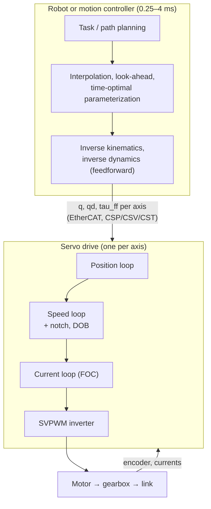

# Servo and motion control: from FOC to industrial robot arms

*How electric motion is controlled, layer by layer:*
- *field-oriented control inside the drive;*
- *cascaded current, speed and position PID loops on one axis;*
- *the extra techniques that high-precision servos use to reach micrometres and nanometres;*
- *how industrial robot arms coordinate six or more servo axes.*

*It covers the structures, tuning workflow, typical numbers, which method suits which task, breakthroughs, trends and quick-start reading. The format matches the other collections in this repository. Equations and runnable examples are in the companion [cookbook](cookbook/COOKBOOK.md) (recipes V1–V25), and every source is in the [catalog](CATALOG.md).*

## Summary

- **Every electric servo is a cascade.**
  - **Current (torque) loop** inside the drive: field-oriented control, 10–40 kHz sampling, 1–5 kHz bandwidth.
  - **Speed loop:** PI, plus filters and a disturbance observer, 1–10 kHz sampling.
  - **Position loop:** P or PI with feedforward, 0.25–4 kHz.
  - **A trajectory generator** above them all.
  - Each loop is several times faster than the one outside it, so each can be tuned on its own. Feedforward from the trajectory does most of the tracking, and feedback handles what the model misses.
- **FOC turns an AC motor into a torque source.**
  - The core: the dq transform, PI current loops with decoupling, and space-vector PWM.
  - Around it: voltage limits, field weakening and MTPA for speed and efficiency, dead-time compensation for low-speed smoothness, and an encoder (sensorless control fails near zero speed).
- **Feedforward and identification dominate single-axis performance.** In the cookbook:
  - velocity and torque feedforward cut following error from 96.75 to 0.10 mrad (V9);
  - a disturbance observer cuts a load-step dip about 10× (V8);
  - a notch filter raises the usable bandwidth from 160 to 260 Hz (V12).
- **Precision servos add learning and compensation.** Model-inversion feedforward, ZPETC for non-minimum-phase zeros, iterative and repetitive learning for repeating errors, cogging tables, friction feedforward at reversals, and cross-coupled contour control. These take errors from tens of micrometres to sub-micrometre in the examples (V13–V18). Lithography stages reach nanometres with the same ideas plus MIMO control and extreme mechanics (Butler 2011; Oomen 2018).
- **Industrial robot arms are many servos plus a robot controller.**
  - **The controller:** path planning, interpolation and inverse kinematics run at about 1–4 ms and send joint setpoints (with torque feedforward) to the drives.
  - **The joints:** independent cascades with high gear ratios (100–160), which suppress posture-dependent inertia (4.03× variation becomes 1.18× at the motor, V19).
  - **Model-based layers on top:** gravity and dynamics feedforward, vibration suppression, collision detection, and force or impedance control on collaborative arms.
- **Trends:**
  - learned and physics-guided feedforward (Bolderman 2023, Kon 2022);
  - automatic tuning by Bayesian optimization (Khosravi 2020);
  - model predictive current control;
  - torque-controlled collaborative and legged actuators;
  - learning controllers that send joint targets to these classical cascades (see [sim2real](../sim2real/)).

## 1. The control hierarchy

| Layer | Runs on | Sampling rate | Typical bandwidth | Job | Recipes |
|---|---|---|---|---|---|
| Current loop (FOC) | Drive DSP, MCU or FPGA | 10–40 kHz | 1–5 kHz | Torque command → phase voltages | V1–V5 |
| Speed loop | Drive | 1–10 kHz (often = PWM rate) | 50–500 Hz | Speed command → torque; reject load | V6–V8, V12 |
| Position loop | Drive or motion controller | 0.25–4 kHz | 10–100 Hz | Position command → speed | V9 |
| Trajectory and interpolation | Motion or robot controller | 0.25–4 ms cycle | — | Smooth, feasible setpoints; feedforward | V10, V21 |
| Robot-level control | Robot controller | 1–4 ms | — | Kinematics, dynamics, force, safety | V19–V25 |

**Interfaces.**
- Drives accept position, velocity or torque setpoints each cycle: CiA 402 cyclic synchronous position, velocity and torque (CSP/CSV/CST), over CANopen or EtherCAT.
- Choosing *where* each loop closes (drive or central controller) trades bandwidth against coordination.

## 2. Inside the drive: field-oriented control

| Element | What it does | Key numbers / choices | Recipe |
|---|---|---|---|
| Clarke and Park transforms (Park 1929) | Phase currents → DC quantities in rotor axes | Needs the *electrical* angle: encoder offset × pole pairs | [H10](../control-systems-engineering/cookbook/COOKBOOK.md#h10-brushless-motors-and-field-oriented-control) |
| PI on $i_d$, $i_q$ with decoupling | Fast, independent torque and flux control | $K_p=L\omega_c$, $K_i=R\omega_c$; decoupling cuts the $i_q$ rise time 6.95 → 0.60 ms at speed | V1 |
| SVPWM | Applies the voltage vector | Peak phase voltage $V_{dc}/\sqrt3$, 15.5% more than sine PWM | V2 |
| Voltage limit and anti-windup | Behaviour at the voltage ceiling | Base speed 246 → 289 rad/s with SVPWM | V2 |
| Field weakening | Run above base speed | Negative $i_d$; 0 → 1.81 N m at 400 rad/s in V3 | V3 |
| MTPA (interior-magnet motors) | Most torque per ampere | +13.6% torque at 20 A in V3 | V3 |
| Dead-time compensation | Accurate small voltages | 0.96 V error at 48 V, 1 µs, 20 kHz | V4 |
| Position sensing | Electrical angle and speed | Encoder or resolver; sensorless fails below a few percent of rated speed | V5 |
| Alternatives | Direct torque control; model predictive current control | Fast response; constraint handling | Takahashi 1986; Brosch 2019 |

## 3. One axis: cascaded PID

**Why cascade?** Each inner loop linearizes and speeds up what the outer loop sees, limits its own variable (current, speed), and can be tuned and tested separately. The price is that every outer loop must be slower; a single high-order controller could in principle do better.

| Structure | Common use | Pros | Cons |
|---|---|---|---|
| P position → PI speed → PI current | Industrial servos (default) | Robust, easy to tune step by step, natural limits | Needs bandwidth separation |
| PID position → PI current | Direct-drive stages, some robot joints | One loop fewer | Derivative of a noisy position |
| 2-DOF (feedback + feedforward) | All high-performance motion | Tracking from feedforward, robustness from feedback | Needs a model |
| PID + disturbance observer | Japanese servo practice, robot joints | Nominal-plant behaviour, load rejection | Noise and robustness trade-off |

**A standard tuning workflow** (cookbook recipes in brackets):
1. Identify inertia and friction (V7), and measure the frequency response (V11).
2. Tune the current loop (V1, [H11](../control-systems-engineering/cookbook/COOKBOOK.md#h11-designing-the-current-loop)).
3. Tune the speed loop, adding notches for resonances (V6, V12) and a disturbance observer where load varies (V8).
4. Tune the position loop, then add velocity and torque feedforward (V9).
5. Choose motion profiles that respect the mechanics (V10, V21).
6. Verify on the real trajectory, and add learning (V15) for repeated tasks.
7. Automatic tuning (relay tests, Bayesian optimization of the whole cascade, Khosravi 2020) speeds this up.

## 4. High-precision servos

**What limits precision, and what fixes it.**

| Error source | Typical size before compensation | Fix | Recipe |
|---|---|---|---|
| Inertia and damping during acceleration | Tens of µm (58.25 µm in V13) | Model-inversion feedforward | V13 |
| Non-minimum-phase or non-collocated dynamics | Unstable inverse | ZPETC, stable inversion, preview | V14 |
| Repeating errors (model error, cogging, process forces) | Persist cycle after cycle | ILC, repetitive control | V15 |
| Cogging and torque ripple | Speed ripple at low speed | Angle tables, repetitive control, better motors | V16 |
| Friction at reversals | Quadrant glitches of tens of µm | Friction feedforward, LuGre models | V17 |
| Axis mismatch in contours | Out-of-round of hundreds of µm | Feedforward, matched dynamics, cross-coupled control | V18 |
| Resonances | Bandwidth ceiling | Notches, stiffer mechanics, active damping | V11, V12 |
| Disturbances (floor, cables, forces) | Varies | Disturbance observers, high bandwidth, isolation | V8 |
| Sensors | Quantization, interpolation errors | Interferometers, high-resolution encoders | [H12](../control-systems-engineering/cookbook/COOKBOOK.md#h12-encoders-and-velocity-estimation) |
| Thermal drift | µm over hours | Thermal control, compensation models | — |

**Mechatronic design matters as much as control.** Precision stages use direct-drive linear motors, air or magnetic bearings, stiff and light structures, and collocated sensors. Lithography adds MIMO control of 6-DoF stages, feedforward with snap terms, and iterative learning (Butler 2011). Learned, physics-guided feedforward is the current research frontier (Bolderman 2023; Kon 2022).

## 5. Industrial robot arms

| Function | Classical industrial arm | Collaborative / torque-controlled arm | Recipe |
|---|---|---|---|
| Joint control | Independent P–PI cascades with high gear ratios (harmonic or cycloidal reducers) | Torque control with joint-torque sensing | V19 |
| Dynamics | Gravity and inverse-dynamics feedforward from identified models | Computed torque, impedance control | V20, V22 |
| Flexibility | Vibration suppression (shaping, model-based) | Flexible-joint control | V21 |
| Path | Look-ahead interpolation; time-optimal parameterization under torque limits | Same | Bobrow 1985; Pham 2018 |
| Contact | Admittance control with a wrist force sensor | Impedance control (Hogan 1985) | V24 |
| Safety | Collision detection from motor currents; safety controller (STO, SLS) | Momentum observers, power and force limiting (ISO/TS 15066) | V23 |
| Accuracy | Repeatability ~0.02–0.05 mm; accuracy improved by calibration | Similar or lower | V25 |

**Why classical arms can use simple joint loops.**
- High gear ratios divide posture-dependent inertia and coupling by $N^2$ and $N$ (V19). Gravity feedforward removes the largest remaining error (V20).
- **Collaborative and legged robots** use low gear ratios and torque control for safety and contact. They therefore need model-based control: computed torque, impedance, observers.

## 6. From one motor to a robot: how the problems scale

| System | Axes | Encoder resolution | Loop rates | Typical accuracy | Dominant techniques |
|---|---:|---|---|---|---|
| Single servo motor (conveyor, pump) | 1 | 12–17 bit | 16 kHz / 4 kHz / 1 kHz | 0.01–0.1° | FOC + PI cascade |
| Precision rotary or linear stage | 1–3 | 23–26 bit, nm linear scales | 10–20 kHz | µm to sub-µm | Feedforward, DOB, ILC, cogging and friction compensation |
| CNC machine tool | 3–5 | 20–26 bit, linear scales | 8–16 kHz / 2–8 kHz | 1–5 µm | Look-ahead, contour control, friction compensation, notches |
| Lithography wafer stage | 6 per stage | Interferometers, nm scales | ≥ 10 kHz | nm | MIMO, snap feedforward, ILC, active isolation |
| Industrial robot arm | 6–7 | 17–23 bit motor encoders | 8–16 kHz / 1–4 kHz / 1–4 ms | ~0.02–0.05 mm repeatable | Joint cascades + gravity and dynamics feedforward, shaping, collision detection |
| Collaborative arm | 7 | Motor + link encoders, torque sensors | ~1–3 kHz torque control | ~0.1 mm | Torque control, impedance, momentum observers |
| Legged-robot joint | 12–30 | 14–18 bit | 10–40 kHz FOC, ~1 kHz PD, 50 Hz policy | — | Quasi-direct drive, joint PD under a learned policy |

The figures are typical ranges from common practice, not specifications of particular products.

## 7. Which method for which task

Fit: ★★★ best fit · ★★ good · ★ possible · — poor fit.

| Task | PI cascade | + feedforward | + DOB | Notch | ILC / repetitive | Cogging / friction tables | Cross-coupled | Computed torque | Impedance / admittance | Input shaping |
|---|---|---|---|---|---|---|---|---|---|---|
| Conveyor or pump drive | ★★★ | ★ | ★ | ★ | — | — | — | — | — | — |
| Point-to-point positioning | ★★★ | ★★★ | ★★ | ★★ | ★ | ★ | — | — | — | ★★ |
| Precision scanning stage | ★★ | ★★★ | ★★★ | ★★ | ★★★ | ★★★ | ★★ | — | — | ★ |
| CNC contouring | ★★★ | ★★★ | ★★ | ★★★ | ★ | ★★★ | ★★ | — | — | ★ |
| Industrial arm, fast pick-and-place | ★★★ | ★★★ | ★★ | ★★ | ★★ | ★★ | — | ★★ | — | ★★★ |
| Robot polishing or assembly | ★★ | ★★ | ★★ | ★ | ★ | ★ | — | ★★ | ★★★ | ★ |
| Collaborative arm | ★★ | ★★★ | ★★ | ★ | — | ★★ | — | ★★★ | ★★★ | ★ |
| Legged-robot joint | ★★ (joint PD) | ★★ | ★ | — | — | ★ | — | ★★ | ★★★ | — |

The ratings are a synthesis, not measurements.

## 8. Breakthroughs, year by year

| Year | Breakthrough | Why it mattered | Source |
|---:|---|---|---|
| 1929 | Park's dq transform | AC machines analysed like DC machines | Park 1929 |
| 1972 | Field-oriented control (Blaschke) | High-performance AC drives | — |
| 1980 | Cross-coupled control; recursive Newton–Euler | Contour accuracy; real-time inverse dynamics | Koren 1980; Luh, Walker & Paul 1980 |
| 1981 | PD + gravity compensation proof; hybrid force/position control | Simple, provably stable robot control; force tasks | Takegaki & Arimoto 1981; Raibert & Craig 1981 |
| 1984 | Iterative learning control | Learning from repetition | Arimoto et al. 1984 |
| 1985 | Impedance control; time-optimal paths | Contact tasks; fastest feasible motion | Hogan 1985; Bobrow et al. 1985 |
| 1986 | Interior-magnet motors; direct torque control | Wide speed range and MTPA; an FOC alternative | Jahns et al. 1986; Takahashi & Noguchi 1986 |
| 1987 | ZPETC; adaptive robot control; elastic joints | Tracking through bad zeros; learning payloads; harmonic-drive models | Tomizuka 1987; Slotine & Li 1987; Craig et al. 1987; Spong 1987 |
| 1988 | Space-vector PWM; repetitive control | More voltage; periodic-disturbance rejection | van der Broeck et al. 1988; Hara et al. 1988 |
| 1990 | Field-weakening current vectors; base inertial parameters; input shaping | Speed range; robot identification; vibration-free moves | Morimoto et al. 1990; Gautier & Khalil 1990; Singer & Seering 1990 |
| 1994–97 | Dead-time compensation; disturbance observers; sensorless drives; optimal excitation | Smooth low speed; robust servos; encoderless motors; better identification | Choi et al. 1994; Ohnishi et al. 1996; Matsui 1996; Swevers et al. 1997 |
| 1999 | Disturbance observer + feedforward for high-speed tables | Precision positioning practice | Kempf & Kobayashi 1999 |
| 2003–04 | EtherCAT | Synchronized multi-axis drives at 100 µs-scale cycles | See [control-systems-engineering](../control-systems-engineering/) |
| 2006–07 | Momentum-observer collision detection; ILC survey; DLR lightweight robot | Safe torque-controlled arms (basis of the KUKA LBR); ILC design practice | De Luca et al. 2006; Bristow et al. 2006; Albu-Schäffer et al. 2007 |
| 2011 | Lithography stage control overview | Nanometre motion control in production | Butler 2011 |
| 2016–17 | ISO/TS 15066; robot collision survey | Collaborative-robot force limits; collision handling | Haddadin et al. 2017 |
| 2018 | Advanced motion control review; TOPP-RA | Learning and identification for precision; robust time-optimal paths | Oomen 2018; Pham & Pham 2018 |
| 2019–20 | Neural networks + ILC on industrial robots; neural-augmented physics; Bayesian-optimization cascade tuning; predictive current control | Learning through closed vendor controllers; data-driven commissioning | Chen & Wen 2019; De Groote et al. 2019; Khosravi et al. 2020; Brosch et al. 2019 |
| 2022–24 | Physics-guided neural feedforward with stability guarantees | Learned feedforward safe for industry | Kon et al. 2022; Bolderman et al. 2023 |
| 2026 | Optimal shaping filters for data-driven feedforward | Exact data-driven 2-DOF tuning | Fujimoto 2026 |

## 9. Latest trends

1. **Learned feedforward on top of physics.** Physics-guided neural networks keep the physical model and learn the rest, with identifiability and stability guarantees (Kon 2022, Bolderman 2023).
2. **Data-driven and automatic tuning.** Bayesian optimization of whole cascades (Khosravi 2020); data-driven feedforward (Fujimoto 2026); auto-notch and auto-tuning in commercial drives.
3. **Learning for repeated tasks.** ILC moves from lithography into robots and printing, now combined with neural networks for generalization across trajectories (Chen & Wen 2019).
4. **Predictive and optimization-based current control** (finite-set and continuous-set MPC), enabled by faster processors (Brosch 2019).
5. **Torque-controlled, low-ratio actuators.** Collaborative arms and legged robots move control from position cascades to torque, impedance and observers.
6. **Higher integration and synchronization.** Drives with integrated safety (STO, SLS), EtherCAT distributed clocks, and centralized multi-axis control in one real-time PC.
7. **Learning-based robot control sits on top.** RL and imitation policies send joint targets at 50–500 Hz to these cascades. The servo's response, delay, limits and friction are exactly the actuator gap studied in [sim2real](../sim2real/reports/01-learned-actuator-contact-models.md).

## 10. A commissioning checklist

1. Check motor and encoder wiring, encoder offset, pole pairs and current-sensor calibration.
2. Tune the current loop: bandwidth for the sampling rate, decoupling, dead-time compensation (V1, V4).
3. Identify inertia and friction (V7), and measure the frequency response (V11).
4. Tune the speed loop with notches for resonances (V12). Add a disturbance observer if the load varies (V8).
5. Tune the position loop. Add velocity and torque feedforward (V9).
6. Set the motion profile with jerk limits and, if needed, input shaping (V10, V21).
7. For precision: add cogging and friction compensation (V16, V17), contour checks (V18) and learning for repeated motion (V15).
8. For robots: identify the dynamics and payload (V22), enable gravity and dynamics feedforward (V20), set collision-detection thresholds (V23), and calibrate the kinematics (V25).
9. Check voltage headroom at the lowest bus voltage and highest speed (V2, V3).
10. Verify against the real task, including thermal drift and worst-case loads.

## 11. Quick start: reading

| Resource | Type | Covers | Recipes |
|---|---|---|---|
| R. Krishnan, *Permanent Magnet Synchronous and Brushless DC Motor Drives* | Textbook | FOC, field weakening, MTPA, sensorless | V1–V5 |
| G. Ellis, *Control System Design Guide* | Practitioner book | Cascades, tuning, resonances, filters, feedforward | V6–V12 |
| T. Oomen, "Advanced motion control for precision mechatronics" (2018) | Open-access review | Feedforward, identification, learning | V11, V13–V15 |
| R. Munnig Schmidt, G. Schitter & A. Rankers, *The Design of High Performance Mechatronics* | Textbook | Precision mechatronic design | V13–V18 |
| D. Bristow et al., "A survey of iterative learning control" (2006) | Survey | ILC design | V15 |
| B. Siciliano et al., *Robotics: Modelling, Planning and Control* | Textbook | Robot dynamics, motion and force control | V19–V24 |
| [*Modern Robotics*](https://modernrobotics.northwestern.edu/), K. Lynch & F. Park | Free textbook | Dynamics, trajectory generation, control | V19–V22 |
| S. Haddadin et al., "Robot collisions" (2017) | Survey | Collision detection and reaction | V23 |
| Drive vendors' commissioning manuals | Documentation | Practical tuning, notch and observer settings | V6–V12 |

## 12. Connection to the other collections

- **[control-systems-engineering](../control-systems-engineering/):** the hardware underneath, from motors, PWM, encoders, sampling and buses to safety ([H6–H23](../control-systems-engineering/cookbook/COOKBOOK.md)).
- **[stability-analysis](../stability-analysis/):** margins with delay, describing functions for friction and backlash, passivity of PD + gravity, and impedance stability.
- **[sim2real](../sim2real/):** the servo cascade *is* the actuator a learned policy commands. Its bandwidth, delay, saturation, friction and thermal limits are what an actuator model must reproduce.
- **[control-estimation-theory](../control-estimation-theory/):** PID, LQR, MPC and observers in general form.

## 13. Sources and caveats

- **Verification.** All DOIs were checked through Crossref, and all arXiv IDs against the arXiv API, on 10 Nov 2026. Quoted results come from the papers' abstracts.
- **Typical numbers** (loop rates, bandwidths, accuracies) are ranges from common practice, not product specifications.
- **Recipes.** They use small illustrative systems with plausible parameters; they show mechanisms, not the performance of specific products. Several compensations are idealized (perfect friction sign, perfect dead-time knowledge), so real gains are smaller.
