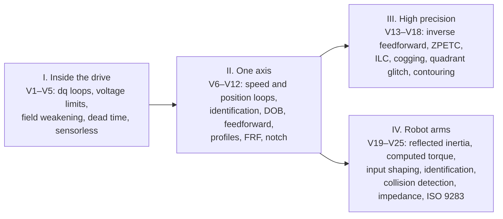
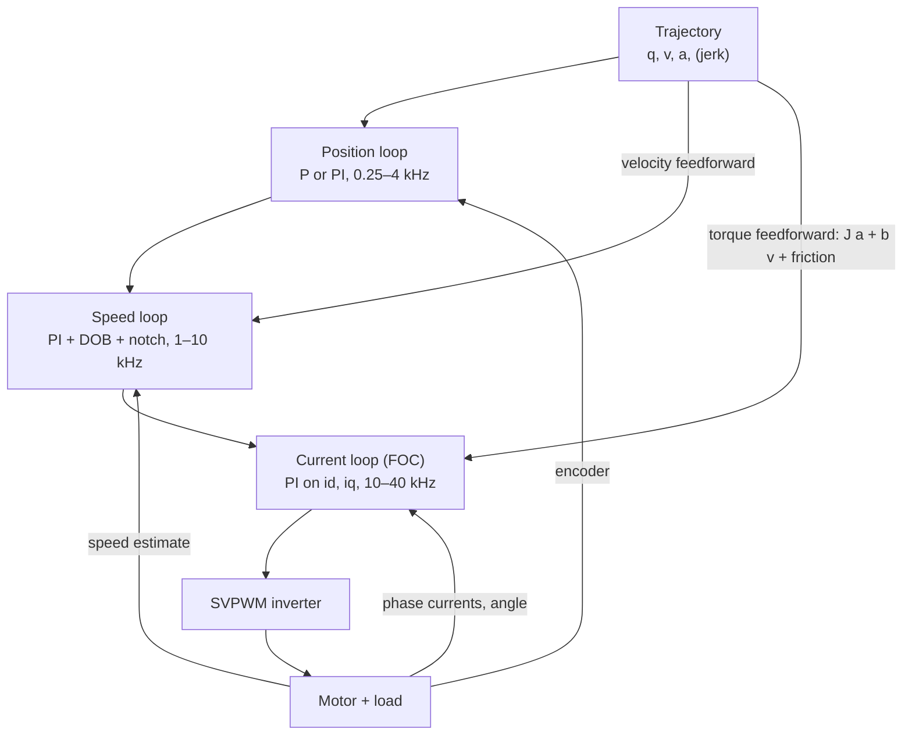

# The Servo and Motion Control Cookbook

*From field-oriented control inside the drive, through cascaded current, speed and position loops on one axis, to high-precision servos and multi-axis industrial robot arms. A companion to [REPORT.md](../REPORT.md). Basics of motors, PWM, encoders and buses are in the [control systems engineering cookbook](../../control-systems-engineering/cookbook/COOKBOOK.md) (H6–H20). Loop stability tools are in the [stability cookbook](../../stability-analysis/cookbook/COOKBOOK.md).*

Each recipe has the same parts: **Problem**, **Recipe**, **Worked example**, **Used in** and **Pitfalls**. The worked examples come from [`examples.py`](examples.py): `python3 examples.py v09` runs recipe V9. Only NumPy is needed. The numbers come from small illustrative systems with plausible values, not from a specific product.

## Contents

- **I. Inside the drive (FOC):** [V1 dq loops and decoupling](#v1-dq-current-loops-and-decoupling) · [V2 Voltage limit and SVPWM](#v2-voltage-limits-svpwm-and-base-speed) · [V3 Field weakening and MTPA](#v3-field-weakening-and-mtpa) · [V4 Dead time](#v4-dead-time-distortion-and-compensation) · [V5 Sensorless](#v5-sensorless-control-and-its-low-speed-limit)
- **II. One axis: cascaded loops:** [V6 Speed loop](#v6-speed-loop-design-and-inertia-mismatch) · [V7 Identification](#v7-identifying-inertia-and-friction) · [V8 Disturbance observer](#v8-disturbance-observer) · [V9 Feedforward](#v9-position-loop-with-velocity-and-torque-feedforward) · [V10 Motion profiles](#v10-motion-profiles-trapezoidal-versus-jerk-limited) · [V11 Frequency response](#v11-measuring-the-frequency-response) · [V12 Notch filter](#v12-notch-filters-for-resonances)
- **III. High-precision servos:** [V13 Inverse feedforward](#v13-model-inversion-feedforward) · [V14 ZPETC](#v14-zpetc-tracking-through-a-non-minimum-phase-zero) · [V15 ILC](#v15-iterative-learning-control) · [V16 Cogging](#v16-cogging-and-torque-ripple-compensation) · [V17 Quadrant glitch](#v17-friction-at-reversals-the-quadrant-glitch) · [V18 Contouring](#v18-contouring-error-and-cross-coupled-control)
- **IV. Multi-axis robot arms:** [V19 Reflected inertia](#v19-why-independent-joint-pid-works-gear-ratio-and-reflected-inertia) · [V20 Computed torque](#v20-gravity-compensation-and-computed-torque) · [V21 Input shaping](#v21-input-shaping-for-flexible-joints) · [V22 Dynamic identification](#v22-identifying-robot-dynamics) · [V23 Collision detection](#v23-collision-detection-with-a-momentum-observer) · [V24 Impedance control](#v24-impedance-control-in-contact) · [V25 ISO 9283](#v25-accuracy-and-repeatability-iso-9283)

---

# I. Inside the drive: field-oriented control

> **Quick start.** R. Krishnan, *Permanent Magnet Synchronous and Brushless DC Motor Drives*. Jahns, Kliman & Neumann (1986) on interior-magnet motors. Morimoto et al. (1990) on field weakening. Holtz (1992) and van der Broeck et al. (1988) on PWM. Texas Instruments and STMicroelectronics FOC application notes for practical firmware.

## V1. dq current loops and decoupling

**Problem.** Regulate the $d$ and $q$ currents of a permanent-magnet motor at high speed, where the axes couple.

**Recipe.**
- **Voltage equations in rotor coordinates:**
$$v_d=Ri_d+L_d\frac{di_d}{dt}-\omega_eL_qi_q,\qquad v_q=Ri_q+L_q\frac{di_q}{dt}+\omega_eL_di_d+\omega_e\lambda .$$
- **Coupling.** The $\omega_eL$ terms couple the axes, and back-EMF $\omega_e\lambda$ loads the $q$ axis. Both grow with speed.
- **Control law:** a PI controller on each axis ($K_p=L\omega_c$, $K_i=R\omega_c$), plus **decoupling feedforward** $-\omega_eL_qi_q$ on $d$ and $+\omega_eL_di_d+\omega_e\lambda$ on $q$.

**Worked example (`v01`).** A 10 A step in $i_q$ at 2100 rad/s electrical (300 rad/s mechanical, 7 pole pairs), with a 500 Hz loop at 20 kHz:
- **PI only:** $i_d$ swings to 2.28 A, and $i_q$ needs 6.95 ms to reach 90% (the integrator must absorb the back-EMF).
- **With decoupling:** $i_d$ stays within 0.77 A, and $i_q$ reaches 90% in 0.60 ms.

**Used in.** Every high-performance permanent-magnet drive: robot joints, machine-tool spindles and axes, EV traction.

**Pitfalls.** Decoupling uses the measured speed and nominal inductances. Inductance falls with saturation, and flux $\lambda$ falls with temperature.

## V2. Voltage limits, SVPWM and base speed

**Problem.** How fast can the motor run at rated current from a given DC bus?

**Recipe.**
- **Maximum phase voltage** (amplitude): $V_{dc}/2$ with sine PWM, $V_{dc}/\sqrt3$ with space-vector PWM or third-harmonic injection.
- **Base speed:** solve $(Ri_q+\omega_e\lambda)^2+(\omega_eL_qi_q)^2=V_{\max}^2$ for the speed where the current controller runs out of voltage.

**Worked example (`v02`).** 48 V bus, 15 A:
- **Sine PWM:** 24.0 V peak, base speed 246 rad/s (2350 rpm).
- **SVPWM:** 27.7 V peak, base speed 289 rad/s (2756 rpm).
- **Gain:** SVPWM gives 15.5% more voltage, and so more speed, from the same bus.

**Used in.** Drive sizing; checking that a motion profile is reachable at the battery's lowest voltage.

**Pitfalls.**
- Battery sag and cable drops lower the available voltage.
- When the current loop saturates its voltage, anti-windup is needed ([H18](../../control-systems-engineering/cookbook/COOKBOOK.md#h18-integrator-windup)).

## V3. Field weakening and MTPA

**Problem.** Run above base speed, and get the most torque per ampere.

**Recipe.**
- **Field weakening.** Negative $i_d$ reduces the effective flux $\lambda+L_di_d$. The voltage limit $(\lambda+L_di_d)^2+(L_qi_q)^2\le(V_{\max}/\omega_e)^2$ is then met at higher speed, trading $q$-current for speed under the current limit $i_d^2+i_q^2\le I_{\max}^2$ (Morimoto et al. 1990).
- **Interior-magnet motors** ($L_q>L_d$) have reluctance torque: $\tau=\tfrac32p[\lambda i_q+(L_d-L_q)i_di_q]$. **MTPA** (maximum torque per ampere) chooses the current angle that maximizes torque for each current magnitude (Jahns et al. 1986).

**Worked example (`v03`).** 48 V, 20 A limit:

| Speed (rad/s) | 200 | 400 | 600 | 800 |
|---|---:|---:|---:|---:|
| Max torque, $i_d=0$ (N m) | 2.10 | 0 | 0 | 0 |
| Max torque, field weakening (N m) | 2.10 | 1.81 | 1.31 | 1.01 |

An interior-magnet motor at 20 A gives 2.100 N m with $i_d=0$. MTPA (current angle 23.8°, $i_d=-8.1$ A) gives 2.387 N m, 13.6% more.

**Used in.** Spindles, EV traction, fast robot joints.

**Pitfalls.**
- Deep field weakening risks over-voltage if the inverter trips at speed, because the back-EMF exceeds the bus.
- Lookup tables must be calibrated per motor.

## V4. Dead-time distortion and compensation

**Problem.** Inverter dead time distorts the voltage, which matters most at low speed.

**Recipe.**
- **Error size:** each switching period loses about $V_{dc}t_df_{\text{pwm}}$ of average voltage, with sign opposite to the phase current.
- **Compensation:** add $V_{dc}t_df\,\mathrm{sign}(i)$ to the command, using the reference current's sign near zero crossings (Choi, Yong & Sul 1994).

**Worked example (`v04`).** 1 µs dead time at 20 kHz on 48 V gives a 0.96 V error:
- **1 V command (low speed):** the current error is 98.9% of RMS uncompensated, and 0.0% compensated.
- **10 V command:** 13.2% uncompensated, 0.0% compensated.

**Used in.** Every inverter; essential for smooth low-speed robot motion and sensorless control.

**Pitfalls.** Current sign is ambiguous near zero; device voltage drops add a similar error. The compensation here is ideal, so real results are worse.

## V5. Sensorless control and its low-speed limit

**Problem.** Estimate the rotor angle without an encoder.

**Recipe.**
- **Back-EMF and flux estimation:** $\hat e=v-\hat Ri-L\,di/dt$, with angle $=\operatorname{atan2}(\hat e)$ followed by a PLL. Works well above roughly 5–10% of rated speed (Matsui 1996).
- **At low speed** the back-EMF vanishes, and voltage errors and resistance errors dominate. Use high-frequency injection (saliency tracking) or an encoder.

**Worked example (`v05`).** 50 mV of voltage noise and offset, resistance 20% off:

| Speed (rad/s) | Back-EMF | Angle error (RMS) | Verdict |
|---:|---:|---:|---|
| 2 | 0.14 V | 130° | fails |
| 20 | 1.40 V | 3.4° | usable |
| 200 | 14.0 V | 0.3° | usable |

**Used in.** Fans, pumps, compressors, drones. Rarely in precision servos or robot joints, which need full torque at zero speed.

**Pitfalls.** Start-up and stall need a separate strategy. Resistance changes with temperature.

---

# II. One axis: cascaded loops

> **Quick start.** G. Ellis, *Control System Design Guide*. Ohnishi, Shibata & Murakami (1996) on disturbance observers. Kempf & Kobayashi (1999) on disturbance observers with feedforward. Singer & Seering (1990) on shaped commands. Drive vendors' tuning guides (Siemens, Yaskawa, Beckhoff) for the industrial workflow.

## V6. Speed-loop design and inertia mismatch

**Problem.** Tune the speed PI, and know what happens when the load inertia changes.

**Recipe.**
- **Gains:** with the current loop treated as a fast lag, set $K_p=J\omega_s$ and $K_i=K_p\omega_s/4$. The symmetric optimum is a common alternative.
- **Bandwidth** scales with $K_p/J$. A heavier load lowers bandwidth and margin; a lighter load raises them.
- **Robustness:** identify $J$ (V7), use gain scheduling, or add a disturbance observer (V8).

**Worked example (`v06`).** Designed for 50 Hz on the nominal inertia:

| Actual inertia | Overshoot | 2% settling |
|---|---:|---:|
| 0.33× nominal | 6.3% | 19.5 ms |
| 1× nominal | 13.9% | 34.0 ms |
| 3× nominal | 26.3% | 78.1 ms |

**Used in.** Commissioning every servo axis; robot joints whose load inertia changes with posture (V19).

**Pitfalls.** Tuning on an unloaded motor and running with the load.

## V7. Identifying inertia and friction

**Problem.** Find $J$, viscous friction and Coulomb friction for tuning and feedforward.

**Recipe.**
- **Model:** $\tau=J\dot\omega+b\omega+F_c\,\mathrm{sign}(\omega)$ is linear in the parameters.
- **Experiment:** drive a torque test that reverses and excites acceleration, filter the speed, differentiate, and fit by least squares.
- **Exclude the low-speed stiction region,** or model it (LuGre).

**Worked example (`v07`).** From a 2 s torque test with noisy speed: $J=1.98\times10^{-4}$ (true $2.0\times10^{-4}$), $b=9.81\times10^{-5}$ (true $1.0\times10^{-4}$), $F_c=0.0101$ N m (true 0.0100).

**Used in.** Drive auto-tuning; feedforward (V9); actuator models for simulation ([sim-to-real G17](../../sim2real/cookbook/COOKBOOK.md#g17-trajectory-matching-through-a-differentiable-simulator)).

**Pitfalls.** Differentiating noisy speed (filter first, which delays). Friction changes with temperature and wear.

## V8. Disturbance observer

**Problem.** Reject load torque without raising the speed-loop gain.

**Recipe.**
- **Estimate** the disturbance as $\hat d=Q(s)[\tau-J_n\dot\omega]$ and add it to the torque command (Ohnishi et al. 1996). $Q$ is a low-pass filter, and $J_n$ the nominal inertia.
- **Effect:** inside the bandwidth of $Q$, the plant behaves like the nominal inertia, and load torque, friction and inertia errors are cancelled.
- **Limits:** the bandwidth of $Q$ is set by noise, sampling and delay.

**Worked example (`v08`).** A 0.05 N m load step on a 20 Hz speed loop:

| Configuration | Speed dip |
|---|---:|
| PI only | 1.469 rad/s |
| PI + DOB ($Q$ at 300 Hz) | 0.142 rad/s |
| PI + DOB, inertia model 30% off | 0.137 rad/s |

**Used in.** Japanese motion-control practice and most high-end servo drives; robot joints (cancelling gravity and friction); hard-disk drives.

**Pitfalls.** A high-bandwidth $Q$ amplifies noise and can interact with resonances. The DOB needs acceleration, so its estimate is only as good as the speed estimate.

## V9. Position loop with velocity and torque feedforward

**Problem.** Follow a fast trajectory with small following error.

**Recipe.**
- **Position loop:** P (or PI) on the position error, outputting a speed command.
- **Velocity feedforward:** add the trajectory's velocity to the speed command.
- **Torque feedforward:** add $J\ddot q_r+b\dot q_r+F_c\,\mathrm{sign}(\dot q_r)$ to the torque command.
- **Division of labour:** feedback then handles only model error and disturbances, and the gains can stay moderate.

**Worked example (`v09`).** A 1 rad move in 0.2 s, 15 Hz position loop, 80 Hz speed loop:

| Configuration | Peak following error |
|---|---:|
| P position + PI speed | 96.75 mrad |
| + velocity feedforward | 0.76 mrad |
| + acceleration (torque) feedforward | 0.10 mrad |

**Used in.** CNC, pick-and-place, robot arms. Every motion controller sends position, velocity and torque feedforward to its drives (for example CiA 402 cyclic synchronous modes).

**Pitfalls.** Feedforward needs smooth trajectories (V10) and identified parameters (V7). Timing misalignment between feedforward and feedback.

## V10. Motion profiles: trapezoidal versus jerk-limited

**Problem.** Choose the trajectory shape for point-to-point moves.

**Recipe.**
- **Trapezoidal velocity** (bang–coast–bang acceleration) is fastest for given velocity and acceleration limits, but its acceleration jumps (infinite jerk).
- **Jerk-limited (S-curve, polynomial) profiles** smooth the acceleration. Their spectrum falls faster at high frequency, so they excite structural modes less, at the price of higher peak acceleration for the same time.
- **For modes slower than the move itself,** use input shaping (V21) or a model-based approach.

**Worked example (`v10`).** A 1 rad move in 0.2 s. Peak acceleration is 112 rad/s² (trapezoidal) against 144 rad/s² (jerk-limited). Worst residual vibration over each band of mode frequencies:

| Mode band | Trapezoidal | Jerk-limited |
|---|---:|---:|
| 5–10 Hz | 331 mrad | 448 mrad |
| 10–20 Hz | 80.4 mrad | 37.4 mrad |
| 20–40 Hz | 18.9 mrad | 4.9 mrad |
| 40–80 Hz | 4.2 mrad | 0.63 mrad |

A trapezoid can look perfect at one frequency, where its spectrum has a zero. Judge profiles over the band where the mode might be.

**Used in.** Every motion controller (PLCopen motion blocks, robot controllers, CNC look-ahead).

**Pitfalls.** Comparing profiles at one mode frequency. Jerk limits that lengthen cycle time more than needed.

## V11. Measuring the frequency response

**Problem.** Find the real plant's resonances before tuning.

**Recipe.**
- **Excite** with a chirp (logarithmic sweep) or random noise, in torque or in the speed reference.
- **Estimate** $H(f)=S_{yu}/S_{uu}$, averaging windowed segments (Welch's method), and check coherence.
- **Read off** the anti-resonance (a dip) and resonance (a peak); the speed response is about $1/(Js)$ between them.

**Worked example (`v11`).** A two-mass axis, 20 s logarithmic chirp from 2 to 400 Hz, noisy speed measurement:
- anti-resonance found at 35.4 Hz (true 35.6);
- resonance found at 70.8 Hz (true 71.2).

**Used in.** Drive commissioning tools ("frequency response" or "Bode" functions in servo software); identification for model-based control in precision systems (Oomen 2018).

**Pitfalls.**
- Closed-loop measurement needs the indirect method, or the loop shapes the result.
- Nonlinear friction distorts low-amplitude data.
- Discretize simulations exactly: explicit Euler makes lightly damped modes grow (the first version of this example diverged).

## V12. Notch filters for resonances

**Problem.** A lightly damped resonance above the crossover limits the speed-loop bandwidth.

**Recipe.**
- **Notch filter** at the resonance: $N(s)=\dfrac{s^2+2\zeta_z\omega_rs+\omega_r^2}{s^2+2\zeta_p\omega_rs+\omega_r^2}$, with $\zeta_z\ll\zeta_p$. Discretize with Tustin and prewarping.
- **It removes the resonance peak** that delay would otherwise push past −180°.
- **A notch is not always the answer.** With motor-side feedback and a resonance *inside* the bandwidth, the resonance and anti-resonance pair gives phase lead, and a notch only adds lag.

**Worked example (`v12`).** A stiff two-mass axis with a 400 Hz, 1%-damped mode; 8 kHz sampling, one sample of computation delay, 1 kHz current loop. The highest speed-loop bandwidth that still settles is 160 Hz without a notch and 260 Hz with one.

**Used in.** Practically every industrial servo drive (automatic notch-filter tuning), robot joints with harmonic drives, ball-screw axes.

**Pitfalls.**
- A notch tuned for one load detunes when the resonance moves (posture, payload); adaptive notches track it.
- Every filter adds phase lag below its frequency.

---

# III. High-precision servos

> **Quick start.** T. Oomen, "Advanced motion control for precision mechatronics" (IEEJ J. Industry Applications 2018, open access). Butler, "Position control in lithographic equipment" (IEEE CSM 2011). Bristow, Tharayil & Alleyne, "A survey of iterative learning control" (IEEE CSM 2006). Schmidt, Schitter & Rankers, *The Design of High Performance Mechatronics*.

## V13. Model-inversion feedforward

**Problem.** Reach micrometre tracking on a fast stage.

**Recipe.**
- **Inverse model:** for a stage $m\ddot x+b\dot x=F$, feed $F_{ff}=m\ddot x_r+b\dot x_r$ (plus friction and other identified terms).
- **Feedback** then only fights model error. The error scales with the size of the model error.
- **Add more terms** for flexible modes and parasitic effects ("snap" or jerk-derivative feedforward), or learn the remainder (V15; physics-guided neural feedforward, Bolderman et al. 2022–23).

**Worked example (`v13`).** A 2 kg direct-drive stage moving 10 mm in 50 ms with a 100 Hz PD loop:

| Configuration | Peak tracking error |
|---|---:|
| Feedback only | 58.25 µm |
| + exact mass and damping feedforward | 3.82 µm |
| + feedforward, mass 10% wrong | 8.57 µm |
| + feedforward, mass 30% wrong | 20.14 µm |

**Used in.** Wafer and reticle stages, pick-and-place, printers, linear-motor gantries.

**Pitfalls.** Non-minimum-phase or lightly damped dynamics cannot be inverted directly (V14). Feedforward cannot fix non-repeatable disturbances.

## V14. ZPETC: tracking through a non-minimum-phase zero

**Problem.** The sampled plant has a zero outside the unit circle, which is common with fast sampling or non-collocated sensors. Exact inversion is unstable.

**Recipe.** Zero Phase Error Tracking Control (Tomizuka 1987):
- Split $B=B_sB_u$ into stable and unstable zeros.
- Invert $A$ and $B_s$ exactly.
- Replace $1/B_u(q^{-1})$ by $B_u(q)/B_u(1)^2$.

The result has zero phase error, needs a few samples of reference preview, and keeps a small gain error at high frequency.

**Worked example (`v14`).** A plant with a zero at 1.2 tracking a smooth 0→1 reference:
- **Exact causal inverse:** the input grows to $2.1\times10^{25}$, which is unusable.
- **Invert the poles and ignore the zero:** peak error 0.0562.
- **ZPETC:** peak error 0.0043.

**Used in.** Disk drives, precision stages, robot joint feedforward (with preview from the trajectory planner).

**Pitfalls.**
- It needs future reference samples.
- The gain error grows near Nyquist, so keep the references smooth.
- Stable-inversion alternatives exist (non-causal filtering).

## V15. Iterative learning control

**Problem.** The same motion repeats (a wafer scan, a pick-and-place cycle, a robot weld path), and model error leaves a repeating tracking error.

**Recipe.**
- **Update rule:** $f_{j+1}=Q(f_j+Le_j)$, applied between trials (Arimoto et al. 1984).
- **Learning filter $L$:** approximately the inverse of the closed-loop system, a gradient or norm-optimal design, or a regularized inverse.
- **Robustness filter $Q$:** a low-pass that keeps learning robust to model error.
- **Result:** the repeating error converges toward the non-repeating noise floor (Bristow et al. 2006).

**Worked example (`v15`).** With a repeating disturbance and $10^{-4}$ measurement noise, the RMS error per trial falls 2.4×10⁻² → 1.2×10⁻² → … → 1.2×10⁻⁴: about 200× in 10 trials, stopping at the noise floor.

**Used in.** Lithography stages, printers, robots on repeated paths (industrial-robot tracking with neural networks trained by ILC: Chen & Wen 2019), batch processes.

**Pitfalls.** Learning amplifies non-repeating noise without $Q$. Any change of trajectory resets the learned signal, unless basis functions or neural networks generalize it.

## V16. Cogging and torque-ripple compensation

**Problem.** Permanent-magnet motors produce torque ripple tied to rotor angle: cogging from slots, and back-EMF harmonics. At low speed it becomes speed ripple.

**Recipe.**
- **Measure** the ripple versus angle in a slow, stiff identification run: the controller's torque command then mirrors the ripple.
- **Store** an angle-indexed table and add it as feedforward.
- **Alternatives:** repetitive control (Hara et al. 1988) or ILC in the angle domain.

**Worked example (`v16`).** Cogging of 0.005 N m, 12 periods per revolution, at 2 rad/s with a 10 Hz speed loop. Speed ripple is 0.761 rad/s without compensation and 0.022 rad/s with a table learned in a slow, stiff run (34× lower).

**Used in.** Direct-drive tables and rotary stages, telescope drives, low-speed robot motion, haptics.

**Pitfalls.**
- A table learned through a weak loop captures only part of the ripple (the first version of this example halved it).
- The ripple changes with temperature and load.

## V17. Friction at reversals: the quadrant glitch

**Problem.** In circular moves, each axis reverses direction at a quadrant boundary. Coulomb friction then stalls it briefly and leaves a spike in the contour.

**Recipe.**
- **Friction feedforward:** add $F_c\,\mathrm{sign}(v_{\text{ref}})$ at the reference reversal, possibly with a shaped pulse and a LuGre or Stribeck model.
- **Measure it with a circle (ballbar) test.**

**Worked example (`v17`).** A 10 mm circle at 1 rev/s with 1 N of Coulomb friction per axis. The peak radial error is 32.56 µm without compensation and 0.05 µm with friction feedforward.

**Used in.** CNC machine tools (ballbar test, ISO 230-4), laser cutters, gantries.

**Pitfalls.** Friction varies with temperature and position, and over-compensation creates the opposite spike. The compensation here is ideal, so real gains are smaller.

## V18. Contouring error and cross-coupled control

**Problem.** In multi-axis paths, the error *normal to the path* matters, not each axis's error. Mismatched axis dynamics distort shapes.

**Recipe.**
- **Matched dynamics:** with matched axis bandwidths, a circle shrinks but stays round.
- **Mismatched dynamics** make it elliptical, because the phase lags differ.
- **Remedies:**
  - feedforward on every axis;
  - matched gains;
  - **cross-coupled control** (Koren 1980), which feeds back the contour (normal) error to all axes.

**Worked example (`v18`).** A 10 mm circle at 1 rev/s:

| Configuration | Mean radial error | Out-of-round |
|---|---:|---:|
| Matched gains 60/60 s⁻¹, no feedforward | −50.4 µm | 0.0 µm |
| Mismatched 60/40, no feedforward | −84.2 µm | 512.6 µm |
| Mismatched + cross-coupled contour gain | +29.4 µm | 174.2 µm |
| Mismatched + feedforward | 0.0 µm | 0.0 µm |

**Used in.** CNC (contouring accuracy, look-ahead), laser cutting, gantry robots, robot paths (each joint's dynamics differ).

**Pitfalls.** Cross-coupling gains interact with stability. Feedforward needs synchronized axes, as with EtherCAT distributed clocks.

---

# IV. Multi-axis industrial robot arms

> **Quick start.** Siciliano, Sciavicco, Villani & Oriolo, *Robotics: Modelling, Planning and Control* (ch. 6–9). Spong, Hutchinson & Vidyasagar, *Robot Modeling and Control*. Lynch & Park, *Modern Robotics* (free). Haddadin, De Luca & Albu-Schäffer (2017) on collisions. ISO 9283 for performance testing.

## V19. Why independent-joint PID works: gear ratio and reflected inertia

**Problem.** A robot's joint inertias change with posture and are coupled. Yet most industrial arms run one PID cascade per joint. Why?

**Recipe.**
- **Inertia seen by the motor:** $J_m+M_{ii}(q)/N^2$.
- **With high gear ratios** (100–160 for harmonic drives), the motor's own inertia dominates. The posture-dependent part and the coupling torques are divided by $N^2$ and $N$, so each joint looks like a nearly constant single-axis servo (V6–V9).
- **Add gravity and friction feedforward;** use computed torque (V20) when speed or low gearing makes the coupling matter.

**Worked example (`v19`).** For joint 1 of a two-link arm, the link-side inertia varies 4.03× with the elbow angle. Seen by the motor ($J_m=10^{-4}$), the variation depends on the gear ratio:

| Gear ratio | 1 | 10 | 50 | 160 |
|---|---:|---:|---:|---:|
| Inertia variation seen by the motor | 4.03× | 3.86× | 2.20× | 1.18× |

**Used in.** Classical industrial robots (ABB, FANUC, KUKA, Yaskawa); the reason low-ratio legged and collaborative robots need model-based control.

**Pitfalls.**
- High ratios bring friction, backlash, compliance (V21) and low backdrivability.
- The "decoupling" fails at high speed, where velocity-dependent coupling grows.

## V20. Gravity compensation and computed torque

**Problem.** Track fast multi-joint trajectories accurately.

**Recipe.**
- **Gravity compensation:** $\tau=K_pe+K_d\dot e+g(q)$ removes the steady-state error from gravity.
- **Computed torque (inverse dynamics):** $\tau=M(q)(\ddot q_r+K_pe+K_d\dot e)+C(q,\dot q)\dot q+g(q)$ makes the error dynamics linear and decoupled. Recursive Newton–Euler computes it in $O(n)$ (Luh, Walker & Paul 1980).
- **Model error matters.** Add integral action, adaptive control (Slotine & Li 1987, Craig et al. 1987) or a disturbance observer.

**Worked example (`v20`).** A two-link arm on a 0.6 s move:

| Controller | Peak joint error | Final error |
|---|---:|---:|
| PD per joint | 38.53 mrad | 12.46 mrad |
| PD + gravity compensation | 16.62 mrad | 0.11 mrad |
| Computed torque | 0.08 mrad | 0.00 mrad |
| Computed torque, 0.5 kg payload not modelled | 41.06 mrad | 40.38 mrad |

**Used in.**
- Torque feedforward in modern robot controllers (from identified models, V22);
- collaborative and lightweight robots (DLR/KUKA LBR);
- legged robots.

**Pitfalls.** A wrong payload model is worse than none for gravity terms without integral action. Payload identification is a standard commissioning step.

## V21. Input shaping for flexible joints

**Problem.** Harmonic drives and long links make the end-effector vibrate after fast moves.

**Recipe.**
- **Convolve the command with impulses** whose vibrations cancel (Singer & Seering 1990).
  - **ZV:** two impulses half a damped period apart, with amplitudes $1/(1+K)$ and $K/(1+K)$, where $K=e^{-\zeta\pi/\sqrt{1-\zeta^2}}$.
  - **ZVD:** three impulses; more robust to frequency error, at twice the delay.
- **Alternatives:** model-based flexible-joint control with singular perturbation (Spong 1987), and link-side sensing.

**Worked example (`v21`).** An 8 Hz mode with 2% damping, step move (vibration relative to the step):

| Shaper | Delay | Residual (mode as modelled) | Residual (mode 20% higher) |
|---|---:|---:|---:|
| Unshaped | 0 ms | 0.939 | 0.939 |
| ZV | 62.5 ms | 0.0020 | 0.275 |
| ZVD | 125 ms | 0.0011 | 0.080 |

**Used in.** Cranes, robot arms (vibration-suppression options in robot controllers), pick-and-place, disk drives.

**Pitfalls.** The mode frequency changes with posture and payload, so schedule the shaper. The added delay costs cycle time.

## V22. Identifying robot dynamics

**Problem.** Get $M$, $C$, $g$ and friction parameters for computed torque and feedforward.

**Recipe.**
- **Linear form:** robot dynamics are linear in a set of base parameters, $\tau=Y(q,\dot q,\ddot q)\,\theta$ (Gautier & Khalil 1990).
- **Experiment:** drive an *exciting* trajectory, for example a Fourier series optimized for information content (Swevers et al. 1997). Record torques (motor currents), filter, and solve by least squares.
- **Check the predicted standard errors** before trusting the parameters.

**Worked example (`v22`).** A two-link arm with five base parameters and noisy torque:
- **Slow single sine:** worst predicted standard error 0.8%, worst actual error 2.1%.
- **Five-harmonic Fourier excitation:** 0.1% and 0.1%.

**Used in.** Robot commissioning and payload identification; feedforward in industrial controllers; collision detection (V23); robot simulation models.

**Pitfalls.** Friction and gear dynamics are often larger than the rigid-body terms. Physically inconsistent estimates (negative masses) need constrained estimation.

## V23. Collision detection with a momentum observer

**Problem.** Detect unexpected contact quickly, using only joint positions and motor torques.

**Recipe.**
- **Generalized momentum** $p=M(q)\dot q$. The residual
$$r=K\Big(p-\int(\tau+C^\top\dot q-g+r)\,dt\Big)$$
follows the external torque as a first-order filter with gain $K$ (De Luca et al. 2006). It needs no acceleration.
- **Threshold** the residual above the level set by model error and friction. Then react: stop, retract, or switch to compliant control (Haddadin et al. 2017).

**Worked example (`v23`).** One joint with inertia 10% off, 0.3 N m of unmodelled friction and noisy velocity:
- the residual before contact stays below 0.67 N m;
- a 1.0 N m threshold detects a 3 N m collision after 2 ms;
- the peak residual is 3.57 N m.

**Used in.** Collaborative robots (power and force limiting, ISO/TS 15066); torque-sensing arms; industrial robots ("collision detection" options).

**Pitfalls.**
- The threshold trades false alarms against sensitivity.
- Payload and friction errors raise the floor; identification (V22) and temperature-aware friction lower it.

## V24. Impedance control in contact

**Problem.** Touch or push on the environment without huge forces.

**Recipe.**
- **Impedance control** (Hogan 1985): command a mass–spring–damper relation between motion and force, $F=K_d(x_r-x)-D_d\dot x$. Penetrating a stiff surface by $\delta$ then produces about $K_d\delta$, not the servo's full stiffness times $\delta$.
- **Admittance control** (force sensor in the loop, position inner loop) suits stiff, geared industrial robots.
- **Hybrid force/position control** (Raibert & Craig 1981) controls force in some directions and position in others.

**Worked example (`v24`).** A reference 5 mm into a wall of stiffness $10^5$ N/m:
- **Stiff position control:** peak contact force 333.8 N, steady 333.3 N.
- **Impedance control** ($K_d=500$ N/m): peak 21.6 N, steady 2.5 N.

**Used in.** Assembly, polishing, grinding, collaborative robots, legged robots' feet, rehabilitation robots.

**Pitfalls.**
- Impedance control needs torque-controllable, backdrivable joints, or a force sensor for admittance control.
- Contact stability with stiff environments limits the gains.

## V25. Accuracy and repeatability (ISO 9283)

**Problem.** Specify and test how precisely a robot reaches a commanded pose.

**Recipe.**
- **Test:** command the same pose 30 times and measure the positions reached (laser tracker).
- **Pose accuracy** $AP$: distance from the barycenter of the measured positions to the commanded position. **Pose repeatability** $RP=\bar l+3S_l$, where $l$ is each point's distance from the barycenter and $S_l$ its standard deviation.
- **Typical industrial arms:** repeatability of a few hundredths of a millimetre, but uncalibrated accuracy of tenths of a millimetre to millimetres, from kinematic errors.
- **Kinematic calibration** reduces the accuracy gap.

**Worked example (`v25`).** 30 cycles:
- **Uncalibrated** (0.4 mm kinematic error): AP 0.404 mm, RP 0.029 mm.
- **After calibration:** AP 0.023 mm, RP 0.026 mm.

**Used in.** Robot data sheets and acceptance tests; offline programming (which needs accuracy, not only repeatability).

**Pitfalls.**
- Comparing a vendor's repeatability with your accuracy needs.
- Thermal drift.
- Path performance (ISO 9283 also defines path accuracy) differs from pose performance.

---

# Appendix · Quick reference

| Idea | Formula or rule |
|---|---|
| PMSM dq model | $v_d=Ri_d+L_d\dot i_d-\omega_eL_qi_q$, $v_q=Ri_q+L_q\dot i_q+\omega_eL_di_d+\omega_e\lambda$ |
| Torque (IPM) | $\tau=\tfrac32p[\lambda i_q+(L_d-L_q)i_di_q]$ |
| Voltage limit | $V_{\max}=V_{dc}/\sqrt3$ (SVPWM), $V_{dc}/2$ (sine PWM) |
| Dead-time error | $\Delta V\approx V_{dc}t_df_{\text{pwm}}\,\mathrm{sign}(i)$ |
| Speed PI | $K_p=J\omega_s$, $K_i=K_p\omega_s/4$ |
| Disturbance observer | $\hat d=Q(s)[\tau-J_n\dot\omega]$, added to the command |
| Feedforward | $\tau_{ff}=J\ddot q_r+b\dot q_r+F_c\,\mathrm{sign}(\dot q_r)$ |
| FRF estimate | $H=S_{yu}/S_{uu}$ (Welch averaging) |
| Notch | $(s^2+2\zeta_z\omega_rs+\omega_r^2)/(s^2+2\zeta_p\omega_rs+\omega_r^2)$ |
| ZPETC | $u=\dfrac{A(q^{-1})B_u(q)}{B_s(q^{-1})B_u(1)^2}\,y_d$ (with preview) |
| ILC | $f_{j+1}=Q(f_j+Le_j)$ |
| Reflected inertia | $J_m+M_{ii}(q)/N^2$ |
| Computed torque | $\tau=M(\ddot q_r+K_pe+K_d\dot e)+C\dot q+g$ |
| ZV shaper | amplitudes $\tfrac1{1+K},\tfrac K{1+K}$, spacing $T_d/2$, $K=e^{-\zeta\pi/\sqrt{1-\zeta^2}}$ |
| Robot dynamics | $\tau=Y(q,\dot q,\ddot q)\theta$ |
| Momentum observer | $r=K(p-\int(\tau+C^\top\dot q-g+r)dt)$ |
| Impedance | $F=K_d(x_r-x)-D_d\dot x$ |
| ISO 9283 | $AP=\lVert\bar x-x_c\rVert$, $RP=\bar l+3S_l$ |
