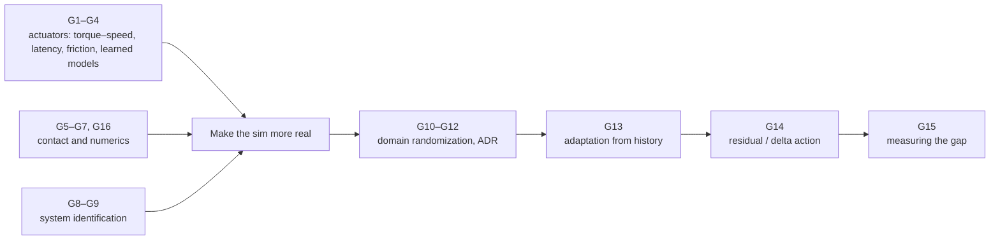

# The Sim-to-Real Cookbook

*The mathematics of the reality gap and how to cross it: actuators, contact, identification, randomization, adaptation and residual models. A companion to [REPORT.md](../REPORT.md). Related background is in the [Control-to-Learning cookbook](../../robot-learning-control/cookbook/COOKBOOK.md) ("R10" contact dynamics, "R33" sim-to-real overview) and the [control cookbook](../../control-estimation-theory/cookbook/COOKBOOK.md) ("C12" identification, "E1" recursive least squares).*

Each recipe has the same parts: **Problem**, **Recipe**, **Worked example**, **Used in** and **Pitfalls**. The worked examples come from [`examples.py`](examples.py): `python3 examples.py g02` runs recipe G2. Only NumPy is needed. The numbers are illustrative, not measurements of a specific robot.

## Contents

- **Actuators:** [G1 Torque–speed limits](#g1-motor-torquespeed-limits) · [G2 Latency](#g2-latency-and-stability) · [G3 Friction and dead bands](#g3-friction-stiction-and-dead-bands) · [G4 Learned actuator models](#g4-learned-actuator-models)
- **Contact and numerics:** [G5 Soft contact stiffness](#g5-soft-contact-stiffness-penetration-and-time-step) · [G6 Friction cones](#g6-friction-cones-and-their-linearization) · [G7 Restitution](#g7-impacts-and-restitution) · [G16 Integrators](#g16-integrators-and-energy)
- **Identification:** [G8 Least-squares ID](#g8-least-squares-system-identification-and-excitation) · [G9 Bayesian ID](#g9-bayesian-identification-and-fitted-randomization)
- **Randomization and adaptation:** [G10 Domain randomization](#g10-domain-randomization-as-robust-optimization) · [G11 Range trade-off](#g11-the-randomization-range-trade-off) · [G12 Automatic DR](#g12-automatic-domain-randomization) · [G13 Online adaptation](#g13-adaptation-from-history)
- **Correction and measurement:** [G14 Delta action](#g14-residual-and-delta-action-models) · [G15 Sim-vs-real correlation](#g15-measuring-the-gap-sim-vs-real-correlation)

---

# Actuators

## G1. Motor torque–speed limits

**Problem.** Many simulators treat a joint as an ideal torque source with a fixed limit. Real electric actuators lose torque as they speed up.

**Recipe.** For a DC or brushless motor with gear ratio $N$ and efficiency $\eta$:
- **Electrical equation:** $V=Ri+k_e\omega_m$, with motor speed $\omega_m=N\omega_{\text{joint}}$.
- **Output torque:** $\tau_{\text{out}}=N\eta k_ti$.
- **Limits.** The current is capped by the driver at $i_{\max}$, and by the voltage at $(V-k_e\omega_m)/R$. So the torque limit is flat at low speed, then falls linearly to zero at the no-load speed $V/(k_eN)$.
- **Simulation.** Model this curve (and the drop in battery voltage under load), not a constant limit.

**Worked example (`g01`).** For a 24 V motor with a 9:1 gearbox, the joint can deliver 25.9 Nm up to about 20 rad/s. It drops to 7.8 Nm at 30 rad/s and 0.8 Nm at 33 rad/s; the no-load speed is 33.3 rad/s. An ideal-torque simulator would let the policy use 25.9 Nm at every speed.

**Used in.** Tan et al. 2018 (actuator model for Minitaur); actuator models in Isaac Lab and legged_gym.

**Pitfalls.** Regenerative braking limits. Thermal derating during long runs.

## G2. Latency and stability

**Problem.** Sensing, computation, communication and the motor driver add delay. Feedback that is stable without delay can oscillate or diverge with it.

**Recipe.**
- A delay $T_d$ adds phase lag $\omega T_d$ at frequency $\omega$. If the loop's crossover frequency is $\omega_c$, it stays stable only while $\omega_cT_d$ is less than the phase margin (C4).
- Stiff PD gains raise $\omega_c$, so they tolerate *less* delay.
- **In simulation:** measure end-to-end latency on the robot, simulate it (a buffer of past commands), and randomize it around the measured value. Tan et al. 2018 list simulated latency as one of their key transfer fixes.

**Worked example (`g02`).** A joint with inertia 0.05 kg·m², $K_p=400$ and $K_d=4$:

| Delay | Result |
|---:|---|
| 0 ms | 22.9% overshoot, settles |
| 5 ms | 66.6% overshoot |
| 10 ms | Unstable |
| 20 ms | Unstable |

A policy trained without delay would learn to rely on gains this stiff.

**Used in.** Peng et al. 2018 (randomized latency); Tan et al. 2018; most legged sim-to-real systems.

**Pitfalls.** Latency jitter, not just mean delay. Observation and action delays that differ.

## G3. Friction, stiction and dead bands

**Problem.** Gearboxes and bearings add friction that simulators often omit. Small, precise motions fail.

**Recipe.**
- **Friction torque:** $\tau_f=\tau_c\,\mathrm{sign}(\dot q)+b\dot q$ (Coulomb + viscous). **Stiction:** the joint stays stuck while $\lvert\tau\rvert\le\tau_s$.
- **Dead band.** Under a PD law with gain $K_p$, any position error below $\tau_c/K_p$ produces too little torque to move: $\lvert e\rvert\lesssim\tau_c/K_p$. Learned policies use low PD gains, which makes this worse.
- **Also:** gear backlash (free play) and joint compliance (harmonic drives, belts).
- **Model** friction from identification (G8), or randomize it per joint.

**Worked example (`g03`).** A 0.05 rad step with $K_p=50$:
- no friction: error 0;
- 1 Nm Coulomb friction: the joint stops 0.018 rad short (dead band 0.02 rad);
- 3 Nm: it never moves (dead band 0.06 rad is larger than the step).

**Pitfalls.** Friction varies with temperature and wear. Friction models are discontinuous at zero velocity, which simulators smooth.

## G4. Learned actuator models

**Problem.** Real actuators combine delay, saturation, friction, compliance and driver dynamics in ways that are hard to model analytically.

**Recipe** (Hwangbo et al. 2019).
1. Log the real actuator: commanded position, position error and velocity histories, and the measured torque.
2. Train a network $\tau_t=f_\phi(e_{t-k:t},\dot q_{t-k:t})$.
3. Insert $f_\phi$ into the simulator in place of the ideal PD, and train the policy against it.

Simpler variants regress torque on a short command history, as in the example below.

**Worked example (`g04`).** For a synthetic actuator with an 8 ms delay, 20 Nm saturation and 1.5 Nm Coulomb friction, predicting held-out torque:
- the ideal model "torque = commanded torque" has an RMS error of 3.83 Nm;
- a linear model on a 12-step command history plus saturation and friction features cuts it to 1.33 Nm.

**Used in.** Hwangbo et al. 2019 (ANYmal), and many quadruped and humanoid pipelines since.

**Pitfalls.** The training data must cover the speeds and loads the policy will use. The model must run fast inside the simulator.

# Contact and numerics

## G5. Soft contact: stiffness, penetration and time step

**Problem.** Penalty and soft-contact models trade penetration against stiffness and time-step size.

**Recipe.**
- **Penalty contact:** $f_n=k\delta+c\dot\delta$.
  - static penetration under weight $mg$: $\delta=mg/k$;
  - contact natural frequency: $\omega=\sqrt{k/m}$;
  - explicit integration is stable only if $\Delta t<2/\omega$, and accurate only well below that.
- **The trade-off:** stiff contact means little penetration but needs small time steps. Soft contact allows large steps but objects sink and feel "spongy".
- **MuJoCo's convex soft contact** (Todorov 2014) exposes this trade-off as its time-constant and impedance parameters (`solref`, `solimp`). Matching them to real foot or ground compliance is part of identification.

**Worked example (`g05`).** A 10 kg body:

| Stiffness | Penetration | Natural frequency | Explicit Euler needs |
|---:|---:|---:|---:|
| $10^4$ N/m | 9.8 mm | 32 rad/s | $\Delta t<63$ ms |
| $10^5$ N/m | 0.98 mm | 100 rad/s | $\Delta t<20$ ms |
| $10^6$ N/m | 0.10 mm | 316 rad/s | $\Delta t<6.3$ ms |

**Pitfalls.** Contact damping set without reference to the real feet. Different engines interpreting the same parameter names differently.

## G6. Friction cones and their linearization

**Problem.** The Coulomb cone $\lVert f_t\rVert\le\mu f_n$ is nonlinear. Many solvers approximate it with a pyramid, which changes how much sideways force the simulator allows.

**Recipe.**
- **Elliptic (exact) cone:** $f_x^2+f_y^2\le\mu^2f_n^2$.
- **Box pyramid:** $\lvert f_x\rvert,\lvert f_y\rvert\le\mu'f_n$.
  - The *inscribed* pyramid ($\mu'=\mu/\sqrt2$) is conservative along the axes.
  - The *circumscribed* pyramid ($\mu'=\mu$) over-allows force along the diagonals.
- More pyramid faces shrink the error. MuJoCo offers both pyramidal and elliptic cones.

**Worked example (`g06`).** With $\mu=0.8$:

| Direction of sliding | Exact cone | Inscribed pyramid | Circumscribed pyramid |
|---:|---:|---:|---:|
| 0° (along an axis) | 0.80 $f_n$ | 0.566 $f_n$ (29% under) | 0.80 $f_n$ |
| 45° (diagonal) | 0.80 $f_n$ | 0.80 $f_n$ | 1.13 $f_n$ (41% over) |

A policy can learn to push diagonally where the simulator allows more friction than reality.

**Pitfalls.** Anisotropic real friction (treads, grain). A single global $\mu$ for every surface pair.

## G7. Impacts and restitution

**Problem.** Impacts happen in milliseconds. Simulators reduce them to a coefficient of restitution $e$ (or to soft-contact damping), and real impacts often don't match.

**Recipe.**
- **Newton's restitution law:** $v^+=-e\,v^-$. Bounce heights then scale as $h_k=h_0e^{2k}$.
- **Rigid-body impact models** (Newton, Poisson, Stronge) disagree for frictional, multi-contact impacts, and their parameters are hard to interpret physically (Fazeli et al. 2017).
- **Real evidence** (Acosta et al. 2022): Drake, MuJoCo and Bullet fit inelastic cube impacts well but fail on elastic ones. For a Cassie landing, model differences beyond contact limit accuracy.

**Worked example (`g07`).** After a 0.5 m drop:
- $e=0.3$ bounces to 4.5 cm, then 0.4 cm;
- $e=0.6$ bounces to 18 cm, 6.5 cm, then 2.3 cm.

Small errors in $e$ make large differences in post-impact behaviour.

**Pitfalls.** Foot and ground compliance dominates real landings. Restitution depends on velocity.

## G16. Integrators and energy

**Problem.** Numerical integration can add or remove energy. With stiff contact springs, a poor integrator explodes.

**Recipe.**
- **Explicit Euler** ($x_{k+1}=x_k+v_k\Delta t$, $v_{k+1}=v_k+a(x_k)\Delta t$) gains energy on oscillators.
- **Semi-implicit (symplectic) Euler** updates the velocity first, then the position with the new velocity. Energy stays bounded.
- **Implicit integrators** handle stiffness at the cost of solving equations each step.
- MuJoCo's default is semi-implicit Euler, with implicit options for damping. Simulator time step and solver iterations are part of the "simulator parameters" to validate.

**Worked example (`g16`).** A 1 kg mass on a $10^4$ N/m contact spring, 400 steps of 5 ms: explicit Euler multiplies the energy by $5.8\times10^{38}$, while semi-implicit Euler keeps it at 0.89× the initial value.

**Pitfalls.** Policies that learn to exploit numerical energy gain (jittering to gain height). Results that change with the time step.

# Identification

## G8. Least-squares system identification and excitation

**Problem.** Estimate inertia, damping, friction and gravity parameters from real joint data.

**Recipe.**
- **Rigid-body dynamics are linear in the inertial parameters:** $\tau=Y(q,\dot q,\ddot q)\,\theta$. For example, $\tau=J\ddot q+b\dot q+\tau_c\,\mathrm{sign}(\dot q)+mgl\sin q$ gives $\theta=[J,b,\tau_c,mgl]$.
- **Solve** $\hat\theta=\arg\min\lVert\tau-Y\theta\rVert^2$ (E1). Filter $\ddot q$ carefully.
- **Excitation.** The regressor columns must be independent over the experiment. Design exciting trajectories (chirps, multi-sines, optimized trajectories). Weak excitation makes some parameters unidentifiable, even with a perfect model.

**Worked example (`g08`).**
- A 0.8 rad chirp identifies $J=0.120$, $b=0.350$, $\tau_c=0.800$, $mgl=2.500$, all exact.
- A slow 0.1 rad sine on the same joint returns $J=-18.3$ and $mgl=-26.7$: nonsense. With small angles, $\sin q\approx q$ and $\ddot q\propto-q$, so inertia and gravity columns are nearly collinear.

**Used in.** Classical robot identification; Tan et al. 2018; most humanoid and quadruped commissioning.

**Pitfalls.** Unmodelled effects (G3, G4) bias the estimates. Closed-loop data correlates noise and input (C12).

## G9. Bayesian identification and fitted randomization

**Problem.** Get a *distribution* over simulator parameters, so randomization covers what is plausible, not a guessed range.

**Recipe.**
- **Posterior:** $p(\xi\mid\mathcal D_{\text{real}})\propto p(\mathcal D_{\text{real}}\mid\xi)\,p(\xi)$. Then train with $\xi$ sampled from the posterior, not a wide uniform.
- **When the likelihood is intractable** (the simulator is a black box), use likelihood-free inference:
  - **BayesSim** (Ramos et al. 2019): learns a posterior from simulated rollouts;
  - **DROPO** (Tiboni et al.): fits the randomization distribution to offline real data;
  - **SimOpt** (Chebotar et al. 2019): updates the distribution to match real rollouts;
  - **BayRn** (Muratore et al. 2021): optimizes randomization parameters on real returns.

**Worked example (`g09`).** 8 pushes of a 2 kg block with known forces and noisy accelerations give a friction posterior with mean 0.430 (true 0.42) and standard deviation 0.005. Randomize around $\mathcal N(0.43,0.005)$, not $U[0.1,0.9]$.

**Pitfalls.** A posterior that is overconfident because the model is wrong (G4, G7). Parameters that only matter jointly.

# Randomization and adaptation

## G10. Domain randomization as robust optimization

**Problem.** Train one policy that works on the real system without knowing its exact parameters.

**Recipe.**
- **Objective:** $\max_\theta\ \mathbb E_{\xi\sim p(\xi)}\big[J(\theta;\xi)\big]$ (R33). The real robot is treated as one more sample $\xi_{\text{real}}$. A worst-case version maximizes $\min_\xi J$ (robust control).
- **What to randomize:**
  - dynamics: mass, CoM, friction, PD gains, motor strength, latency, damping;
  - sensors: noise, bias, delay;
  - environment: terrain, external pushes;
  - visuals: textures, lighting, camera pose (Tobin et al. 2017; CAD2RL).
- **Memory.** Recurrent or history policies (G13) can identify where in the range they are, rather than being merely robust.

**Worked example (`g10`).** A position controller with a 20 ms delay, for a real system that is lighter (0.35 kg) than the nominal model (1.0 kg):
- tuned on the nominal model alone, the best gain (300) is **unstable** on the real system;
- tuned on masses randomized over 0.3–1.0 kg, it picks gain 75, which works on the real system (cost 0.115), at a slightly worse nominal cost (0.135 vs 0.064).

**Used in.** Peng 2018; Dactyl; legged_gym; humanoid soccer; nearly every sim-to-real system.

**Pitfalls.** Randomizing parameters that don't matter wastes capacity. Randomization can't substitute for modelling a systematic effect (G1–G2).

## G11. The randomization-range trade-off

**Problem.** How wide should the ranges be?

**Recipe.**
- **Too narrow:** the real robot falls outside the training distribution and may fail catastrophically.
- **Too wide:** the policy must work everywhere in the range, so it becomes conservative (lower gains, slower gaits) and loses nominal performance.
- **Fixes:** measure (G8–G9); grow ranges automatically (G12); add adaptation (G13) so the policy specializes online instead of hedging.

**Worked example (`g11`).** Same controller, worst case evaluated over 0.15–1.0 kg:

| Training mass range | Chosen gain | Nominal cost | Worst case |
|---|---:|---:|---|
| [0.90, 1.0] | 300 | 0.064 | Unstable |
| [0.60, 1.0] | 255 | 0.069 | Unstable |
| [0.30, 1.0] | 75 | 0.135 | Unstable |
| [0.15, 1.0] | 20 | 0.270 | 0.270 (stable everywhere) |

Only the widest range is safe everywhere, and it costs 4× the nominal performance.

**Pitfalls.** Judging transfer on the nominal model only.

## G12. Automatic domain randomization

**Problem.** Let training itself decide how wide the ranges can go.

**Recipe** (OpenAI 2019).
1. Start with a narrow range around nominal for each parameter.
2. Periodically test the policy at the range boundaries.
3. If performance at a boundary exceeds a threshold, widen it; if it falls below a lower threshold, shrink it.

Ranges grow with the policy's competence, giving an automatic curriculum. OpenAI reported signs of emergent meta-learning in memory-augmented policies trained this way.

**Worked example (`g12`).** A friction range starting at [0.925, 1.075] grows to [0.70, 1.30] by iteration 10, [0.45, 1.55] by 20, and [0.225, 1.775] by 40. Each widening happens only while measured success stays above the threshold (0.81 at the end).

**Pitfalls.** Many parameters widen at once, so credit assignment is hard. The thresholds need tuning.

## G13. Adaptation from history

**Problem.** Rather than hedging over every possible parameter, infer the current one online and act on it.

**Recipe.**
- **Explicit online identification** (UP-OSI, Yu et al. 2017): estimate $\hat\xi$ from recent states and actions, then run $\pi(s,\hat\xi)$.
- **Privileged teacher → student** (Lee et al. 2020): train a teacher with true $\xi$ (terrain, friction) in simulation, then a student from proprioceptive history by imitation (DAgger, R32).
- **Rapid Motor Adaptation** (Kumar et al. 2021): an adaptation module regresses an environment latent $z$ from history, letting the base policy adapt "in fractions of a second".
- **In-context adaptation:** a transformer policy over the observation–action history adapts without explicit estimates (Radosavovic et al. 2024).

**Worked example (`g13`).** Recursive least squares with forgetting factor 0.98 estimates mass from force and acceleration. It reads 1.000 kg before a payload is added. When the true mass jumps to 1.6 kg at step 200, the estimate is 1.22 thirty steps later and 1.56 by step 400.

**Pitfalls.** Adaptation only covers what training randomized. Identifiability needs excitation (G8).

# Correction and measurement

## G14. Residual and delta-action models

**Problem.** After identification and randomization, a systematic gap remains. Learn it from real data and fold it into the simulator.

**Recipe.**
- **Residual dynamics:** $s_{t+1}=f_{\text{sim}}(s_t,a_t)+g_\phi(s_t,a_t)$, with $g_\phi$ fitted to real transitions. Swift fits residual models of dynamics and perception from real flights.
- **Delta action** (ASAP, He et al. 2025): learn $\Delta a=h_\phi(s,a)$ such that $f_{\text{sim}}(s,a+\Delta a)\approx f_{\text{real}}(s,a)$. Then fine-tune the policy in the corrected simulator. ASAP reports lower tracking error than system ID, domain randomization and delta-dynamics baselines on the Unitree G1.
- **Neural simulators:** learn the whole dynamics (RWM; the world model in SuperMimic, R30).

**Worked example (`g14`).** The real system is a weaker, biased actuator: $x^+=x+(0.8u-0.1)\Delta t$. Regressing from real data recovers $\Delta u=-0.200u-0.099$ (true $-0.2u-0.1$). Re-tuning the controller in the corrected simulator lowers real tracking RMSE from 0.104 to 0.070.

**Pitfalls.** Residual models extrapolate poorly outside the logged states. Collecting real data with an unsafe initial policy.

## G15. Measuring the gap: sim-vs-real correlation

**Problem.** Know whether improvements in simulation predict improvements on the robot.

**Recipe.**
- **Sim-vs-real correlation (SRCC)** (Kadian et al. 2020): run $n$ policies in both and compute the correlation of their scores. High SRCC means the simulator is a valid proxy for *ranking* methods, even if absolute numbers differ.
- **Complements:**
  - sim-to-sim tests (train in one engine, test in another, as ASAP does);
  - replaying real logs in simulation;
  - success-rate gaps per condition.
- **Kadian et al.** found SRCC 0.18 for Habitat PointGoal success in the CVPR19 challenge setup, caused by agents sliding along walls. Tuning the simulator improved it substantially.

**Worked example (`g15`).** For 9 policies, a simulator with exploitable collisions has SRCC 0.17. A tuned simulator, where real scores track simulated ones with an offset, has SRCC 0.99.

**Pitfalls.** Too few policies for a meaningful correlation. A high SRCC can still hide a large absolute gap.

---

# Appendix · Quick reference

| Idea | Equation |
|---|---|
| Motor torque limit | $\tau_{\max}(\omega)=N\eta k_t\min\big(i_{\max},(V-k_eN\omega)/R\big)$ |
| Delay phase lag | $\omega T_d$; stable while $\omega_cT_d<$ phase margin |
| Friction dead band | $\lvert e\rvert\lesssim\tau_c/K_p$ |
| Actuator network | $\tau_t=f_\phi(e_{t-k:t},\dot q_{t-k:t})$ |
| Penalty contact | $f_n=k\delta+c\dot\delta$, $\delta=mg/k$, $\omega=\sqrt{k/m}$ |
| Friction cone | $\lVert f_t\rVert\le\mu f_n$; pyramid error up to ~29% (inscribed) / 41% (circumscribed) |
| Restitution | $v^+=-ev^-$, $h_k=h_0e^{2k}$ |
| Identification | $\tau=Y(q,\dot q,\ddot q)\theta$, $\hat\theta=\arg\min\lVert\tau-Y\theta\rVert^2$ |
| Bayesian ID | $p(\xi\mid\mathcal D)\propto p(\mathcal D\mid\xi)p(\xi)$ |
| Domain randomization | $\max_\theta\mathbb E_{\xi\sim p(\xi)}J(\theta;\xi)$ |
| Delta action | $f_{\text{sim}}(s,a+\Delta a)\approx f_{\text{real}}(s,a)$ |
| SRCC | $\mathrm{corr}(\text{score}_{\text{sim}},\text{score}_{\text{real}})$ over policies |
