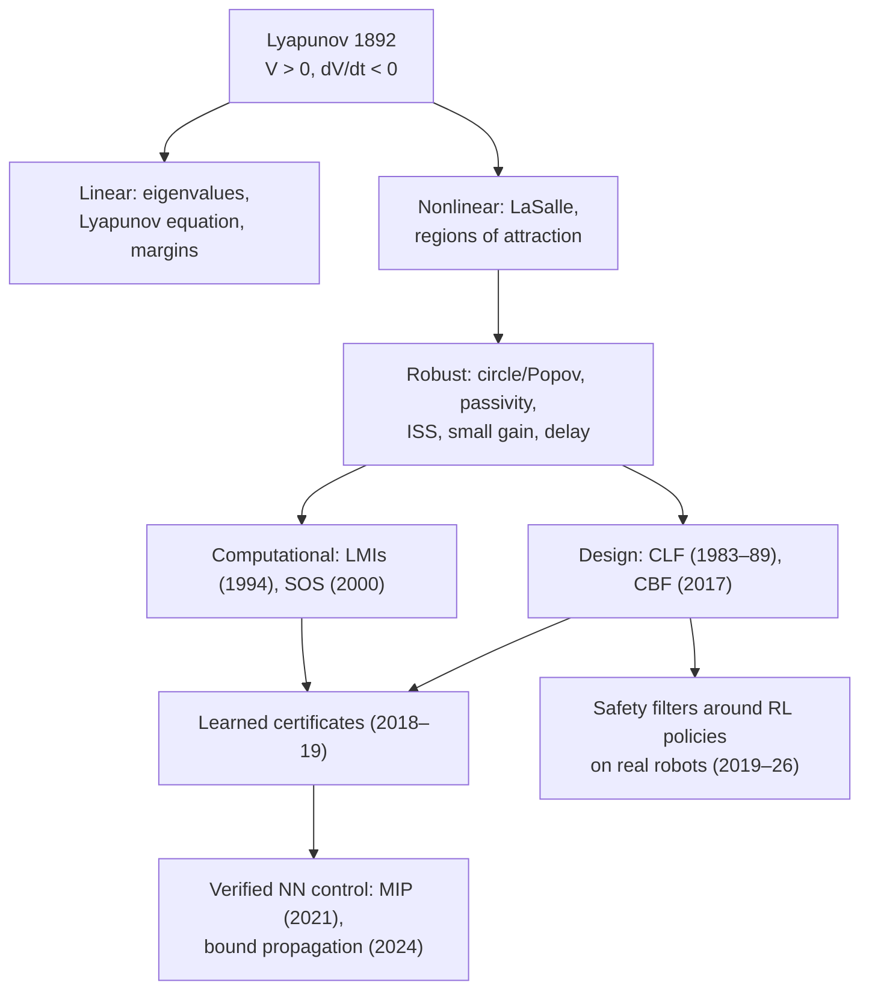

# Stability analysis: from Lyapunov to neural-network control

*How control engineers show that a closed loop is stable, and how those methods are being carried over to learned and neural-network controllers. It covers definitions, the main method families compared, which method suits which task, breakthroughs from 1868 to 2026, the latest trends, limitations and quick-start reading. It uses the same format as the other collections in this repository. Equations and runnable examples are in the companion [cookbook](cookbook/COOKBOOK.md) (recipes S1–S17), and every source is in the [catalog](CATALOG.md).*

## Summary

- **Stability is proven, not observed.**
  - A simulation shows that *some* trajectories converge.
  - A stability proof shows that *all* trajectories in a region do. Usually the proof is a Lyapunov function, an energy-like $V(x)>0$ that decreases along the closed loop.
  - Lyapunov's 1892 idea is still the core of almost every method here, including the neural ones.
- **Classical and robust control have mature tools for known models:**
  - eigenvalues and margins for linear loops;
  - Lyapunov equations and LMIs;
  - circle and Popov criteria for saturation-type nonlinearities;
  - passivity for mechanical systems;
  - input-to-state stability (ISS) and small gain for disturbances;
  - Lyapunov–Krasovskii functionals for delay;
  - Poincaré maps for walking gaits.
- **Neural-network controllers have no stability guarantee by default.**
  - RL policies are judged by reward and by testing, not proof.
  - Since 2017, three ways to recover guarantees have emerged:
    1. **constrain learning** with a Lyapunov condition (Berkenkamp 2017, Chow 2018, Han 2020);
    2. **learn a certificate together with the controller**, with a falsifier (Richards 2018, Chang 2019);
    3. **verify the network formally** with mixed-integer programs or bound propagation (Dai 2021, Yang 2024).
- **Barrier functions handle safety; Lyapunov functions handle convergence.** Control barrier functions (Ames 2017, 2019) keep the state inside a safe set. They are the most widely deployed certificate on real robots, as *safety filters* around learned policies. One example: on a real Unitree H1 humanoid, a CBF-QP filter cut constraint violations of a Safe-RL policy by 92% (Muraccioli et al. 2026).
- **The main limits:**
  - formal certificates for neural controllers exist only for small systems (pendulum, cart-pole, planar and 3D quadrotor models);
  - verification cost grows steeply with state dimension and network size;
  - all certificates are only as good as the model, which ties stability to the sim-to-real gap ([sim2real collection](../sim2real/));
  - many bounds are very conservative (in the cookbook, a generic ISS bound is 730× loose, S9).
- **Trend.**
  - Methods are moving from proving a given controller stable, to learning controller and certificate together, to GPU-scale verification.
  - In parallel, CLF-shaped rewards bring stability arguments into RL training for humanoid walking (Olkin et al. 2026).

## 1. What "stable" means

| Notion | Informal meaning | Typical certificate | Recipe |
|---|---|---|---|
| Lyapunov stability | Start close, stay close | $V>0$, $\dot V\le0$ | S3 |
| Asymptotic / exponential stability | Start close, converge (at rate $c$) | $\dot V<0$; $\dot V\le-cV$ | S2, S3 |
| Region of attraction | How far from the goal the system can start and still converge | Largest sublevel set $\{V\le c\}$ with $\dot V<0$ | S4 |
| Global stability | Converge from anywhere | Radially unbounded $V$ | S3, S8 |
| Input-to-state stability (ISS) | Bounded disturbance gives bounded error | $\dot V\le-\alpha(\lVert x\rVert)+\sigma(\lVert d\rVert)$ | S9 |
| Input–output (finite-gain) stability | Bounded input energy gives bounded output energy | Small-gain, passivity | S8, S10 |
| Orbital stability | A periodic motion (a gait) returns to itself | Poincaré-map eigenvalues inside the unit circle | S13 |
| Incremental stability / contraction | All trajectories converge to each other | Contraction metric | S14 |
| Safety (forward invariance) | Never leave a safe set; not the same as stability | Control barrier function $\dot h\ge-\alpha(h)$ | S12 |

## 2. The method families compared

| Family | System class | What it gives | Computation | Scales to | Main limitation |
|---|---|---|---|---|---|
| **Eigenvalues, Routh–Hurwitz** (Routh 1877, Hurwitz 1895) | Linear, or linearized | Local stability | Trivial | Any size | Local only (S1) |
| **Frequency domain: Nyquist, margins** (Nyquist 1932, Bode) | Linear loops, delays | Gain, phase and delay margins | Trivial | One loop at a time | Single-loop view; no large signals (S5) |
| **Lyapunov direct method, LaSalle** (Lyapunov 1892, LaSalle 1960) | Any ODE | Stability, region of attraction | Finding $V$ is the hard part | Small, structured systems | No general recipe for $V$ (S3, S4) |
| **Lyapunov equation, LMIs** (Boyd et al. 1994) | Linear, polytopic, sector-bounded | Quadratic $V$, robust and $H_\infty$ bounds | Convex (SDP) | Hundreds of states | Quadratic $V$ is conservative (S2) |
| **Absolute stability: circle, Popov, IQC** (Lur'e 1944, Popov 1961, Megretski & Rantzer 1997) | Linear + sector nonlinearity | Global stability for a class of nonlinearities | Frequency test or SDP | Moderate | Sufficient only (S6) |
| **Describing function** | Linear + hard nonlinearity | Predicted limit cycles | Trivial | One loop | Approximation, not proof (S7) |
| **Passivity, dissipativity** (Willems 1972; Takegaki & Arimoto 1981) | Mechanical, electrical, interconnected systems | Stability that composes | Analytical | Large interconnections | Broken by delay, sampling, non-collocation (S8) |
| **ISS, small gain** (Zames 1966, Sontag 1989) | Systems with disturbances or uncertain parts | Error bounds; interconnection rules | Analytical or SDP | Moderate | Often conservative (S9, S10) |
| **Time delay: Lyapunov–Krasovskii** (Fridman 2014) | Delay systems | Delay-dependent stability | LMIs | Moderate | Conservative; tuning needed |
| **Hybrid, switched: multiple Lyapunov functions, Poincaré maps, HZD** (Branicky 1998; Westervelt 2003) | Walking, impacts, switching | Gait stability | Numerical | Low-dimensional reduced models | Local; model-specific (S13) |
| **Sum-of-squares** (Parrilo 2000; Tedrake 2010) | Polynomial systems | Polynomial $V$, region-of-attraction proofs | SDP, grows fast with degree and state | About 6–12 states | Polynomial models needed |
| **CLF and CBF design** (Artstein 1983, Sontag 1989, Ames 2014/2017) | Control-affine systems | Controllers with built-in stability or safety | QP at each step (real time) | Full humanoids (as filters) | Needs a valid CLF or CBF; model error (S11, S12) |
| **Contraction** (Lohmiller & Slotine 1998) | Any ODE | Convergence of all trajectories; tracking | Metric search (SDP or learned) | Moderate | Strong property (S14) |
| **Lyapunov-constrained learning** (Berkenkamp 2017, Chow 2018, Han 2020) | Learned policies with models or critics | Stability during or after learning | Training-time constraints | Medium RL tasks | Model-dependent; conservative (S17) |
| **Learned certificates + falsifier** (Richards 2018, Chang 2019, Zhou 2022, Wu 2023) | Nonlinear, neural controllers | Neural $V$, larger regions of attraction | Training + SMT or sampling | Low-dimensional systems | Proof cost; model error (S15) |
| **Formal NN verification** (Katz 2017, Wang 2021, Dai 2021, Yang 2024) | ReLU and general networks | Proven bounds and Lyapunov conditions | MIP, SMT or GPU bound propagation | Small to medium networks, low state dimension | Exponential worst case (S16) |
| **NN robustness via quadratic constraints and Lipschitz bounds** (Fazlyab 2019, Yin 2022) | Linear plant + NN controller | Region-of-attraction ellipsoids; gain bounds | SDP | Moderate | Conservative for deep networks (S10) |

## 3. Neural-network controllers: what makes stability hard

1. **Size and non-smoothness.**
   - A policy network has thousands to millions of parameters with ReLU kinks.
   - Exact verification of ReLU networks is NP-complete (Katz 2017).
   - Bounds that scale (intervals, linear relaxations) loosen with depth (S16).
2. **High-dimensional state.**
   - A quadruped or humanoid has 30–70 states.
   - Every certified neural-Lyapunov result to date is on low-dimensional models: inverted pendulum, cart-pole, 2D and 3D quadrotors (Dai 2021); pendulum and quadrotor with output feedback (Yang 2024).
3. **Contact and impacts.** Locomotion is hybrid. Its stability is about periodic orbits and footholds, not one equilibrium (S13).
4. **The model gap.**
   - A certificate proves stability of the *model*. Actuator delay, saturation, friction and residual dynamics change the real loop.
   - Bounded model errors can be absorbed by ISS and robust margins (S9). Unbounded ones cannot.
   - This links directly to the [actuator-model review](../sim2real/reports/01-learned-actuator-contact-models.md).
5. **Conservatism.**
   - Products of layer norms (S10) and generic Lyapunov ISS bounds (S9) can be orders of magnitude loose.
   - A controller that is stable in practice may not be certifiable.
6. **What deployed systems do instead.**
   - They rely on stress testing, domain randomization and safety filters (CBF-QP, recovery policies) around the learned policy.
   - CLF-guided rewards are a new bridge: Olkin et al. (2026) prove exponential stability of the optimal policy under CLF-RL rewards and apply them to humanoid walking.

## 4. Which method for which task

Fit: ★★★ best fit · ★★ good · ★ possible · — poor fit.

| Task | Eigen / margins | Lyapunov / LMI / SOS | Circle, Popov, describing fn | Passivity / ISS / small gain | CLF / CBF filter | Poincaré / HZD | Learned certificate + verification | Empirical stress tests |
|---|---|---|---|---|---|---|---|---|
| Joint servo loop with delay and saturation | ★★★ | ★★ | ★★★ | ★★ | ★ | — | ★ | ★★ |
| Robot arm tracking and interaction | ★ | ★★ | ★ | ★★★ | ★★ | — | ★ | ★★ |
| Balance (inverted pendulum, Segway) | ★★ | ★★★ | ★ | ★★ | ★★★ | — | ★★ | ★★ |
| Bipedal and quadrupedal walking | ★ | ★ | — | ★ | ★★ (as filter) | ★★★ | ★ | ★★★ |
| Drone attitude and position | ★★ | ★★ | ★ | ★★ | ★★ | — | ★★ | ★★ |
| Autonomous car lane keeping, collision avoidance | ★★ | ★★ | ★ | ★★ | ★★★ | — | ★ | ★★★ |
| Safe RL exploration on hardware | — | ★★ | — | ★★ | ★★★ | ★ | ★★ | ★★ |
| Certifying a small NN controller | ★ | ★★ | ★★ (quadratic constraints) | ★★ (Lipschitz) | ★★ | — | ★★★ | ★ |
| Deep RL locomotion policy, full robot | — | — | — | ★ | ★★★ (as filter) | ★★ | ★ | ★★★ |
| Learned dynamics models (neural ODEs) | ★ | ★★ | — | ★★ | — | — | ★★★ (stable by construction) | ★★ |

The ratings are a synthesis of the literature and the recipes, not measurements.

## 5. Breakthroughs, year by year

| Year | Breakthrough | Why it mattered | Source |
|---:|---|---|---|
| 1868 | Maxwell, "On Governors" | First mathematical stability analysis of a feedback controller | Maxwell 1868 |
| 1877 / 1895 | Routh and Hurwitz criteria | Stability from polynomial coefficients | Routh 1877; Hurwitz 1895 |
| 1892 | Lyapunov's thesis | Stability without solving the equations: the direct method | Lyapunov 1892 (English 1992) |
| 1932 | Nyquist criterion | Closed-loop stability from open-loop frequency response | Nyquist 1932 |
| 1944–1963 | Lur'e problem; Popov criterion; KYP lemma | Absolute stability for sector nonlinearities; frequency tests linked to Lyapunov functions | Lur'e & Postnikov 1944; Popov 1961; Kalman 1963 |
| 1960 | LaSalle's invariance principle | Convergence from $\dot V\le0$ | LaSalle 1960 |
| 1966 | Small-gain and circle theorems | Input–output stability of interconnections | Zames 1966 |
| 1972 | Dissipative systems | Passivity and storage functions as a general framework | Willems 1972 |
| 1981 | PD + gravity compensation is globally stable | Lyapunov proof for robot arms | Takegaki & Arimoto 1981 |
| 1983 / 1989 | Control Lyapunov functions; Sontag's universal formula | Design controllers directly from $V$ | Artstein 1983; Sontag 1989 |
| 1989 | Input-to-state stability | Disturbance-to-error bounds for nonlinear systems | Sontag 1989 |
| 1994 | LMIs in control | Convex computation of Lyapunov functions | Boyd et al. 1994 |
| 1997 | Integral quadratic constraints | Unified robustness analysis | Megretski & Rantzer 1997 |
| 1998 | Contraction analysis; multiple Lyapunov functions | Incremental stability; switched and hybrid systems | Lohmiller & Slotine 1998; Branicky 1998 |
| 2000–02 | Sum-of-squares programming | Polynomial Lyapunov functions by SDP | Parrilo 2000; Papachristodoulou & Prajna 2002 |
| 2002 | Lyapunov design for safe RL | First Lyapunov-constrained reinforcement learning | Perkins & Barto 2002 |
| 2003 | Hybrid zero dynamics | Stability of underactuated bipedal walking | Westervelt et al. 2003 |
| 2010 | LQR-trees | Verified regions of attraction stitched into feedback motion plans | Tedrake et al. 2010 |
| 2014 / 2017 | CLF-QP; CBF-QP | Real-time optimization with stability and safety constraints | Ames et al. 2014, 2017 |
| 2017 | Safe model-based RL with stability guarantees; Reluplex | Certified regions during learning; exact NN verification | Berkenkamp et al. 2017; Katz et al. 2017 |
| 2018 | Lyapunov neural network; Lyapunov-based safe RL; CROWN | Learned certificates; constrained MDPs; scalable NN bounds | Richards 2018; Chow 2018; Zhang 2018 |
| 2019 | Neural Lyapunov Control; LipSDP; safe RL with CBFs | Learner + falsifier; tight Lipschitz bounds; barrier-protected exploration | Chang 2019; Fazlyab 2019; Cheng 2019 |
| 2020–21 | Stable deep dynamics; Lyapunov actor-critic; β-CROWN; MIP-verified NN control | Stability by construction; RL with stability guarantees; verification at scale; verified quadrotor controllers | Manek & Kolter 2019; Han 2020; Wang 2021; Dai 2021 |
| 2022 | Quadratic constraints for NN controllers; safe RL for legged robots; certificate survey | Region-of-attraction ellipsoids for NN loops; recovery-policy switching; field overview | Yin et al. 2022; Yang et al. 2022; Dawson et al. 2023 |
| 2024 | Lyapunov-stable neural control with GPU bound propagation | Larger verified regions; output feedback; no SOS, MIP or SMT solvers | Yang et al. 2024 |
| 2026 | CLF-guided RL stability; CBF-QP filters for RL on a real humanoid; ISSf-CBF whole-body control; α,β-CROWN for control | Stability proofs for RL rewards; 92% fewer violations on Unitree H1; robust safety under disturbance; a general verification toolkit | Olkin 2026; Muraccioli 2026; Lee 2026; Li 2026 |

## 6. Latest trends

1. **Certificates learned with the controller.** Learner–falsifier loops (S15) are now routine for low-dimensional systems. Recent work extends them:
   - maximal Lyapunov functions that cover the whole region of attraction (Liu 2026);
   - switched systems (Huang 2026);
   - stochastic systems.
2. **GPU verification replaces solvers.**
   - Bound propagation with branch and bound (α,β-CROWN) verifies Lyapunov conditions faster than SOS, MIP or SMT (Yang 2024).
   - A 2026 tutorial packages it for control problems (Li et al. 2026).
3. **Safety filters around RL policies on hardware.** CBF-QPs enforce joint, velocity, torque and collision limits without retraining the policy (Muraccioli 2026). Input-to-state safe CBFs keep guarantees under bounded disturbance (Lee 2026).
4. **Control theory inside RL training.**
   - CLF-shaped rewards come with exponential-stability proofs for the optimal policy (Olkin 2026).
   - "Stabilization learning" proposes stability, not reward, as the primary objective (Quan 2026).
5. **Robustness to the model gap.** ISS, input-to-state safety and bounded residuals make certificates survive bounded model error. This pairs naturally with sim-to-real actuator identification.
6. **Stable-by-construction learning.** Contracting networks (S14), stable dynamics models (Manek & Kolter) and Lipschitz-constrained policies (S10) avoid post-hoc verification.

## 7. Limitations and open problems

- **Scale.** No formal stability certificate exists for a full deep-RL locomotion policy on a 30–70-state robot. The state of the art verifies networks on 2–12-state systems.
- **Model dependence.** Every certificate assumes a model. With learned or identified models, the guarantee is only as good as the identification and its error bound.
- **Conservatism.** Sufficient conditions can reject good controllers (S6, S9, S10).
- **Hybrid and contact-rich dynamics.** Impacts, slipping and changing contact modes break the smooth assumptions of most tools.
- **Safety versus stability.** Barrier filters can stop a robot safely while destroying task progress. Joint CLF–CBF guarantees can be infeasible.
- **Sampled data and delay.** Most learned-certificate work is continuous-time without delay. Real controllers run at fixed rates with latency (S5).

## 8. A practical checklist

1. Linearize at the operating point and check eigenvalues and margins, including delay (S1, S5).
2. Identify the nonlinearities (saturation, dead zone, friction) and apply sector or describing-function tests (S6, S7).
3. Bound the model error and residuals, and compute an ISS or L1 error bound (S9).
4. For learned controllers:
   - bound the Lipschitz constant (S10);
   - estimate the region of attraction by sampling (S4);
   - try a learned certificate on a reduced model (S15–S16).
5. Wrap the learned policy in a CBF safety filter for hard limits (S12).
6. For gaits, check the Poincaré map numerically (S13).
7. Test empirically beyond the model: perturbations, delays, parameter changes, hardware.

## 9. Quick start: reading and tools

| Resource | Type | Covers | Recipes |
|---|---|---|---|
| *Nonlinear Systems*, H. K. Khalil (3rd ed., 2002) | Textbook | Lyapunov, LaSalle, ISS, passivity, circle and Popov | S1–S10 |
| *Applied Nonlinear Control*, J.-J. Slotine & W. Li (1991) | Textbook | Lyapunov design, describing functions, sliding mode | S3, S7, S11 |
| [*Feedback Systems*](https://fbswiki.org/), K. J. Åström & R. M. Murray | Free textbook | Eigenvalues, Lyapunov functions, Nyquist, margins | S1–S5 |
| [*Mathematical Control Theory*](http://www.sontaglab.org/FTPDIR/sontag_mathematical_control_theory_springer98.pdf), E. Sontag (1998) | Free textbook | Control Lyapunov functions, ISS | S9, S11 |
| [*Linear Matrix Inequalities in System and Control Theory*](https://web.stanford.edu/~boyd/lmibook/), S. Boyd et al. (1994) | Free book | LMIs, quadratic Lyapunov functions, absolute stability | S2, S6 |
| [*Underactuated Robotics*](https://underactuated.mit.edu/), R. Tedrake | Free online course | Lyapunov analysis, SOS, regions of attraction, simple walking models | S4, S13 |
| *Introduction to Time-Delay Systems*, E. Fridman (2014) | Textbook | Lyapunov–Krasovskii methods | S5 |
| Ames et al., "Control Barrier Functions: Theory and Applications" (2019) | Tutorial paper | CBFs, CLF–CBF QPs | S11, S12 |
| Dawson, Gao & Fan, "Safe Control with Learned Certificates" (2023) | Survey | Neural Lyapunov, barrier and contraction certificates | S14–S16 |
| Li et al., "Bridging Control with Neural Network Verifier α,β-CROWN" (2026) | Tutorial | Verifying Lyapunov and barrier conditions on networks | S16 |
| Tools: [α,β-CROWN](https://github.com/Verified-Intelligence/alpha-beta-CROWN), [SOSTOOLS](https://github.com/oxfordcontrol/SOSTOOLS), [CVXPY](https://www.cvxpy.org/), [Drake](https://drake.mit.edu/) | Software | Bound propagation, SOS and SDP, Lyapunov analysis | S4, S15, S16 |

## 10. Connection to the sim-to-real work in this repository

- **Actuator patterns map to stability tools.**
  - delay → delay margin and Lyapunov–Krasovskii (S5);
  - saturation → circle and Popov criteria, region of attraction (S4, S6);
  - friction and backlash → describing functions and passivity (S7, S8);
  - bounded residual → ISS (S9).
- **Why bound the learned actuator residual.** A learned residual bounded by $\delta$ turns into an error bound that grows linearly with $\delta$ (S9). An unbounded residual gives no guarantee. This is the stability argument behind the bounded residual proposed in the [actuator-model review](../sim2real/reports/01-learned-actuator-contact-models.md).
- **Safety filters as the practical bridge.** For full-robot RL policies, a CBF filter on joint position, velocity and torque limits (S12) gives a hard guarantee that formal Lyapunov verification cannot yet give.

## 11. Sources and caveats

- **Verification.** All arXiv IDs were checked against the arXiv API, and all DOIs through Crossref, on 5 Nov 2026. Quoted results come from the papers' abstracts.
- **Venues** of arXiv papers are given as recalled where the arXiv record has no journal reference. Check before citing.
- **Recipes.** They use small illustrative systems; they show mechanisms, not the performance of specific robots.
- **Ratings.** The fit ratings and task map are a synthesis, not measurements.
